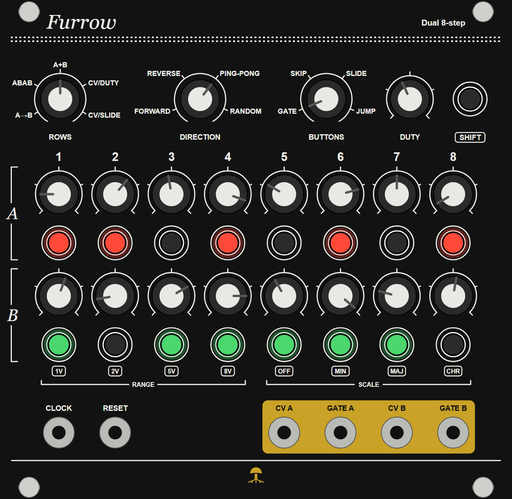

# Eight — dual 8-step sequencer

The Kosmo 8-step sequencer (`8-step-sequencer.ino`, an Arduino Mega with two
MCP4725 DACs and an ADS1115) rebuilt as a 26HP Eurorack module and played
the Korg SQ-1 way.

- **Steps:** two rows of eight, each step with a pot and an LED button.
- **ROWS:** A→B, ABAB, A+B, CV/DUTY or CV/SLIDE.
- **DIRECTION:** forward, reverse, ping-pong or random.
- **BUTTONS:** picks what the step buttons edit (gate, skip or slide, all
  three kept per step) or makes them jump.
- **Also:** DUTY, and SHIFT for each row's range and quantizer.
- **Jacks:** CLOCK, RESET, CV A, GATE A, CV B, GATE B.

Same parts and pin map as the Kosmo build. The Mega becomes a Mega 2560 Pro
(Embed) on sockets, behind the pots, on one board. The firmware is a new
sketch, `eight/eight.ino`; the Kosmo build keeps its own.

On the panel it is **Furrow**, one of the voice case's Garden names
(2026-11-02), with the gold mushroom mark at the foot.



## Status

| Part | Status | Files |
|---|---|---|
| Panel layout, drill template, artwork | Approved: no mode LEDs (2026-10-31), split knobs (2026-11-01) | `hardware/tools/panel.py`, `hardware/panel/` |
| Placement of the panel parts, Mega socket fit | Done; 0 clearance problems | `hardware/tools/circuit.py` |
| Circuit plan, pin map, open choices | Written | [docs/design.md](docs/design.md) |
| Netlist | Done: 95 parts, 0 problems, checked against the sketch's pins | `hardware/tools/circuit.py` |
| Firmware | Written; compiles for the Mega; host test 23 of 23 | `eight/eight.ino`, `eight/test/` |
| EasyEDA schematic | Done: six pages, 0 problems | `hardware/tools/easyeda_export.py`, `hardware/easyeda/` |
| PCB placement, panel PCB | Done: placed, unrouted, 0 problems | `hardware/tools/pcb.py`, `panel_pcb.py` |
| Routing | Next: you import into EasyEDA Pro and route | [routing notes](docs/design.md#routing-notes) |

## Files

```
8-step-sequencer.ino      the Kosmo build's firmware, unchanged
eight/
  eight.ino               Eight's firmware (Arduino IDE, Mega 2560)
  test/                   host test: a stand-in Arduino core, host_test.cpp, run.sh
docs/design.md            controls, panel, pin map, firmware, circuit plan, board, open choices, parts
hardware/
  tools/
    circuit.py            panel parts, Mega pins, placement, the Mega's socket footprint, the netlist and their checks
    panel.py              hole list, drill template and the panel artwork from the placement
    easyeda_export.py     the EasyEDA Pro project: schematic pages, symbols, footprints, checks
    pcb.py                the board placed (unrouted), its checks and preview
    panel_pcb.py          the panel as a PCB, from panel.py's layout
  easyeda/
    Eight.epro2           EasyEDA Pro project (import it): schematic, placed PCB, panel PCB; eight-easyeda-*.png previews
  panel/
    eight-panel-holes.csv, eight-panel-drill.svg (with the Mega behind the panel)
    eight-panel.svg       panel artwork (groups: copper, silk, holes, mockup), eight-panel-preview.png
```

Run from `hardware/tools`: `python circuit.py && python panel.py && python easyeda_export.py`. The
firmware's test runs in WSL from `eight/test`: `wsl.exe -e sh run.sh`.
