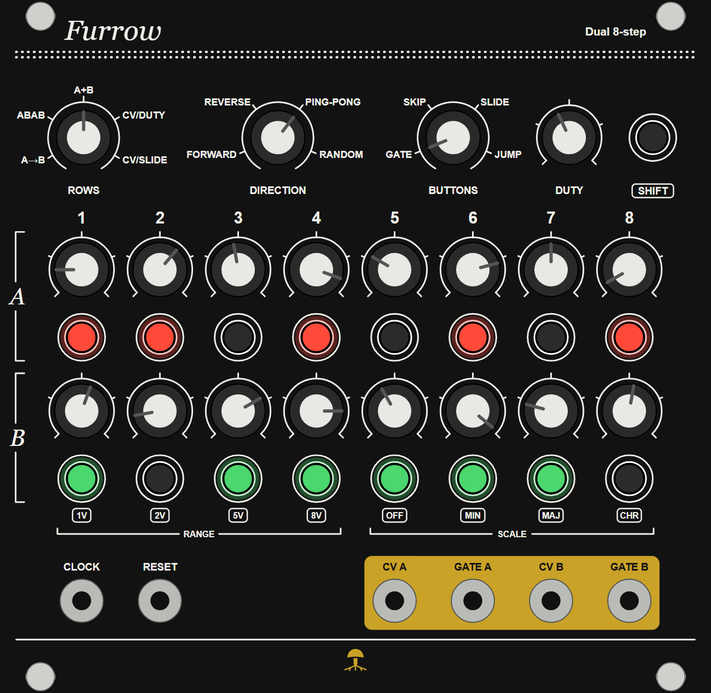

# Eight — design notes

The Kosmo 8-step sequencer (`8-step-sequencer.ino`, RIG.md "Sequencer")
rebuilt as a 26HP Eurorack module for the new voice case. The parts and the
pin map stay. New:

- **A RESET input,** so the clock module can send the sequencer back to
  step 1.
- **The MODE knob split into ROWS and DIRECTION.**
- **The Korg SQ-1's step settings:** every step keeps its gate, skip and
  slide at once.

That made the firmware a rewrite of the step logic. It is a new sketch,
`eight/eight.ino`; the Kosmo build keeps its own. Reference designators match
`hardware/tools/circuit.py`.

Status (2026-11-01):

- **Panel:** approved without the mode LEDs (2026-10-31), then with the
  split knobs (2026-11-01).
- **Netlist:** done in `circuit.py`, 95 parts. It takes the defaults of the
  open choices below; every check passes ([Netlist](#netlist)).
- **Firmware:** `eight/eight.ino` compiles for the Mega (15.6 kB of flash,
  943 bytes of RAM). Its host test passes all 23 checks ([Firmware](#firmware)).
- **Schematic:** `hardware/easyeda/Eight.epro2`, six pages, 0 problems
  ([Schematic](#schematic)).
- **PCB:** the board placed (unrouted) and the panel as a second PCB, in
  the same project; 0 placement problems ([Board](#board)).
- **Next:** you import, check DRC and route ([Routing notes](#routing-notes)).
- **Build order:** last of the voice case, when the Kosmo case retires.

---

## What it does

| Control | What it does |
|---|---|
| Step knobs, rows A and B | One pot per step. The row's voltage, 0 V up to its range |
| Step buttons | A tap toggles the step's setting that BUTTONS shows. Holding one repeats it; on release the sequence carries on from where it was. The LEDs show that setting; the playing step shows inverted |
| ROWS (5 positions) | How the two rows make the sequence: A→B (16 steps, A then B) · ABAB (16, taking turns) · A+B (two sequences of 8 side by side) · CV/DUTY (row A plays, row B sets each step's gate length) · CV/SLIDE (row A plays, row B sets each step's glide into the next) |
| DIRECTION (4 positions) | Forward · reverse · ping-pong (turns at the ends, which play once) · random |
| BUTTONS (4 positions) | What the step buttons edit: GATE (the step sounds or rests) · SKIP (the step is in the sequence or left out) · SLIDE (the step ties into the next and glides to it) · or JUMP (a press makes the next clock play that step) |
| DUTY | Gate length as a fraction of the clock period |
| SHIFT + step 1–4 | That row's range: 1, 2, 5 or 8 V |
| SHIFT + step 5–8 | That row's quantizer: off, minor, major, chromatic |
| CLOCK | One step per rising edge; the gate length follows the measured period |
| RESET | The next clock plays step 1 (see [Firmware](#firmware)) |
| CV A / GATE A, CV B / GATE B | In A+B, row A on A and row B on B; otherwise both play the one sequence |

The SQ-1's eight modes are ROWS and DIRECTION combinations:

| SQ-1 | Kosmo build | Eight |
|---|---|---|
| Alternating steps | ABAB | ABAB, forward |
| A then B | A→B | A→B, forward |
| Parallel reverse | PING-PONG | A+B, ping-pong |
| Parallel | A+B | A+B, forward |
| A only, duty from B | CV/DUTY | CV/DUTY, forward |
| A only, slide from B | GLIDE | CV/SLIDE, forward |
| A random, duty from B | RND DUTY | CV/DUTY, random |
| A & B random | RANDOM | A→B, random |

The other twelve combinations are new. Among them:

- a 16-step ping-pong;
- two random rows side by side;
- reverse runs;
- random steps with chosen slides.

---

## Panel



26HP, in the house frame (title, subtitle, dotted band, rule and the gold mushroom mark
at the same spots as Envy and Offset).

- **Controls along the top.** ROWS, DIRECTION and BUTTONS are pots with
  their position words round the knob; the pointer shows the position.
  DUTY is a plain knob; SHIFT is an LED button.
  - **Word placement:** each word sits at the middle of the stretch of
    travel where the sketch's `knobPosition()` selects it. That is an
    equal share of the Alpha pot's 300° (±5°), not the 270° the other
    knobs' scales show.
  - **No mode LEDs.** The Kosmo build needed the 8 mode and 4 transition
    LEDs because the words did not fit round its knobs; here they do.
- **Steps in eight columns, 14.5 mm apart,** numbered 1–8 on top. Each
  column holds pot A, button A, pot B and button B. The rows are labelled
  once, with A and B on brackets in the left margin.
- **SHIFT functions under the B buttons.** 1V 2V 5V 8V and OFF MIN MAJ CHR,
  boxed like the SHIFT label, grouped as RANGE and SCALE. They apply to
  both rows: SHIFT plus a button in row A sets row A.
- **Jacks along the bottom,** so the cables hang away from the hands.
  CLOCK and RESET are under steps 1–2. The outputs are under steps 5–8, on
  the gold band.

| Row | Panel y (mm) | Parts |
|---|---|---|
| Controls | 25.5 | RV17 ROWS, RV18 DIRECTION, RV19 BUTTONS, RV20 DUTY, SW17 SHIFT |
| Step numbers | 41.4 | silk |
| Pots A | 50.0 | RV1–RV8, Alpha 9 mm B10k |
| Buttons A | 62.55 | SW1–SW8, Thonk LED buttons |
| Pots B | 76.21 | RV9–RV16 |
| Buttons B | 88.76 | SW9–SW16 |
| SHIFT legend | 95.5 | silk |
| Jacks | 111.41 | J1 CLOCK, J2 RESET, J3 CV A, J4 GATE A, J5 CV B, J6 GATE B |

- **Columns:** step x is 15.14 + 14.5 k mm, centred on the panel. ROWS
  sits at x 15.5, DIRECTION at 51.5, BUTTONS at 84.0, DUTY at 105.5, SHIFT
  at 121.0.
- **Why the rows sit where they do.** The Mega's socket rows need two
  strips on the front, 33.02 mm apart; [Board](#board) explains why. The
  rows are computed in `circuit.py` (`ROW`):
  - **Pot to button, 12.55 mm.** The pot's pins stand 7.5 mm below its shaft
    and must clear the button body.
  - **Button A to pot B, 13.66 mm.** This makes the first strip.
  - **Button B to the jacks, 22.65 mm.** This makes the second strip, which
    the SHIFT legend shares; the jacks' sleeve pads set its bottom edge.
- **Checks:**
  - `panel.py` reports no gap under 1 mm between knob scales, button rings
    and nuts, and no label running into another label or a part.
  - `circuit.py` reports no pot pin under another part's body.
- **Wording to confirm:**
  - The name: Eight.
  - ROWS: A→B, ABAB, A+B, CV/DUTY, CV/SLIDE.
  - DIRECTION: FORWARD, REVERSE, PING-PONG, RANDOM.
  - BUTTONS: GATE, SKIP, SLIDE, JUMP.
  - EasyEDA's stroke font has no →; the panel PCB will draw it as a line.
- **26HP is needed now.** The four control knobs and their words take about
  120 mm of the top row; 24HP (121.6 mm wide) no longer fits them.

---

## Pin map

The Kosmo build's pins, kept so its tables carry over. Step 1 first.

| Function | Mega pins | Wiring |
|---|---|---|
| Row A pots | A7, A0, A1, A2, A3, A4, A5, A6 | B10k from +5 V (CCW) to GND (CW); the sketch plays 1 − reading, so CW is higher |
| Row B pots | A8 … A15 | as row A |
| Row A buttons | D52, D50, D48, D46, D44, D42, D40, D38 | switch to +5 V, 10k to GND: pressed reads HIGH |
| Row B buttons | D53, D51, D49, D47, D45, D43, D41, D39 | as row A |
| Row A LEDs | D35, D37, D33, D25, D27, D31, D23, D29 | anode to +5 V through 1k, cathode to the pin (LED_ON is LOW) |
| Row B LEDs | D36, D34, D22, D24, D26, D28, D30, D32 | as row A |
| SHIFT | D19 | to GND, internal pull-up |
| CLOCK | D18 (INT3) | input stage, rising edge |
| **RESET** | **D2 (INT4)** | **new**; input stage, rising edge |
| GATE A / GATE B | D17 / D15 | to the gate buffers |
| I²C | D20 SDA, D21 SCL | ADS1115 0x48; MCP4725 0x61 = CV A, 0x60 = CV B |
| ADS1115 | A0 DIRECTION, A1 DUTY, A2 BUTTONS, A3 ROWS | ROWS, DIRECTION and BUTTONS CW to +5 V (their first position is fully CCW); DUTY CW to GND (the sketch inverts it: CW is longer) |
| Free | D0 / D1 (serial), D3–D12, D14, D16 (the Kosmo build's mode LEDs), D13 (the board's LED) | |

- **Interrupt pins.** The Mega's six were all taken on the Kosmo build: D2
  and D3 by mode LEDs, D18 by CLOCK, D19 by SHIFT, D20 / D21 by I²C. With
  the mode LEDs gone, RESET takes D2.
- **ADS1115 channels.** The Kosmo build's three stay on A1–A3, and
  DIRECTION takes A0, which was tied to GND.
- **Step pin order.** The step pins are scattered round the Mega (the Kosmo
  wiring's order). Keeping them costs the firmware nothing. If the routing
  wants another order later, only the tables at the top of the sketch
  change. `circuit.py` reads those tables and the ADS channels from the
  sketch and checks the board against them.

---

## Firmware

`eight/eight.ino` (Arduino IDE, board "Arduino Mega or Mega 2560"; it uses
RobTillaart's MCP4725 and ADS1X15 libraries, as the Kosmo sketch does).
The Kosmo build keeps `8-step-sequencer.ino` unchanged: its panel has an
8-position MODE knob and 12 LEDs, and the new firmware doesn't fit it.

- **Lines.** The sequence is one line of 16 steps through both rows (A→B
  in order, ABAB taking turns), one line of 8 per row (A+B), or row A alone
  (CV/DUTY, CV/SLIDE). DIRECTION moves along each line.
  - Skipped steps are left out.
  - Ping-pong turns at the last step that plays, so the ends play once.
  - Random picks among the steps that play.
- **Step settings.** Each step keeps three settings at once, as on the
  SQ-1. BUTTONS picks which one the buttons show and toggle:
  - **GATE:** off is a rest. No gate, and the CV holds the last note, so
    its release stays in tune.
  - **SKIP:** off leaves the step out of the sequence. Shorter rows side
    by side in A+B give polymeter.
  - **SLIDE:** on ties the step into the next, like a 303.
    - The gate stays open over the clock, so the next note doesn't
      retrigger.
    - The next step glides in over half a step (`SLIDE_LENGTH`).
    - If the clock stops, a tied gate closes 1.25 periods in.
  - **JUMP:** a press makes the next clock play that step; the sequence
    carries on from there. On JUMP the LEDs show the gates.
- **CV/DUTY:** row B's knob of the playing step sets its gate length, and
  the DUTY knob is unused.
- **CV/SLIDE:** row B's knob of a step sets how much of the next step the
  glide into it takes, from none (fully CCW) to all of it (fully CW). A step
  with SLIDE on still ties its gate.
- **Row B in CV/DUTY and CV/SLIDE:** its buttons do nothing. Its LEDs light
  the step whose knob is in use.
- **Outputs.** In A+B each row has its own output. In every other position
  both outputs play the one sequence, as on the SQ-1. The Kosmo build split
  A→B and ABAB across the outputs instead; `SPLIT_ROWS = true` brings that
  back (open choice 11).
- **Holds.** Holding a step repeats it on every clock; its line waits and
  carries on from where it was on release. In A→B and ABAB a held step
  pauses the whole sequence.
- **Turning ROWS** keeps the sequence going from the same place, cut to the
  new length. The SQ-1 restarts the sequence when its mode changes.
- **RESET:**
  - A reset makes the next clock play step 1; in reverse, step 8.
  - A reset up to 5 ms *after* a clock edge counts for that clock, which
    then plays step 1 instead. The clock module fires its RESET pulse
    together with the first tick of bar 1 (`clock/docs/design.md`), and
    either can reach the Mega first.
  - A held step still wins: it keeps repeating, and on release the sequence
    starts from step 1.
- **Saved over a power cycle:** the step settings and each row's range and
  quantizer, in EEPROM. The save happens 3 s after the last change, and
  only the bytes that changed are written.
- **Calibration:** `CV_FACTOR` (2.0 for the ×2 stages) is measured on the
  built module with a 1 V/oct check. `DAC_VOLTS` is the LM4040's 5.0.
- **Host test:** `eight/test/run.sh` builds the sketch on a PC against a
  stand-in Arduino core, with the address and undefined-behaviour
  sanitizers. It checks all of the above in 23 tests: the sequences each
  combination plays, skips, holds, jumps, the three reset timings, gates,
  ties, glides, CV/DUTY, CV/SLIDE, range and quantizer, LEDs and the saved
  settings. Run it in WSL: `wsl.exe -e sh run.sh` from `eight/test`.

---

## Circuit plan

Everything the Kosmo build has, on one PCB. The netlist in `circuit.py`
follows this plan; the designators below are its own.

```
 Eurorack 2x5 ── 1N5819 x2 ──┬── 5 V switcher U7 ── +5V: Mega 5V pins, pots, buttons, LEDs, ADS1115
                             └── 10R ── +12 / -12 V ──┬── TL074 U5 (output amp, gate buffers)
                                                      └── 820R ── LM4040 5.0 V ── VDAC: MCP4725 x2

 CLOCK, RESET ── 22k ──┬── D18 / D2         MCP4725 0x61 ── TL074 x2 ── 1k ──┬── CV A
            100k, 1n ──┤                    MCP4725 0x60 ── TL074 x2 ── 1k ──┴── CV B (feedback from here)
          BAT85 clamps ┘                    D17 ── 10k ── TL074 x2 ── 1k ── GATE A
                                            D15 ── 10k ── TL074 x2 ── 1k ── GATE B
```

### Power

- **Header J7:** 2 × 5, 2.54 mm, shrouded. No bus +5 V is needed.
- **Reverse protection:** a 1N5819 in each rail (D901, D902). On +12 V the
  anode goes to the header; on −12 V the *cathode* goes to the header (the
  reversed −12 V diode on the older PCBs is the error to avoid).
- **Filters:** 10 Ω and 47 µF per rail for the TL074 and the reference. The
  switcher takes its +12 V straight after the diode, ahead of the 10 Ω, so
  its input current pulses stay out of the op-amp's rail.
- **5 V, U7:** a 3-pin switching module from +12 V (Recom R-78E5.0-0.5 or
  Traco TSR 0.5-2450, both pin-compatible with a 7805), with 10 µF in and
  out. It feeds the Mega's 5V pins, which bypass the Mega's own regulator.
  - **Load:** about 100 mA at 5 V: the Mega about 50 mA, the 16 button LEDs
    2–3 mA each, 19 pots at 0.5 mA, the ADS1115 under 1 mA. That is about
    56 mA from +12 V.
  - **Why not a 7805:** it would burn about 0.7 W.
- **USB:** flash the Mega with the rack off or the module out. USB and the
  switcher would otherwise both drive the 5 V rail. A Schottky from the
  switcher would stop that, at the cost of 0.3 V on the rail (open choice
  4).

### DAC reference (new)

The MCP4725 uses its supply as its reference. A CV's accuracy is only as
good as that supply.

- **The problem on the shared 5 V rail:** the step LEDs switch up to 48 mA
  on every clock. Every CV scales with any droop that causes: 15 mV of
  droop is 0.3 %, which at 8 V out is about a third of a semitone.
- **The fix:** both DAC breakouts get their own 5.000 V, VDAC, from an
  LM4040-5.0 (U6, TO-92), fed from +12 V through 820 Ω (R903), with 10 µF.
  - **Current:** 7.2–8.8 mA over the bus's ±5 %. The DACs and their
    breakouts' I²C pull-ups take up to 2.8 mA of it, which leaves the
    LM4040 at least 4.4 mA (it needs 0.1, takes 15 at most).
  - **Pinout:** TI's LM4040 and its older LM4040-N swap the TO-92's anode
    and NC pins. The footprint ties pins 1 and 3 both to GND, with the
    cathode on pin 2, so either part fits.
- **Firmware:** `setMaxVoltage(5.1)` becomes 5.0 (calibration, see RESET).

### Output amp

One TL074 (U5), ±12 V, a 100 n pair beside it. Sections: A CV A, B GATE
A, C CV B, D GATE B.

- **CV A, CV B:** non-inverting ×2 (10k to GND, 10k feedback, 1 %), 1k
  series out.
  - **Feedback from the jack side of the 1k.** The loop then corrects the
    1k's drop, which would otherwise be 1 % into a VCO's 100k input:
    80 mV, about a semitone, at the top of the 8 V range. A 100 pF from the
    op-amp's output to its inverting input keeps it stable into a long
    cable. The 1k still limits the current into a shorted or driven jack.
  - **Range:** 5.0 V from the DAC gives 10 V of headroom; the 8 V range
    needs 4 V from the DAC. The TL074 tops out about 1.5 V under its rail,
    near 9.6 V, so 8 V is clear.
  - **Offset:** the TL074's few mV, doubled, move every note alike (under
    a tenth of a semitone typical); the VCO's tuning takes it out.
  - **Calibration:** `CV_A_FACTOR` and `CV_B_FACTOR` (1.98 / 1.64 on the
    Kosmo build) are measured again with a 1 V/oct check. Both should come
    out close to 2.0.
- **GATE A, GATE B:** non-inverting ×2 from D17 / D15, through 1k out.
  The stage would make 10 V; the TL074 stops it near 9.6 V.
  - **10k in series** from the pin: it limits the current into the
    op-amp's input when USB powers the Mega and the rack is off.
  - **100k to GND at the pin:** it holds the gate low while the Mega
    boots, when its pins float.
  - **Why buffer:** the Mega pins no longer drive cables directly, and the
    gates are hotter for long mults.
  - **Alternative:** ×1 for 5 V gates, as now (open choice 2).
- **The Kosmo build's amp:** I could not find its circuit in the repo. The
  two factors suggest non-inverting stages of about ×2 and ×1.64. If you
  want it copied exactly, tell me its parts; otherwise the plan above
  replaces it, and the ranges and quantizer work the same after
  calibration.

### CLOCK and RESET inputs

- **Per jack:** tip → 22k → the pin, with 100k and 1 nF to GND and a BAT85
  clamp to +5 V and one to GND (R101–R104, C101–C102, D101–D104). The
  switch lug goes to GND, so an unpatched input sits at 0 V.
- **Non-inverting,** so the sketch's RISING edges stay.
- **Threshold:** the ATmega reads high from 3.0 V at most and low below
  1.5 V at least, so it trips somewhere between 1.8 and 3.7 V at the jack.
  The clock module's 8.25 V pulses and any 5 V clock trigger it.
- **Edges:** the 1 nF makes an 18 µs filter against spikes from a cable
  beside a busy one. The pin's own Schmitt input and the 2 ms holdoff
  handle slow or bouncy edges.

### Panel I/O

- **Step pots:** B10k, wiper straight to A0–A15 (the Mega's ADC wants ≤ 10k
  source impedance; a B10k is at most 2.5k).
- **ROWS / DIRECTION / BUTTONS / DUTY:** B10k across 5 V into the ADS1115. Its
  ±6.144 V range reads 5 V as about 26700, as the sketch's `KNOB_MAX`
  expects.
- **Step buttons:** one contact to +5 V, the other to the pin, with 16
  pull-downs of 10k: two bussed 9-pin SIP networks, common to GND (RN1 row
  A, RN2 row B).
- **LEDs:** the 16 button LEDs, 1k each from +5 V: two bussed 9-pin SIP
  networks, common to +5 V (RN3, RN4). That gives red 2.9 mA and green
  (a 3 V LED) 1.9 mA; a green that looks dim against the red wants a 470 Ω
  network.
- **SHIFT:** to GND. Its LED pins are left open (open choice 9).

### Breakouts

Wired by pin name: the footprints follow the boards you pick (open
choice 5).

- **ADS1115 module (U2):** VDD 5 V, ADDR to GND (0x48), A0–A3 the four
  control knobs, ALRT open. The usual 1 × 10 pin order (VDD, GND, SCL, SDA, ADDR, ALRT,
  A0–A3) is the same on Adafruit's and on the generic boards.
- **Two MCP4725 modules (U3 CV A, U4 CV B):** VCC from the LM4040, A0 to
  VCC (0x61, CV A) and A0 to GND (0x60, CV B).
  - **The sketch's 0x60 / 0x61 are the MCP4725A0 chip,** on SparkFun's
    board and its generic copies. Adafruit's board carries the A2 chip,
    0x62 / 0x63: it works, but the sketch's two addresses change.
  - **Where A0 is a solder jumper** rather than a header pin, set it on
    the board and leave the pad open.
- **Reuse:** the Kosmo build's three boards can move over if their pinouts
  are known (open choice 5).

### Netlist

`python circuit.py` builds it and checks it. 95 parts, 102 nets.

| Block | Designators |
|---|---|
| Panel | RV1–RV20, SW1–SW17, J1–J6 |
| Logic | U1 Mega, U2 ADS1115, U3 / U4 MCP4725 |
| Inputs | R101–R104, C101–C102, D101–D104 |
| Outputs | U5 TL074, R201–R216, C201–C204 |
| Networks | RN1–RN4 |
| Power, reference | J7, D901–D902, R901–R903, C901–C905, U6 LM4040, U7 5 V |

The checks, all passing:

- **Netlist:** no single-pin nets, no designator twice, no TL074 pin left
  out, no op-amp output driving another's net, no Mega pad wired twice.
- **Panel:** every panel part is both placed and wired.
- **Sketch:** the pin tables and the ADS1115 channel of each knob are read
  from `eight/eight.ino` itself and compared with the ones the netlist is
  built from. A pin the sketch drives as an output may not be wired to an
  input.
- **Numbers from the part values:** input thresholds, CV gain, gate level,
  the LM4040's current, LED currents and the 5 V load, against the targets
  above.

### Schematic

`python easyeda_export.py` writes `hardware/easyeda/Eight.epro2` (EasyEDA Pro)
and a preview PNG per page beside it. Built the way the S&H's is, from your
MorrisSynth library parts where they exist.

| Page | What |
|---|---|
| 1 Mega, CLOCK and RESET | U1 with a net port on every pin it uses; the two input stages; J1, J2 |
| 2 Row A | RV1–RV8, SW1–SW8, RN1 (pull-downs), RN3 (LED resistors) |
| 3 Row B | RV9–RV16, SW9–SW16, RN2, RN4 |
| 4 Controls, ADC and DACs | RV17–RV20, SW17, U2 ADS1115, U3 / U4 MCP4725, U6 LM4040 with R903 and C905 |
| 5 Outputs | U5 TL074: the two CV stages and two gate stages, J3–J6, C203 / C204 |
| 6 Power | J7, the reverse diodes, 10R and 47 µF per rail, U7 R-78E with its 10 µF pair |

- **New symbols and footprints, drawn here:**
  - The Mega's sockets, from `MEGA_PADS`. The pad numbers are the pin
    names (D52, A7, 5V1).
  - The two breakouts on 1 × 10 and 1 × 6 sockets.
  - The LM4040 in TO-92, with pins 1 and 3 both on GND.
  - The R-78E (SIP-3), the 2 × 5 header, the SIP-9 networks and the LED
    button.
- **The checks pass:**
  - Every netlist pin is drawn once.
  - Each page's wiring and port names match `circuit.py` net by net.
    Changing one net in the netlist after drawing shows up as a split net.
  - Every footprint pad has a symbol pin.
  - The written file holds every device, symbol and footprint it names.
- **What EasyEDA's DRC will still report:** floating pins that are open on
  purpose. These are:
  - the Mega's unused pins (D0, D1, D3–D14, D16, VIN, 3V3, AREF, RST);
  - the ADS1115's ALRT;
  - SHIFT's LED pins.
- **To check before routing:**
  - The MCP4725 breakout's pin order and outline. The footprint follows
    Adafruit's order (VCC, GND, SCL, SDA, A0, OUT).
  - The breakouts' outlines, and the R-78E's body.
  - The Mega's pad positions against the board you buy.

---

## Board

**One board.** The panel parts go on its front; everything else goes on
its rear, the Mega on sockets. Board 130.58 × 108 mm.

- **The catch with one board** (Envy's lesson): a through-hole part on the
  rear is soldered on the front, where the pot, button and jack bodies lie
  flat. So its pads must stay out from under them. The Mega's sockets are
  the hard case: two double rows, 54 mm long, 33.02 mm apart.
- **How it fits.** The step rows are spaced to leave two clear strips
  exactly that far apart, and the Mega's rows land in them:
  - **Upper strip:** the 2 × 21 row (power, D0–D31), at panel y 68.83,
    between the A buttons and the B pots.
  - **Lower strip:** the 2 × 16 row (A0–A15, D32–D47), at panel y 101.85,
    between the B buttons and the jacks.
  - **Stub:** the 2 × 3 D48–D53 stub points up from the lower row, between
    the step 3 and step 4 buttons.
  - **Margin:** `mega_check()` passes with 0.40 mm to the nearest body.
- **The Mega's footprint:** the measured clone footprint from
  Alarm-Siren's KiCad library (`Clone_Mega2560_Pro_Socket`), 54.61 ×
  38.1 mm. Check its pin positions against the board you buy before the
  PCB.
- **USB:** the Mega lies under steps 1–4, its micro-USB flush with the
  board's left edge, so it can be flashed from the side with the module
  out.
- **The rest of the rear, as placed** (`pcb.py`; front view, board mm).
  The Mega covers x 0–54.6, y 13.9–52.0, so nothing else goes on the rear
  there.
  - **Power,** above the control knobs: J7 at the top between DIRECTION and
    BUTTONS, pin 1 (−12 V) on the left. Its diodes, 10 Ω and 47 µF are below
    it, and U7 (R-78E) with its two 10 µF is under the DIRECTION / BUTTONS
    gap.
  - **ADS1115 (U2):** its 1 × 10 socket row along the strip under the
    control knobs (y 79.4). The module hangs down over the A pots, on the
    rear.
  - **SIP networks:** RN3 (row A LEDs), RN4 (row B LEDs) and RN1 (row A
    pull-downs) lie along the line between the B pots and the A buttons
    (y 49.7), right of the Mega. RN2 (row B pull-downs) is under the B
    buttons beside the Mega's lower row (y 24.3).
  - **Outputs:** U5 (TL074) lies along the strip under the B buttons,
    above the output jacks (y 16–24), with its sixteen resistors and two
    100 pF round it. C203 / C204 are 3.3 / 2.0 mm from its supply pins.
  - **DACs:** U3 / U4's 1 × 6 socket rows run up the right margin (x 126.4),
    the modules over columns 7 and 8. U6 (LM4040) with R903 is between
    them, C905 under U4.
  - **CLOCK and RESET stages:** the pocket between the RESET jack and CV A
    (x 35–67, y 1–14).
- **Placement checks, all at 0:**
  - every part placed once;
  - pads 0.25 mm apart and 0.5 mm from the edge;
  - no two rear bodies overlapping, and no rear pad under a panel part's
    body;
  - every panel part at its PLACEMENT origin;
  - every Mega pad where `mega_check()` has it;
  - every PAD_NET a real pad.
- **The jack row moved 0.53 mm down** (110.88 → 111.41) when the PCB check
  found the jacks' sleeve pads, which reach 7.03 mm above the barrel,
  0.13 mm into the Mega's A0 / A12 pads. `circuit.py` now models the jack
  pads, and the panel moved with them.
- **Ruled out:** two boards would need about 60 header pins between them
  (16 pots, 16 buttons, 16 LEDs, the control knobs, jacks, power).
- **Depth:** about 22 mm behind the panel. That is the 7 mm panel gap, the
  board, 8.5 mm sockets and the Mega with its USB socket, plus the power
  cable. The 47 µF caps stand 11 mm.

### Routing notes

- **Rules:** clearance 0.25 mm, track 0.3 mm, a POWER class of 0.6 mm
  (+12V, −12V, +5V, VDAC, P12_D), via 0.8 / 0.4 mm, copper 0.5 mm from the
  edge. A 3 mm keepout round each jack barrel on the front layer (ground
  copper may stay).
- **By hand first, then lock:**
  - **Power:** P12_D from D901 to U7; +5V from U7 along the strip under
    the knobs, then down to the Mega's 5V pins at its USB end, by the
    board's edge;
    ±12 V down the right side to U5.
  - **VDAC** as a short star from U6 to U3 / U4's VCC pins.
  - **Each output stage's in− node:** short and on one layer.
- **Autoroute the rest**, skipping GND and the POWER class.
  - Pot wipers and button lines want the front (panel-side) layer under
    the pour.
  - The LED lines (LED_*, LEDA_*) and I²C want the rear.
  - Keep DAC_A / DAC_B off SCL / SDA.
- **Ground:** one GND, poured on both layers. The front is mostly free
  between the panel parts; the rear under the Mega is free apart from its
  pins and makes a good plane.
- **Long runs to expect:**
  - CLOCK and RESET from the pocket by the jacks up to D18 / D2 in the
    Mega's upper row, under the module between its rows;
  - I²C from D20 / D21 across to U2 and the right margin;
  - the button and LED lines from columns 1–4 to their networks.

---

## Open choices

The netlist takes the first option of each (the proposed one); a change
is a few lines in `circuit.py`.

1. **Panel:**
   - **Decided:** ROWS, DIRECTION and BUTTONS by pointer and words, without
     LEDs (approved 2026-10-31 and 2026-11-01). 26HP, since 24HP no longer
     fits the four knobs.
     - **Knob alignment:** a push-on knob on a knurled shaft goes on in
       steps (18 teeth, 20°). Fit each knob so its pointer sits on a word.
       A ROWS position spans 60°, a DIRECTION or BUTTONS position 75°.
   - the name and words (above);
   - LED colours: the preview and the netlist have row A red and row B
     green.
2. **Gate level:** 10 V through the TL074 (proposed) or 5 V as now.
3. **DAC supply:** the LM4040 5.0 V reference (proposed) or the 5 V rail as
   now.
4. **5 V supply:** the switching module (proposed), a 7805 with a heatsink,
   or the bus +5 V with a 16-pin header. Also: a Schottky so USB can stay
   plugged in while racked, or not.
5. **Breakouts:** reuse the Kosmo build's MCP4725 and ADS1115 boards
   (which make? the footprint follows their pinout) or buy new ones.
   Adafruit's 1085 (ADS1115) has a documented outline; for the DACs, a
   SparkFun-style board keeps the sketch's 0x60 / 0x61, while Adafruit's
   935 needs 0x62 / 0x63 in the sketch.
6. **The old output amp:** copy it (send its parts), or the ×2 plan above.
7. **Passives:**
   - SIP resistor networks (tidy, six parts) or discrete resistors;
   - through-hole (as drawn) or SMD passives assembled by the fab. SMD
     pads need no clear front.
8. **Pin map:** keep the Kosmo order (drawn), or let
   the routing re-order the step pins (only the sketch's tables change).
9. **SHIFT LED:** left open (the netlist), or lit while SHIFT is held: a
   1k from +5 V and its cathode on a free pin, D3 say,
   plus two lines in the sketch. D13 is a poorer pin: the board's own LED
   hangs on it and the bootloader blinks it.
10. **RESET timing:** the 5 ms window, which assumes the clock module's
    RESET rises with or just after its first tick. A RESET that rises
    earlier only needs the pending flag.
11. **Where the sequence comes out** in A→B, ABAB and the CV modes: on
    both outputs, as on the SQ-1 (the firmware), or row A's steps on
    output A and row B's on output B, as on the Kosmo build
    (`SPLIT_ROWS = true`). The split lets two voices take turns; the
    SQ-1 way lets one voice play all 16 steps.
12. **Glide length of a SLIDE step:** half a step (`SLIDE_LENGTH`, about
    a 303's at 16ths of 120 BPM), or a fixed time, or the DUTY knob's
    length.

---

## Parts (from the netlist)

| Qty | Part | Designators | Notes |
|---|---|---|---|
| 1 | Mega 2560 Pro (Embed), CH340G | U1 | Tayda / AliExpress; headers soldered pointing down |
| 1 + 1 + 1 | female sockets 2 × 21, 2 × 16, 2 × 3, 2.54 mm | U1 | cut from 2 × 20 / 2 × 40 strips; the ICSP pads get none |
| 20 | Alpha 9 mm B10k (Thonk) | RV1–RV20 | 16 steps, ROWS, DIRECTION, BUTTONS, DUTY; knobs as on Offset / Envy |
| 17 | Thonk low-profile LED button | SW1–SW17 | 8 red, 8 green, 1 any colour (SHIFT, LED unused); clip the three feet |
| 6 | Thonkiconn PJ398SM | J1–J6 | |
| 1 | ADS1115 breakout | U2 | reuse or new; 1 × 10 socket |
| 2 | MCP4725 breakout, A0 chip (0x60 / 0x61) | U3, U4 | reuse, or SparkFun-style new; sockets to suit |
| 1 | TL074 + DIP-14 socket | U5 | output amp and gate buffers |
| 1 | LM4040-5.0, TO-92 (e.g. LM4040DIZ-5.0) | U6 | DAC supply and reference; either TO-92 pinout fits |
| 1 | R-78E5.0-0.5 or TSR 0.5-2450 | U7 | 5 V |
| 2 | 1N5819 | D901, D902 | power |
| 4 | BAT85 | D101–D104 | input clamps |
| 2 | 9-pin bussed SIP, 10k (Bourns 4609X-101-103) | RN1, RN2 | button pull-downs |
| 2 | 9-pin bussed SIP, 1k (4609X-101-102) | RN3, RN4 | button LEDs |
| 4 | 10k 1 % | R201, R202, R209, R210 | CV gain |
| 6 | 10k | R205–R207, R213–R215 | gate buffers |
| 4 | 100k | R102, R104, R204, R212 | input and gate pull-downs |
| 4 | 1k | R203, R208, R211, R216 | output series |
| 2 | 22k | R101, R103 | input series |
| 1 | 820 Ω | R903 | LM4040 feed |
| 2 | 10 Ω | R901, R902 | rail filters |
| 2 | 1 nF | C101, C102 | input filters |
| 2 | 100 pF | C201, C202 | CV amp stability |
| 2 | 100 nF | C203, C204 | TL074 |
| 2 | 47 µF 25 V | C901, C902 | rails |
| 3 | 10 µF 25 V | C903–C905 | switcher in, out; VDAC |
| 1 | 2 × 5 shrouded header, 2.54 mm | J7 | |
| 2 | PCBs: module, panel | | 1.6 mm FR4; the panel black mask, white silk, ENIG |
