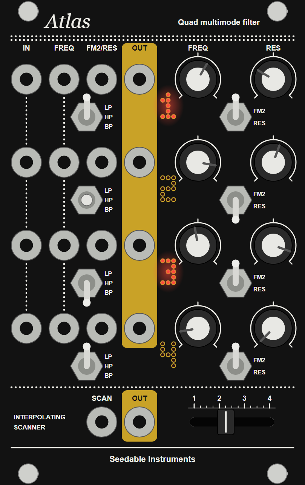

# Atlasy — a Vostok Instruments Atlas clone

A clone of Vostok Instruments' Atlas (2024): four analog multimode filters
in 16HP, each with LP / HP / BP, CV over cutoff and resonance, and a fifth
section, the interpolating scanner, that morphs from filter 1 to filter 4
under a fader and a CV. The IN and FREQ jacks are normalled down the rows,
so one input and one CV can feed all four filters. Atlas builds its filters
from SSI2164 gain cells "inspired by 80s Japanese synths", and its scanner
from AS3360 VCAs after Haible's and Tillman's scanners. The clone uses the
same chips and Sound Semiconductor's own filter app note (AN701). It is
built the Marblesy way: generated panel, netlist and EasyEDA project, Thonk
parts where Thonk has them.

## Status

| Part | Status | Files |
|---|---|---|
| Panel layout, hole table, drill template, artwork | Draft, waiting for review | `hardware/tools/panel.py`, `hardware/panel/` |
| Circuit plan | Draft, waiting for review | `docs/design.md` |
| Netlist, schematic, PCBs, panel PCB | Not started | |

## Panel

The original's arrangement (Vostok's manual, figure "Atlas_Ref"): per row the
four jacks on the left with the mode switch under them, the channel numeral,
then FREQ and RES with the FM2/RES switch between them; the scanner below a
dotted divider. House style otherwise: the same title band, rule and maker
line as every other module, outputs on gold.

| Control | Part | Notes |
|---|---|---|
| IN 1–4 | Thonkiconn | Each normalled from the row above (IN 1 from ground) |
| FREQ 1–4 (jacks) | Thonkiconn | Cutoff CV, normalled from the row above like IN |
| FM2/RES 1–4 | Thonkiconn | A second cutoff CV or a resonance CV, by the switch |
| OUT 1–4, scanner OUT | Thonkiconn | 1 kΩ out, on the gold column / patch |
| SCAN (jack) | Thonkiconn | Sums with the fader |
| FREQ, RES 1–4 (knobs) | Alpha 9 mm B100k, 10 mm caps | |
| Mode 1–4 | Dailywell 2M sub-mini toggle, DPDT ON-ON-ON (2MD6-T1-B1-M2-Q-E-S; Tayda) | Up LP, middle HP, down BP. Atlas has a 3-way slide switch |
| FM2/RES 1–4 | Dailywell 2M sub-mini toggle, SPDT ON-ON (2MS1T1B1M2QES; Thonk) | Up FM2, down RES. Atlas has a slide switch |
| Channel numerals | 3 × 5 grid of 0.8 mm holes in gold rings, a 3 mm red LED behind | Lights with the channel's output level |
| SCAN fader | 20 mm travel slide pot, B10k (Bourns PTA2043 or Alpha RA2045F) | 22.4 × 2.4 mm slot; lever height fixed in the PCB step |

Differences from Atlas, all on purpose:

- **Labels once per column.** Atlas repeats IN / FREQ / FM2/RES / OUT and
  FREQ / RES over every row. Here each column is named once above row 1,
  the numerals name the rows, and only the switch positions are labelled
  per switch (like the L / R marks on the mixer's pans). The dotted lines
  down the IN and FREQ columns show the normals.
- **Toggles instead of slide switches.** Panel slide switches with a long
  enough actuator are hard to get; sub-mini toggles are not. Same places,
  same positions.
- **Jacks 10 mm apart** instead of about 9.3, the most 16HP allows next to
  two knob columns.
- **The numerals show the output**, not the input as on Atlas: with the
  scanner you see which filter is ringing, and with the inputs chained all
  four would light the same.

`hardware/panel/atlas-panel-holes.csv` lists every hole in panel
coordinates (from the top-left, y down) next to its footprint origin on the
faceplate board.

## Open questions

See the end of `docs/design.md`: mode toggles or LED buttons, output or input
LEDs, fader or knob for SCAN, and a likely third board.
