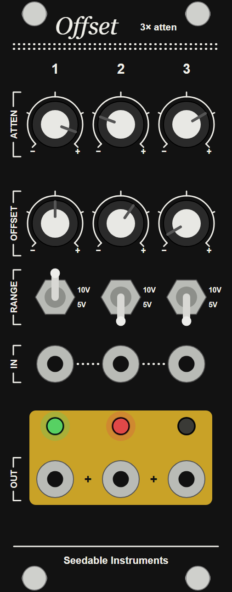

# Offset — triple offset attenuverter

Three channels of `OUT = ATTEN × IN + OFFSET` in 10HP Eurorack, all analog,
on one PCB (3 × TL074, two LM4040 references). Each channel has an
attenuverter (−1 … +1), an offset of ±5 V or ±10 V (RANGE toggle), and a
bicolour LED on its output. The inputs normal down the column (IN 1
normals to +1 V), so one source feeds every channel at its own depth. An
unpatched output adds into the next channel, so OUT 3 can be a mix. Thonk
panel parts.



## Status

| Part | Status | Files |
|---|---|---|
| Panel layout, drill template, artwork | Redrawn for 10HP with RANGE toggles (2026-10-31), to be looked at | `hardware/tools/panel.py`, `hardware/panel/` |
| Netlist | Done: one board, 81 parts, 0 problems, DC check passes | `hardware/tools/circuit.py`, [docs/design.md](docs/design.md#netlist) |
| EasyEDA schematic, PCB placement, panel PCB | Not started | |

## Files

```
docs/design.md            behaviour, circuit, netlist, op-amp map, references and power, BOM, choices
hardware/
  tools/
    circuit.py            the netlist with its checks and DC solve, and the panel placement
    panel.py              hole list, drill template and the panel artwork from the placement
  panel/
    offset-panel-holes.csv, offset-panel-drill.svg
    offset-panel.svg      panel artwork (groups: copper, silk, holes, mockup), offset-panel-preview.png
```

Regenerate from `hardware/tools`:

```bash
python circuit.py && python panel.py
```
