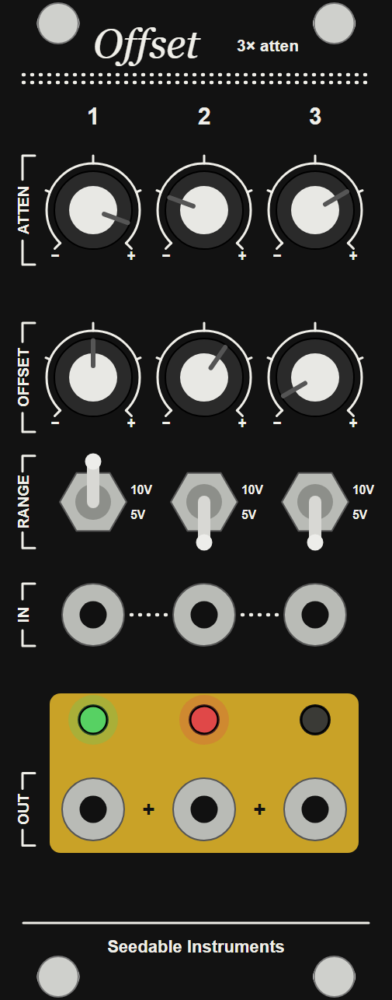

# Offset — design notes

Three offset attenuverters in 10HP Eurorack, all analog, on one PCB. Each
channel scales a CV or audio signal between −1 and +1, adds an offset of
±5 V or ±10 V (a toggle per channel), and shows the result on a bicolour
LED. The inputs normal down the column, so one source can feed all three
channels at different depths. The outputs add into the next channel when
unpatched, so the module also mixes modulation. Reference designators
match `hardware/tools/circuit.py`.

Status (2026-10-31): netlist written for one board, 81 parts, 0 problems,
and its DC check passes (see [Netlist](#netlist)). The panel was redrawn
for 10HP with the RANGE toggles and needs a look. The EasyEDA schematic,
PCB placement and panel PCB are not started.

---

## What it does

Per channel k:

```
OUT k = ATTEN k × IN k + OFFSET k  (+ OUT k−1, when OUT k−1 is unpatched)
```

| Control | Range | Notes |
|---|---|---|
| ATTEN k | −1 (CCW) … 0 (noon) … +1 (CW) | Linear. The ends are exact (1 % resistors); noon is 0 V whatever the input |
| OFFSET k | −5 V … +5 V, or −10 V … +10 V | From two LM4040 5.0 V references, so the ends do not move with the supply |
| RANGE k | lever down 5V, up 10V | Sets OFFSET k's range only |
| IN k | ±10 V, 100 kΩ | Unpatched, IN k takes IN k−1; IN 1 takes +1 V |
| OUT k | 1 kΩ series | Unpatched, it adds into channel k+1. OUT 3 is the sum of every channel whose output is unpatched |
| LED k | green = positive, red = negative | Lights from about ±2 V; brightness follows the voltage |

### Normals, and what they are for

- **Fan-out (inputs).** Patch one LFO into IN 1 and all three channels get
  it. Each ATTEN then sets that destination's depth and polarity, and each
  OFFSET sets its centre. Patch IN 2 as well, and channels 2 and 3 follow
  that source instead.
- **Fine offsets (IN 1 normal).** With nothing patched, every input sits
  at +1 V. ATTEN then becomes a fine ±1 V offset beside the coarse
  OFFSET. Use this to tune a pitch or to place a filter's cutoff exactly.
- **Mix (outputs).** Leave OUT 1 unpatched and take OUT 2: it carries
  channel 1 + channel 2. Use this to add an envelope to a slow LFO, or to
  add two LFOs into one cutoff. To use a channel alone, patch its output.
  Otherwise a channel whose output is unpatched still adds into the next
  channel, unless its ATTEN and OFFSET are both at noon.

---

## Circuit

One TL074 per channel. Every signal stage is inverting, so no op-amp input
moves with the signal: a follower fed −10 V would sit past the old TL07x's
common-mode range on ±12 V, where its output can flip. All resistors are
100 k 1 % unless noted.

```
            IN k-1 (IN 1: NORM, +1 V)
               │ switch lug
 IN k jack ────┴─ tip ── 100k ──┬─[A −]── N_k = −IN_k
                                └─ 100k feedback
 N_k ── 100k ── [B −] ── P_k = +IN_k            (100k feedback)

 ATTEN k (B10k):   P_k ─ pin 1 ┤wiper├ pin 3 ─ N_k
 OFFSET k (B10k): +5 V ─ pin 1 ┤wiper├ pin 3 ─ −5 V

 ATTEN wiper ── 100k ─────────────────┐
 OFFSET wiper ─ 100k ─────────────────┤
 OFFSET wiper ─ RANGE k (up) ─ 100k ──┼── SUM_k ─[C −]── OA_k ── 1k ── OUT k tip
 CAS_k ──────── 100k ─────────────────┘   100k ∥ 22p      │
                                                          └── 2k2 ── bicolour LED ── GND

 OUT k switch lug ── 100k ─[D −]── CAS_k+1 = −OUT_k   (100k feedback; open lug = 0 V)
```

- **A and B** give the ATTEN pot a low-impedance end at each polarity. A
  pot hung on the jack itself would load the source, and with the inputs
  normalled three deep, one source would drive three pots.
- **C** inverts. Turning ATTEN clockwise takes its wiper to N_k (−IN), and
  turning OFFSET clockwise takes its wiper to −5 V, so both come out of C
  positive.
- **RANGE** puts a second 100k beside the OFFSET resistor: 50 k into the
  100 k feedback doubles the offset. The toggle sits in the wiper's path,
  so the summing node (virtual ground, the sensitive one) never runs to
  the panel. It is a Dailywell 2MS1 SPDT ON-ON with common on pin 2.
  Mounted with pin 3 at the bottom, lever up joins 2–3; pin 1 stays open.
  Toggles join the throw *opposite* the lever. That is standard, but ring
  one out before soldering three.
- **D** turns the previous channel's output back into the sign the summer
  wants. When OUT k is patched, the jack's switch lug opens and D outputs 0 V.
- **Wiper loading.** A B10k wiper into 100k reads 1.8 % low at three
  quarters of the travel; into the 50 k of the 10 V range, 3.6 %. The
  ends and noon are exact. That is why the pots are 10 k and not 100 k
  (100 k would read 16 % low at three quarters).
- Channel 1 has no CAS input, and OUT 3 has no D stage after it.
- **Headroom.** C swings about ±10.5 V on ±12 V. A full ±10 V offset sits
  just inside that; anything added to it clips, as expected.

### Op-amp sections

| Chip | A | B | C | D |
|---|---|---|---|---|
| U1 | N_1 | P_1 | channel 1 summer | cascade 1 → 2 |
| U2 | N_2 | P_2 | channel 2 summer | cascade 2 → 3 |
| U3 | N_3 | P_3 | channel 3 summer | NORM: follower for +1 V (39k / 10k from +5 V) |

### References and power

- **+5 V:** LM4040-5.0 (TO-92), cathode on the +5 V node, fed by 1k from
  +12 V. That gives 7 mA; the three OFFSET pots take 3 mA, which leaves 4 mA
  for the reference (its range is 0.06–15 mA).
- **−5 V:** a second LM4040-5.0, with its cathode on GND, fed by 1k to −12 V.
- **Power entry:** 16-pin Eurorack header (2.54 mm, shrouded). There is a
  1N5819 in each rail: the +12 V anode on the header, and the −12 V
  *cathode* on the header (the reversed −12 V diode on the older PCBs is the
  error to avoid). Each rail then has a 10 Ω and 10 µF, and each TL074 has a
  100 n pair at its supply pins.
- **Current, estimated:** TL074s about 17 mA per rail, references 7 mA each,
  LEDs up to 3 × 3.6 mA, ATTEN pots up to 2 mA each at full input. That
  comes to about 40 mA per rail at worst, 25 mA typical.

---

## Netlist

`hardware/tools/circuit.py`, one board. `python circuit.py` prints the part
counts, the netlist problems (single-pin nets, designators used twice,
TL074 pins left out) and a DC check.

| Designators | What |
|---|---|
| J1–J3, J4–J6 | IN 1–3, OUT 1–3 (Thonkiconn: 1 sleeve, 2 switch lug, 3 tip) |
| RV1, RV3, RV5 / RV2, RV4, RV6 | ATTEN / OFFSET (pin 3 = CW end, both on the negative side; lugs 4, 5 on GND) |
| SW1–SW3 | RANGE toggles (2 common, 3 = lever up = 10 V, 1 open) |
| D1–D3 | output LEDs, 2-lead bicolour: current from pin 1 to pin 2 = green |
| U1–U3 | TL074 per channel, sections A (pins 1–3), B (5–7), C (8–10), D (12–14) |
| R*k*01–R*k*13, C*k*01 | channel *k*'s resistors and summer cap (R101 … R313) |
| D4, D5, R901–R904, C901, C902 | ±5 V references, the +1 V divider |
| J7, D6, D7, R905, R906, C903–C910 | power entry, bulk and decoupling |

Net names say what they carry: `IN1`, `N1` (−IN), `P1` (+IN), `AW1` / `OW1`
(the wipers), `OR1` (the RANGE throw), `SUM1`, `OA1` (summer out), `OUT1`
(tip), `OSW1` (its switch lug), `CAS2` (OUT 1 inverted, into channel 2),
`NORM`, `REF_P`, `REF_N`.

**DC check.** `solve()` builds the netlist's nodal equations with ideal
op-amps and ideal references. It takes pot positions, RANGE levers and a
patch state: patched inputs as sources, patched outputs as 100k loads, and
an unpatched jack's lug shorted to its tip. It returns every node voltage.
`dc_check()` runs ten patch cases whose answers were worked out by hand:
- noon is 0 V
- the +1 V normal
- the offset ends at 5 V and at 10 V
- 3/4 OFFSET on the 10 V range, with its wiper loading
- fan-out
- a patched IN 2 breaking the chain
- cascades to OUT 2 and OUT 3

All pass to 1 µV. Two results worth knowing:

- Each cascade step reads the previous channel 1 % low: D takes OUT k's
  tip, which sits behind the 1k output resistor, into 100k.
- One source with a 1k output impedance, fanned out to all three inputs
  (3 × 100k), arrives at 97 %.

---

## Panel

10HP, in the house style. The channels are columns like the mixer's
strips, 14.3 mm apart (the mixer's are 13.5 mm). Each row's word stands
once in the left margin, on a bracket. The knobs are at the top, the RANGE
toggles under the OFFSET knobs they belong to, and the jacks at the
bottom, so cables hang away from the hands. Each toggle's two positions
are stacked beside its lever, as on Atlas. The outputs and their LEDs sit
on the gold band. Dotted lines between the inputs show the fan-out; a +
between the outputs shows the mix.



| Row | Panel y (mm) | Parts |
|---|---|---|
| Channel numbers | 16.0 | silk |
| ATTEN | 27.0 | RV1, RV3, RV5: Alpha 9 mm B10k |
| OFFSET | 48.5 | RV2, RV4, RV6: Alpha 9 mm B10k |
| RANGE | 64.5 | SW1–SW3: sub-mini toggle, 6.5 mm hole |
| IN | 79.0 | J1–J3: Thonkiconn |
| LEDs | 92.5 | D1–D3: 3 mm bicolour, 2 leads |
| OUT | 104.0 | J4–J6: Thonkiconn |

Channel x: 12.0, 26.3, 40.6. `panel.py` reports no gaps under 1 mm. The
subtitle is "3× atten": in 10HP the title "Offset" ends at x 26, which
leaves room for about ten characters before the frame's right edge at
x 38.5.

---

## Parts (estimate)

| Qty | Part | Where | Notes |
|---|---|---|---|
| 6 | Thonkiconn PJ398SM | Thonk | |
| 6 | Alpha 9 mm vertical B10k | Thonk | A centre-detent version would help find noon on both rows; check stock |
| 3 | Sub-mini toggle SPDT ON-ON, PCB mount (Dailywell 2MS1 type) | Thonk / Tayda | |
| 3 | 3 mm bicolour LED red/green, 2 leads | Tayda | Thonk if stocked |
| 3 | TL074 + DIP-14 sockets | Tayda | Use the 7.62 mm DIP footprint, not the library's 8.89 mm one |
| 2 | LM4040 5.0 V, TO-92 | Mouser | A or B grade (0.1 / 0.2 %) |
| 30 | 100k 1 % | | |
| 3 + 3 | 1k, 2k2 | | output series, LED |
| 2 + 1 + 1 | 1k, 39k, 10k | | reference feeds, +1 V divider |
| 2 | 10 Ω | | rail filters |
| 3 | 22 p C0G | | summer feedback |
| 8 | 100 n | | 6 decoupling, 2 at the references |
| 2 | 10 µ electrolytic | | rail bulk |
| 2 | 1N5819 | | reverse protection |
| 1 | 16-pin shrouded Eurorack header, 2.54 mm | Thonk | Not the 2.00 mm footprint the FM / Clap / Compressor boards got |

---

## Choices

Settled on 2026-10-31:

1. **Width and channel count:** 10HP, three channels (the voice-case
   list's slot).
2. **IN 1 normal:** +1 V, a fine offset. +5 V (ATTEN becomes a second
   coarse offset) or 0 V (unpatched channels are pure offsets) is one
   resistor change: R903 / R904.
3. **OFFSET range:** ±5 V, with ±10 V on the toggle.
4. **The free strip:** the RANGE toggles.
5. **One board:** the panel parts on its front, everything else on its
   rear. The generators for the next steps are a one-board cut of the
   mixer's.
