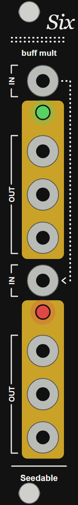

# Six — buffered mult

Two groups of one input to three buffered outputs in 4HP Eurorack. IN 2
takes IN 1 while unpatched, so one cable into IN 1 gives six copies. Every
output has its own op-amp with its 1 kΩ inside the loop: it holds its level
under load, and a shorted output leaves the others alone. A bicolour LED
per group shows the signal. All analog, all through-hole (2 × TL074), on
two stacked PCBs with Thonk panel parts.



## Status

| Part | Status | Files |
|---|---|---|
| Panel layout, hole table, drill template, artwork | Draft, waiting for review | `hardware/tools/panel.py`, `hardware/panel/` |
| Netlist | Done: two boards, 59 parts, 0 problems, DC check passes | `hardware/tools/circuit.py`, [docs/design.md](docs/design.md#netlist) |
| EasyEDA schematic, PCB placement, panel PCB | Not started | |

## Panel

| Part | What | Notes |
|---|---|---|
| IN 1 | Thonkiconn | 100 kΩ; unpatched 0 V |
| OUT 1a, 1b, 1c | Thonkiconn, on the gold band | IN 1, buffered one op-amp each |
| IN 2 | Thonkiconn | 100 kΩ; unpatched it takes IN 1 (the dotted line) |
| OUT 2a, 2b, 2c | Thonkiconn, on the gold band | IN 2 |
| LED 1, LED 2 | 3 mm bicolour | green positive, red negative |

For pitch CV, build it with 0.1 % resistors and TL074Bs: see
[Accuracy](docs/design.md#accuracy).

## Files

```
docs/design.md            why 4HP, behaviour, circuit, accuracy, boards and headers, netlist, panel, parts, choices
hardware/
  tools/
    circuit.py            the netlist of both boards with its checks and DC solve, and the panel placement
    panel.py              hole list, drill template and the panel artwork from the placement
  panel/
    six-panel-holes.csv, six-panel-drill.svg
    six-panel.svg         panel artwork (groups: copper, silk, holes, mockup), six-panel-preview.png
```

Regenerate from `hardware/tools`:

```bash
python circuit.py && python panel.py
```
