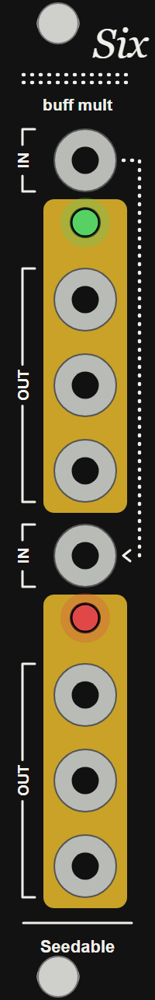

# Six — design notes

A buffered mult in 4HP Eurorack: two groups of one input to three outputs,
with IN 2 normalled to IN 1 so the module is a 1 → 6 mult when only IN 1 is
patched. Every output has its own op-amp with its output resistor inside
the feedback loop, so each output holds its level under load and a shorted
output leaves the other five alone. A bicolour LED per group shows the
signal. All analog, all through-hole, two stacked boards. Reference
designators match `hardware/tools/circuit.py`.

Status (2026-10-31): panel drawn and netlist written for two boards, 59
parts, 0 problems, DC check passes. The EasyEDA schematic, PCB placement
and panel PCB are not started.

---

## Why 4HP and not 1HP

The request was 1HP. A Thonkiconn needs a 6.5 mm panel hole and its nut
is 8 mm across; a 1HP panel is 4.78 mm wide. The only way to 1HP is a
blade PCB perpendicular to the panel with nutless mid-mount jacks, ~3.8 mm
holes that leave 0.5 mm of panel each side, all SMD, and no Thonk parts.
Plugs wider than 5 mm then block the neighbour's jacks (Redux Kits' 1HP
passive mult carries the same warning). 2HP is the narrowest panel for
Thonkiconns, but only with a SOIC op-amp. The user picked 4HP with all
through-hole parts.

---

## What it does

| Jack / light | Does |
|---|---|
| IN 1 | 100 kΩ input. Unpatched: 0 V (its switch lug is on GND) |
| OUT 1a, 1b, 1c | IN 1, each from its own op-amp, 1 kΩ inside the loop |
| IN 2 | 100 kΩ input. Unpatched: takes IN 1 |
| OUT 2a, 2b, 2c | IN 2 (or IN 1), as above |
| LED 1, LED 2 | green while the group's input is positive, red while negative; lights from about ±2 V, brightness follows the voltage |

- **Range:** ±10 V in and out. The TL074 swings to about ±10 V on the
  diode-dropped rails (±11.6 V), so a full ±10 V input can lose a few
  hundred millivolts at the peaks.
- **Bandwidth:** each stage has 100k ∥ 10p in its feedback (160 kHz), so
  audio passes flat (−0.14 dB at 20 kHz through both stages).
- **Loading:** an output holds its level into any load the op-amp can
  drive: 2 V stays 2 V into 100k, 10k or 1k (DC check). A shorted output
  drives its op-amp into the rail through the 1k (about 11 mA); the other
  outputs do not move.
- **The normal:** IN 2's switch lug takes IN 1's tip, so with IN 2
  unpatched one source drives both input stages: 50 kΩ. A source with a
  1 kΩ output impedance then arrives at 98.0 % (99.0 % with IN 2 patched).
  All six outputs carry the same voltage either way, so VCOs fed from them
  track each other.

---

## Circuit

Every signal stage is inverting, as on Offset: no op-amp input moves with
the signal. A follower fed −10 V would sit past the old TL07x's
common-mode range on ±12 V, where its output can flip to the positive
rail. Two inversions give +1.

```
                    IN 1 tip (IN 2 only; IN 1's lug is on GND)
                         │ switch lug
 IN g jack ──────────────┴─ tip ── 100k ──┬─[A −]──┬── N_g = −IN_g
                                          └─ 100k ∥ 10p ┘
 N_g ── 2k2 ── bicolour LED ── GND        (pin 1 on GND: green = IN positive)

 per output x = a, b, c (sections B, C, D):
                      ┌──────────── 10p ────────────┐
 N_g ── 100k ──┬─[−]──┴── OA_gx ── 1k ──┬── OUT gx tip
               └──────── 100k ──────────┘
```

- **The 1k inside the loop.** The 100k feedback comes from the jack side
  of the 1k, so at DC the op-amp holds the tip itself at +IN, whatever
  current the load draws. Above about 160 kHz the 10p from the op-amp
  output takes over the feedback, so cable capacitance behind the 1k
  cannot make the stage ring.
- **One op-amp per output.** A short or a fight with another module's
  output on one jack stays on that jack.
- **The LED** hangs on N_g, the input stage's output, so the output
  stages never see its current.

### Op-amp sections

| Chip | A | B | C | D |
|---|---|---|---|---|
| U1 | input 1 → N1 | OUT 1a | OUT 1b | OUT 1c |
| U2 | input 2 → N2 | OUT 2a | OUT 2b | OUT 2c |

### Accuracy

The gain is two resistor ratios in a row, so the 16 100k in the signal
path (R101, R102, R111, R112, R121, R122, R131, R132, and the same in the
200s) are 0.1 %. `circuit.py` puts all four of one path at the edge of
their tolerance and solves:

| Resistors | Worst-case gain | In pitch |
|---|---|---|
| 0.1 % | 0.996 … 1.004 | ±4.8 cents per octave; about 1.4 typical |
| 1 % | 0.961 … 1.041 | ±49 cents per octave: not for pitch |

Pairing 1 % resistors with a meter works too: what matters is that each
stage's two 100k match. Pairs within 0.05 % keep the overall gain within
±0.1 %.

The op-amps' offset adds a fixed shift per output: 2 × the input stage's
plus 2 × the output stage's. With a TL074 (3 mV typical, 10 mV max) that is
about 8 mV typical (10 cents), 40 mV worst. A TL074B (3 mV max) caps it at
12 mV. A VCO's tune knob removes a fixed shift, but moving a cable from one
output to another can move the pitch by the difference, so use TL074Bs if
the mult carries pitch.

### Power

- **Entry:** 16-pin Eurorack header (2.54 mm, shrouded), a 1N5819 in each
  rail (the +12 V anode on the header, the −12 V *cathode* on the header),
  10 Ω + 10 µF per rail, a 100 n pair at each TL074.
- **Current, estimated:** TL074s about 11 mA per rail (8 × 1.4 mA), LEDs up
  to 2 × 3.6 mA, loads under 1 mA: about 20 mA per rail, 30 mA worst.

---

## Boards

Two boards, because in 4HP the jack column takes the middle 9 mm of an
18.8 mm board: the strips beside it (5.9 and 3.9 mm) cannot hold a DIP-14
(9.2 mm over its pads), and through-hole parts behind a jack would push
their leads into its body. With SOIC TL074s the whole module would fit on
one board.

| Board | Front (panel side) | Rear |
|---|---|---|
| Faceplate, 18.8 × 108 | 8 Thonkiconns, 2 LEDs | two 1×6 male headers |
| Main, 18.8 × 108 | two 1×6 female sockets | 2 TL074, the resistors standing up, the power entry |

Header positions (faceplate front view, board mm, pins along y, pin 1 at
the top): H1 at x 2.9 in the left strip, centred on OUT 1b; H2 at x 16.85
in the right strip, centred on OUT 2b. They hold the boards at opposite
corners. There is no room for standoffs beside the jack column; whether the
two headers hold the main board firmly enough is for the PCB step.

| Pin | H1 | H2 |
|---|---|---|
| 1 | IN1 | IN2 |
| 2 | GND | GND |
| 3 | LED1 | LED2 |
| 4 | OUT1A | OUT2A |
| 5 | OUT1B | OUT2B |
| 6 | OUT1C | OUT2C |

The IN 1 → IN 2 normal is a trace on the faceplate board (J5's switch lug
to J1's tip). The orders get tuned for crossings when the boards are
placed.

---

## Netlist

`hardware/tools/circuit.py`, both boards in one netlist. `python
circuit.py` prints the part counts per board, the netlist problems
(single-pin nets, designators used twice, TL074 pins left out, header pins
used on one board only), the DC check, the loading figures and the
worst-case gains.

| Designators | What |
|---|---|
| J1, J5 | IN 1, IN 2 (Thonkiconn: 1 sleeve, 2 switch lug, 3 tip) |
| J2–J4, J6–J8 | OUT 1a–1c, OUT 2a–2c |
| D1, D2 | group LEDs, 2-lead bicolour: current from pin 1 to pin 2 = green; pin 1 on GND |
| HF1, HF2 / H1, H2 | 1×6 male headers on the faceplate / sockets on the main board |
| U1, U2 | TL074 per group, sections A (pins 1–3), B (5–7), C (8–10), D (12–14) |
| R*g*01–R*g*03, C*g*01 | group *g*'s input stage and LED resistor |
| R*gx*1–R*gx*3, C*gx*1 | output *x* of group *g* (x = 1, 2, 3 for a, b, c): input, feedback, 1k, 10p |
| J9, D3, D4, R901, R902, C901–C906 | power entry, bulk and decoupling |

Net names: `IN1` (tip), `NA1` (input stage in−), `N1` (−IN 1), `LED1`,
`S1A` (output stage in−), `OA1A` (op-amp output), `OUT1A` (tip); `_F` on
the faceplate side of each header pin.

**DC check.** `solve()` builds the nodal equations of both boards joined
at the headers, with ideal op-amps; patched inputs are sources, patched
outputs loads to GND, an unpatched jack's lug shorted to its tip.
`dc_check()` runs seven cases worked out by hand: nothing patched, +5 V
and −10 V into IN 1 (all six outputs), the two groups apart, IN 2 alone,
outputs into 100k / 10k / 1k, and a shorted output. All pass to 1 µV.
Feeding back from the op-amp output instead of the tip fails the load
case, and IN 2's lug on GND fails the normal case, so the check sees both
mistakes.

---

## Panel

4HP (20.0 × 128.5 mm) in the house style: one column of jacks, 1 mm right
of centre, the rows' words in the left margin on brackets, each group's LED
and outputs on a gold band, and a dotted line round the right of group 1
with an arrowhead into IN 2 for the normal.



| Part | Panel y (mm) | Notes |
|---|---|---|
| IN 1 | 20.6 | J1 |
| LED 1 | 28.6 | D1, on the band |
| OUT 1a–1c | 38.5, 49.5, 60.5 | J2–J4, on the band |
| IN 2 | 71.4 | J5 |
| LED 2 | 79.4 | D2, on the band |
| OUT 2a–2c | 89.3, 100.3, 111.3 | J6–J8, on the band |

All at x 11.0. What sets the spacing: the Thonkiconn body runs 7.48 mm
above its barrel and 2.92 mm below (sleeve up), so the LED needs 9.9 mm to
the OUT below it on the board, the outputs 11.0 mm between them (bodies
0.6 mm apart), and OUT 1c to IN 2 10.9 mm (0.5 mm apart). `panel.py`
checks the nuts, LEDs and screw heads on the panel and the bodies on the
board; it reports nothing under its limits.

**Where the frame bends.** 4HP has room for one mounting slot per rail
(x 7.5). The title keeps its spot (x 12, baseline 7.4, 5.2 serif), which
leaves 7.5 mm before the edge: three letters, hence "Six". The subtitle
("buff mult") cannot sit right of it, so it moves under the dotted band.
"Seedable Instruments" is 23 mm at 2.2, so the maker line says "Seedable",
on its usual baseline, 0.5 mm above the bottom screw head.

---

## Parts (estimate)

| Qty | Part | Where | Notes |
|---|---|---|---|
| 8 | Thonkiconn PJ398SM | Thonk | |
| 2 | 3 mm bicolour LED red/green, 2 leads | Tayda | Thonk if stocked |
| 2 | TL074 + DIP-14 sockets | Tayda | TL074B (TL074BCN, Mouser) for pitch duty; 7.62 mm DIP footprint |
| 16 | 100k 0.1 % metal film, 25 ppm | Mouser | or 1 % paired with a meter |
| 6 | 1k | | output series |
| 2 | 2k2 | | LED |
| 2 | 10 Ω | | rail filters |
| 8 | 10 p C0G | | stage feedback |
| 4 | 100 n | | decoupling |
| 2 | 10 µ electrolytic | | rail bulk |
| 2 | 1N5819 | | reverse protection |
| 1 | 16-pin shrouded Eurorack header, 2.54 mm | Thonk | not the 2.00 mm footprint the FM / Clap / Compressor boards got |
| 2 + 2 | 1×6 male header / 1×6 female socket, 2.54 mm | | board to board |
| 1 | 4HP panel as a PCB, 2 M3 screws | JLCPCB | |

---

## Choices

Settled on 2026-10-31:

1. **Width:** 4HP, all through-hole (see [Why 4HP](#why-4hp-and-not-1hp)).
2. **Channels:** 2 × 1 → 3, IN 2 normalled to IN 1.

Open:

3. **Name and wording:** "Six" / "buff mult" fit the frame; any other name
   longer than about three letters does not, unless the title moves left
   of x 12.
4. **The frame in 4HP:** subtitle under the band, maker "Seedable". The
   alternative is a narrow-panel frame for every module.
5. **LEDs:** one per group. Without them the outputs could sit at 12 mm.
6. **TL074 or TL074B,** and 0.1 % resistors or paired 1 % ones.
