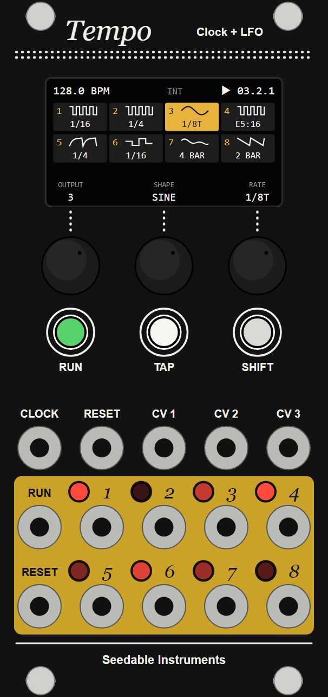

# Tempo — a clock and LFO module on a Daisy Seed

A 12HP Eurorack clock with eight outputs, each a clock (ratio, swing,
euclidean, probability, gate width) or a clock-synced wave (sine,
triangle, saw, square, pump, S&H, smooth random). It works like ALM's
Pamela's PRO Workout, but runs its own firmware. CLOCK and RESET in, RUN
and RESET out, three CV inputs, tap tempo. It shares the screen, encoders
and shift-register chain with Side FXy, and the DAC output stage with
Marblesy. "Tempo" is a working title.



## Status

| Part | Status | Files |
|---|---|---|
| Panel layout, drill template, artwork | Approved 2026-10-31 | `hardware/tools/panel.py`, `hardware/panel/` |
| Netlist | Done, 93 parts on the main board (SMD) and 64 on the faceplate, 36 header pins; netlist and circuit-value checks at 0 | `hardware/tools/circuit.py`, [docs/design.md](docs/design.md) |
| EasyEDA schematic, PCB placement, panel PCB | Not started | |
| Firmware | Not started (plan in [docs/design.md](docs/design.md#firmware-plan)) | |

Two boards: through-hole panel parts on the faceplate's front with SMD logic
(74HC165, two 74HC595) on its rear; an SMD main board with the Seed
breakout, four MCP4922 and four TL074.

Run the checks and regenerate the panel files from `hardware/tools`:

```bash
python circuit.py && python panel.py
```
