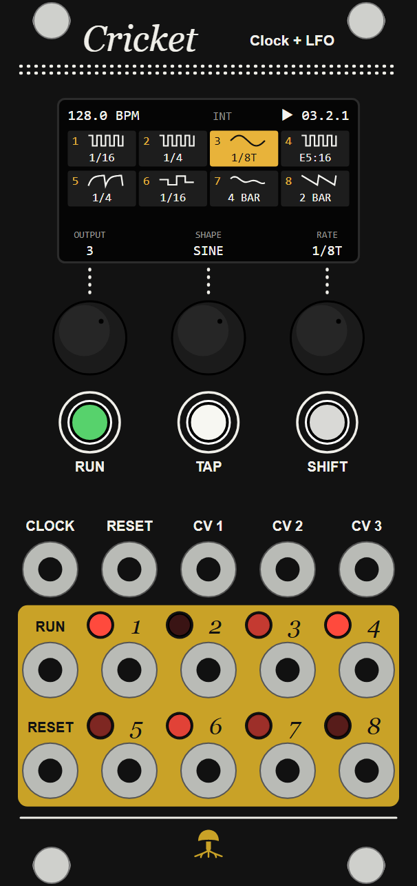

# Tempo — design notes

A clock and LFO module for the Eurorack voice case, 12HP, on a Daisy Seed.
It works like ALM's Pamela's PRO Workout but runs its own firmware (ALM's
is closed): eight outputs, each either a clock or a clock-synced wave. It
replaces the Kosmo case's Arduino clock (`analog-clock/`) and the planned
separate LFO module. It also adds the reset line the rig never had (RIG.md,
"Clock and sync").

The hardware reuses Side FXy's parts and Marblesy's circuits:

- **From Side FXy:** the 1.9" ST7789 screen, the EC11 encoders, the
  shift-register chain and the Seed on Rob Heel's `seed_power_opamps`
  breakout.
- **From Marblesy:** the MCP4922 DACs with their output stage, the CV
  inputs and the gate outputs.

Every reference designator matches `hardware/tools/circuit.py`. Run
`python circuit.py` to print the part counts, the netlist checks and the
circuit values.

**Status (2026-10-31):**

- **Panel:** approved as drawn.
- **Main board:** SMD (your choice).
- **Netlist:** written. It passes its checks (0 netlist problems, 0 circuit
  problems; see [Checks](#checks)).
- **Schematic:** the EasyEDA Pro schematic is written, five A3 pages that
  match the netlist (0 problems; see [Schematic](#schematic)).
- **PCBs:** both boards placed and net-assigned, unrouted, and the panel as
  a third PCB, all in the same project (0 problems; see [PCBs](#pcbs)). Not
  yet imported into EasyEDA.
- **Not yet:** routing (yours, in EasyEDA) and firmware.

"Tempo" is still a working title.

---

## What it does

| Function | Here |
|---|---|
| Tempo | Internal, 20–300 BPM, with tap tempo; or it follows CLOCK in (4 PPQN, the rig's 16ths, by default) |
| Transport | RUN button. RESET in. RUN out (high while running). RESET out (a pulse at every start and every reset) |
| Outputs | 8, each a **clock** or a **wave** |
| Clock outputs | ×/÷ ratio, swing, euclidean, probability, gate width, phase, level |
| Wave outputs | sine, triangle, saw, ramp, square, pump, S&H, smooth random, each with tempo ratio, level, offset, phase and shape |
| CV inputs | CV 1–3, each assignable to any output parameter with an amount |
| UI | 320 × 170 screen, three soft encoders named by the screen, RUN, TAP and SHIFT buttons, an LED for each output |

---

## Panel



| Control | Part | Notes |
|---|---|---|
| Screen | Waveshare 1.9inch LCD Module (ST7789V2, IPS 170 × 320, SPI), as in Side FXy | Landscape here. Window 43.7 × 23.7 mm, the active area plus 0.5 mm all round |
| ENC1–ENC3, three soft knobs | EC11 encoder with push, M7 bushing, D shaft (Tayda / Mouser) | Unlabelled: the screen names each knob in the cell just above it. Short dotted guides join the screen to the knobs |
| SW1 RUN, SW2 TAP, SW3 SHIFT | Thonk low-profile LED button: green, white, red | RUN is lit while running, TAP flashes on the beat, SHIFT is red as on Side FXy |
| J1 CLOCK, J2 RESET, J3–J5 CV 1–3 | Thonkiconn | The input row |
| J6 RUN, J11 RESET, J7–J10 and J12–J15 outputs 1–8 | Thonkiconn | On the gold output band. Transport outputs in the left column, outputs 1–8 in a 4 × 2 block |
| D1–D8 output LEDs | 3 mm, red | Left of each output's number, where Marblesy has them. Brightness follows the output |

**Layout:**

- **Grid:** the jack grid is Plaitsy's, five columns 11.5 mm apart, with
  the rows 14.6 mm apart. The lowest row is at Side FXy's height, so the
  jack rows of the case line up.
- **Controls:** the encoders and buttons stand on the midpoints between
  jack columns 1–2 and 4–5 and on the centre column.
- **Frame:** title, subtitle, band, rule and mushroom mark are at the house spots.
- `python panel.py` reports no gap under 1 mm between knobs, nuts, rings,
  LEDs, the window and the edges.

**What the layout leaves for the boards (front view, board mm):**

- **Behind the screen (y 78.4–105.7):** the module sits in the panel gap
  with its glass on the panel. No part with leads may sit there on the
  faceplate, but SMD parts on the rear may.
- **The encoder bodies (y 63.5–75.1):** the encoders' mounting tabs end
  about 2 mm below the module.
- **The buttons at y 57:** they leave a strip for rear parts above the top
  jack row's sleeve lugs (y 44.2–52.6).
- **The LEDs:** they sit between the jack rows. They clear the jack bodies
  by 0.1–0.2 mm, the same fit as Marblesy's, which is built and routed.

---

## Architecture

```
 panel ─┬─ display module in the panel gap, glass to the window
        ├─ faceplate board (FB) 59.4 x 108, 64 parts
        │     front: 15 Thonkiconn, 3 EC11, 3 LED buttons, 8 LEDs
        │     rear (SMD): 74HC165 (switches), 2x 74HC595 (LEDs), 12 pull-ups, 11 LED resistors;
        │                 CN1 (8 wire pads, through-hole) for the display cable
        │      36 pins in 4 headers (male on the FB, female on the MB)
        └─ main board (MB) 59.4 x 108, 95 parts, SMD
              Daisy Seed on seed_power_opamps (through-hole sockets), 4x MCP4922 + LM4040,
              4x TL074 (8 output stages, -2.5 V reference, 3 CV inputs, RUN/RESET gate outputs),
              CLOCK and RESET input transistors
```

**Why two boards:** the user prefers one board where possible, but it
doesn't work here, for the same reasons as on Side FXy:

- The breakout is 96.7 mm long, so it can only stand vertically. Its socket
  leads would then come through behind the screen.
- 15 jacks, three encoders and three buttons fill the faceplate's front.

**Why SMD:** a through-hole main board would carry about 1.7 times
Marblesy's part density. In SMD (SOIC, SOT-23, SOD-123, 0603, 1206 for the
bulk caps) it takes about a third of the area, the way Senay solved the
same problem.

**The faceplate's rear goes SMD too, as on Senay:**

- **The rear can hold all the LED logic.** SMD parts have no leads through
  the board, so they may sit behind the screen. The two 74HC595s and their
  eleven resistors therefore move from the main board to the faceplate,
  next to the LEDs.
- **That shortens the headers.** It takes eleven LED lines off them for one
  data line (SR_DOUT).

---

## Daisy Seed pin map

| Seed pin | libDaisy (STM32) | Net | Use |
|---|---|---|---|
| 1 | D0 (PB12) | CLK | clock input after Q1, active low; EXTI12, timestamped |
| 2 | D1 (PC11) | DAC_CS4 | U5 chip select |
| 3 | D2 (PC10, SPI3 SCK) | DAC_SCK | the four DACs |
| 4, 5, 6 | D3 (PC9), D4 (PC8), D5 (PD2) | DAC_CS1..3 | U2–U4 chip selects |
| 7 | D6 (PC12, SPI3 MOSI) | DAC_MOSI | the four DACs |
| 8, 9, 11 | D7, D8, D10 (SPI1 NSS, SCK, MOSI) | LCD_CS, LCD_SCK, LCD_MOSI | display, **Side FXy's pins** |
| 12, 13, 14 | D11, D12 (TIM4_CH4), D13 | LCD_DC, LCD_BL, LCD_RST | display, **Side FXy's pins** |
| 10 | D9 (PB4) | RST | reset input after Q2, active low; EXTI4 |
| 15 | D14 (PB7) | DAC_LDAC | all four DACs: pulse after the eight writes, so the outputs change together |
| 16–19 | codec | — | unused (no audio) |
| 20, 40 | AGND, DGND | GND | |
| 21 | 3V3A | 3V3A | DACs, reference, CV bias |
| 22, 23, 24 | A0, A1, A2 | ADC_CV1..3 | CV inputs |
| 25, 26 | D18 (PA7), D19 (PA6) | GATE_RUN, GATE_RST | to the RUN and RESET out stages |
| 27–32 | D20–D25 | ENC1_A, ENC1_B, ENC2_A, ENC2_B, ENC3_A, ENC3_B | encoder phases (pulled up on the faceplate), polled at 4 kHz |
| 33, 34 | D26, D27 | SR_CLK, SR_LOAD | the chain: 165 /PL and 595 RCLK, **Side FXy's pins** |
| 36, 37 | D29, D30 | SR_DOUT, SR_DIN | to the 595s, from the 165, **Side FXy's pins** |
| 38 | 3V3D | 3V3D | the faceplate's logic, LEDs and display |
| 35, 39 | D28 (A11), VIN | — | free |

The breakout's J1 (GND, −12 V ×3) and J3 (GND, +12 V ×3) feed the
op-amps. The ground pins of J4 and J5 are tied to GND, as on Marblesy; the
audio pins stay open.

**Pin notes:**

- **The display and the chain:** they are on Side FXy's pins, so one driver
  and one configuration serve both modules.
- **The DACs:** they get SPI3 on D2/D6, which are SDMMC pins that are free
  on both modules. The DAC traffic therefore never waits for a display DMA
  transfer on SPI1.
  - libDaisy's `src/per/spi.cpp` lists PC10 (AF6) as SPI3 SCK and PC12
    (AF6) as SPI3 MOSI, checked 2026-10-31.
  - Configure it transmit-only with a software NSS. libDaisy then skips the
    MISO and NSS pin checks, and D1 (PC11) stays a plain chip select.
- **D9:** the display never reads, so D9 (SPI1 MISO) carries the reset
  input. CLK on PB12 and RST on PB4 use different EXTI lines.

---

## Main board circuits

### Outputs (8×): MCP4922 + Marblesy's output stage

Four MCP4922-E/SL (12-bit dual, SOIC-14, the DIP's pinout) run on 3V3A,
with VREFA and VREFB from VREF. Each output is Marblesy's inverting summer:

```
V_out = −(100k/24k)·V_dac − (100k/47k)·NREF = 5.32 V − 4.17·V_dac
```

- **Range:** code 0 gives +5.32 V and code 4095 gives −5.09 V, in steps of
  2.54 mV.
- **Output:** 1k series resistor.
- **Clocks:** a clock is two DAC codes; +5 V is the default high.
- **Calibration:** each output gets an offset and scale from the firmware.

| Output | DAC | Op-amp | Rdac 24k | Rref 47k | Rf 100k | Rs 1k |
|---|---|---|---|---|---|---|
| 1 | U2 A | U6A | R30 | R31 | R32 | R33 |
| 2 | U2 B | U6B | R34 | R35 | R36 | R37 |
| 3 | U3 A | U6C | R38 | R39 | R40 | R41 |
| 4 | U3 B | U6D | R42 | R43 | R44 | R45 |
| 5 | U4 A | U7A | R46 | R47 | R48 | R49 |
| 6 | U4 B | U7B | R50 | R51 | R52 | R53 |
| 7 | U5 A | U7C | R54 | R55 | R56 | R57 |
| 8 | U5 B | U7D | R58 | R59 | R60 | R61 |

Per DAC:

- VDD and /SHDN go to 3V3A, both VREF pins to VREF, VSS to GND.
- /CS goes to its own Seed pin; SCK and SDI are on SPI3; /LDAC is shared.
- Pins 2, 6 and 7 are not connected.
- 100 n at VDD (C23–C26).

### Reference

| Part | What |
|---|---|
| D11 | LM4040-2.5 in SOT-23: 1 = cathode (VREF), 2 = anode, 3 = substrate, tied to the anode as TI asks |
| R73 | 1k5 feed from 3V3A |
| C14 | 100 n |
| U8D, R71, R72 | inverter, 100k / 100k: NREF = −2.50 V |

Changed from Marblesy (2.2k feed, 10k inverter): four DACs load VREF twice
as much as two. With the new values:

- 0.53 mA comes in through R73.
- The eight DAC reference inputs (about 165k each) and the inverter take
  0.15 mA.
- That leaves 0.39 mA in the LM4040, well above its 45 µA minimum.

### CV inputs (3×)

Marblesy's stage, with the values its hardware test suite changed on
2026-11-13 (its report, M1):

```
jack tip ── 100k ──┬── (−) TL074 ──┬── 1k ── Seed ADC
                   ├── 13k ────────┤
                   └── 1n ─────────┘
BIAS 1.57 V ──────── (+)
```

- **Range:** ±12 V reads 0.22–3.34 V, so no patch can drive the ADC pin
  past 3V3A + 0.3 V. ±5 V reads 1.13–2.43 V. The old 27k / 15k (±5 V on
  0.33–3.03 V) overdrove the pin from about −7 V.
- **BIAS:** R74 11k / R75 10k from 3V3A, with C13 1 µ.
- **Corner:** 13k with 1n is 12.2 kHz, as on Marblesy.
- **Firmware:** the gain is −0.13 and the zero is 1.78 V at the pin (about
  2200 of 4096); calibrate both, as Marblesy does.
- **Unplugged:** the switch lug grounds the tip, so the input reads 0 V.

| Input | Section | Rin | Rf | Cf | Rs | ADC |
|---|---|---|---|---|---|---|
| CV 1 | U8A | R62 | R63 | C10 | R64 | A0 |
| CV 2 | U8B | R65 | R66 | C11 | R67 | A1 |
| CV 3 | U8C | R68 | R69 | C12 | R70 | A2 |

### CLOCK and RESET inputs (2×)

Side FXy's clock stage, twice, in SMD:

```
jack tip ── 100k ── base MMBT3904, emitter to GND
            1N5819HW cathode on the base, anode to GND
            collector ── 10k to 3V3D, and to the Seed
```

| Input | 100k | 10k | Transistor | Clamp | Seed |
|---|---|---|---|---|---|
| CLOCK | R76 | R77 | Q1 | D9 | D0 |
| RESET | R78 | R79 | Q2 | D10 | D9 |

- **Threshold:** about 0.7 V.
- **Drive:** a 5 V clock gives 43 µA of base current against 0.33 mA of
  collector current, so the transistor needs a gain above 8.
- **Unplugged:** the switch lug grounds the tip. The firmware follows CLOCK
  whenever pulses arrive.

### RUN and RESET outputs (2×)

Marblesy's gate stage: a TL074 section, non-inverting ×2.5, then 1k out,
giving 0 V / 8.25 V. U9A (RUN: R80 10k to GND, R81 15k feedback, R82 1k)
and U9B (RESET: R83, R84, R85), driven from D18 and D19. U9C and U9D are
grounded followers.

R86 / R87 (100k) pull D18 / D19 to GND. While the Seed is unpowered, in
reset or in its bootloader, the pins float and the stage could put out
anything up to its swing; with the pull-downs the outputs sit at 0 V
(Marblesy's test report, L3).

### Power

| Rail | Load | Estimate |
|---|---|---|
| ±12 V | the four TL074s | about 22 mA per rail |
| +12 V | the Seed, through the breakout's DC/DC | about 60 mA more, so about 85 mA in all |
| −12 V | the TL074s only | about 25 mA |
| 3V3D | the display (40 mA max), the LEDs (up to about 35 mA), logic | about 80 mA on top of the Seed |
| 3V3A | the DACs, reference and bias | 2.1 mA |

- **Decoupling:** 100 n per rail beside each TL074 (C15–C22) and 10 µ bulk
  on each rail by the breakout's J1 / J3 (C27, C28, 1206).
- **Measure on the first build:** the 3V3D current. Side FXy has the same
  open point.

---

## Faceplate circuits

### Jacks

| Jack | Tip | Switch lug |
|---|---|---|
| J1 CLOCK, J2 RESET | CLK_IN_F, RST_IN_F | GND_F |
| J3–J5 CV 1–3 | CV1_F..CV3_F | GND_F |
| J6 RUN, J11 RESET (outputs) | RUN_OUT_F, RST_OUT_F | open |
| J7–J10, J12–J15 outputs 1–8 | OUT1_F..OUT8_F | open |

### Encoders and buttons

- **Encoder phases:** pulled up by R1–R6 (10k to 3V3D_F), straight through
  H3 to D20–D25. The firmware decodes them in the 4 kHz tick.
- **Encoder pins:** common C, switch S1 and both mounting tabs go to
  GND_D_F.
- **Switches:** the encoder pushes and the RUN, TAP and SHIFT buttons go
  into U10 (74HC165D) on D0–D5, each pulled up by R7–R12 (10k). D6 and D7
  are tied high and read as released. DS and /CE are grounded, and Q7 is
  SR_DIN.

| U10 input | D0 | D1 | D2 | D3 | D4 | D5 | D6, D7 |
|---|---|---|---|---|---|---|---|
| Switch | K1 push | K2 push | K3 push | RUN | TAP | SHIFT | spare (high) |

### LEDs

- **U11 (74HC595D):** first in the chain, SER = SR_DOUT. QA–QH drive the
  output LEDs D1–D8 through R13–R20 (470R, 2.7 mA into red). Its QH' feeds
  U12.
- **U12:** QA–QC drive the RUN, TAP and SHIFT button LEDs through R21–R23;
  QD–QH are spare.
- **Cathodes:** all to GND_D_F.
- **Resistor values:** RUN and TAP get 150R, SHIFT 470R. A white LED, and a
  green one if Thonk's is InGaN, drops close to 3 V, so a 470R at 3.3 V
  would give it under 1 mA. With 150R that is 2.5 mA (white) to 6 mA (an
  old-style green). Measure the buttons when they arrive; the brightness is
  balanced in software anyway.

### The chain

Side FXy's order, with SR_LOAD on the 165's /PL and both 595s' RCLK, and
SR_CLK on all three:

1. SR_LOAD goes low and the 165 loads.
2. SR_LOAD goes high and the 595s latch the previous scan's bytes.
3. 16 clocks read the 165's byte (the first 8) and shift two LED bytes
   out. The first byte shifted ends in U12, the second in U11.

The scan runs in the 4 kHz tick. Brightness comes from binary-code
modulation over the scans.

### Display

The same module and cable as Side FXy. The cable's wires go into CN1,
eight wire pads in Waveshare's order (VCC, GND, DIN, CLK, CS, DC, RST, BL,
pin 1 at the top). C4 (10 µ, 1206) sits beside it.

- **Orientation:** landscape. With the flex end on the left, the module
  covers board x 2.1–53.3, y 78.4–105.7 (front view).
- **The cable:** its connector sits 34.3–38.5 mm from the flex end, centred
  in height. The cable goes through a 13.5 × 16.7 mm cutout in the
  faceplate (x 34.95–48.45, y 83.7–100.4, front view; room for the plug and
  the bend, Side FXy's proportions). On the rear it runs right to CN1 in
  the 6 mm right margin, over a strip kept free of parts.
- **Why wire pads, not a right-angle header:** the header's Dupont plug
  lies flat and reaches about 18 mm in from its pins. From the right margin
  that is right over the cutout the cable comes up through. Cut the Dupont
  ends off, shorten the wires and solder them in; the module end stays a
  plug. A 1×8 pin strip fits the same holes if you would rather keep the
  plugs and find another way to lay them.
- **Mounting:** tape round the window. The M2 holes are under the glass, as
  on Side FXy.

Decoupling: C1–C3 (100 n) at U10–U12.

The faceplate keeps two grounds, as Side FXy does: GND_F (jacks) and
GND_D_F (logic, LEDs, display). They join only on the main board.

---

## Board-to-board headers

From `circuit.HEADERS`: male pins on the faceplate (HF1–HF4), sockets on
the main board (H1–H4). Each stands in a column, pin 1 at the top; see
[PCBs](#pcbs) for where. The pin order is the one with the fewest crossing
straight lines from each pin to the nearest pad of its net, both boards
counted. It was searched against the placement and repeated until it
settled. That cut the headers' own crossings from 70 to 24.

| Header | Pins | Nets, pin 1 (top) first (MB name; the faceplate adds _F) |
|---|---|---|
| H1 / HF1 | 6 | CV3, CLK_IN, GND, CV2, CV1, RST_IN |
| H2 / HF2 | 11 | OUT4, OUT8, OUT3, OUT7, OUT2, OUT6, RUN_OUT, GND, OUT1, RST_OUT, OUT5 |
| H3 / HF3 | 12 | SR_DIN, SR_LOAD, SR_CLK, SR_DOUT, ENC3_B, ENC3_A, ENC2_B, ENC2_A, 3V3D, GND (GND_D_F), ENC1_B, ENC1_A |
| H4 / HF4 | 7 | LCD_CS, LCD_SCK, LCD_MOSI, LCD_DC, LCD_BL, LCD_RST, GND (GND_D_F) |

---

## Checks

`python circuit.py` runs two sets of checks.

**`check()`, the netlist:**

- no single-pin nets;
- no designator used twice on a board;
- every header pin used on both boards;
- no net name on both boards;
- every faceplate net ends in _F;
- every panel part has a PLACEMENT entry, and the reverse.

**`circuit_check()`, the numbers:**

- **How it works:** it looks up the resistors by the nets they join. A
  resistor on the wrong net makes the lookup fail, so the numbers below
  come from the netlist as wired.
- **What it reports:** the reference (NREF, the LM4040's current), every
  output's range and step, the CV inputs' ADC range, the gate height, the
  transistor inputs' drive, the LED currents and the 3V3A load.

Both report 0 problems. Tested both ways: moving R31 to VREF and dropping
the Seed's SR_DIN pin each get caught.

---

## Schematic

`hardware/tools/easyeda_export.py` writes `hardware/easyeda/Tempo.epro2`:
two boards (Tempo Main, Tempo Faceplate), each with its schematic, on five
A3 pages, and each with its placed PCB; a third board, Tempo Panel, holds
the panel PCB (see [PCBs](#pcbs)).

| Page | Holds |
|---|---|
| Main 1 | Seed, CLOCK / RESET input stages, CV inputs (U8A–C), bias, the reference and its inverter (U8D) |
| Main 2 | the four MCP4922s and the eight output stages (U6, U7) |
| Main 3 | RUN / RESET gate stages (U9), decoupling, H1–H4 |
| Faceplate 1 | jacks, encoders, LED buttons, output LEDs |
| Faceplate 2 | U10–U12 with their resistors, CN1, decoupling, HF1–HF4 |

The pages are drawn the way Senay's are: every pin ends in a net port or a
ground flag named after its net, so parts sit in blocks without wires
between them. Same name, same net within a board; the header pins carry the
nets across.

Run `python easyeda_export.py` from `hardware/tools` (needs Pillow for the
previews `hardware/easyeda/tempo-easyeda-*.png`). It reports four kinds of
problem, all 0:

- the drawing against the netlist, per page (every pin on its net, no
  T-junctions or pins in the middle of a wire);
- every netlist pin drawn exactly once;
- every symbol pin with a footprint pad, and the reverse;
- every Device, Symbol and Footprint the pages name present in the
  written file.

**Where the parts come from:**

- **Your MorrisSynth library caches:** the resistor, capacitor, 1N5819 and
  TL074ACN symbols, the WQP518MA jack, net ports, ground flags, the frame.
- **Taken over from Senay:** the SMD footprints (0603 / 0805 / 1206, SOIC-14,
  SOIC-16, SOT-23 with B / E / C pads, SOD-123), the 3 mm LED and the
  headers.
- **Taken over from Side FXy:** the Seed breakout, the EC11 and the Thonk
  LED button, with their symbols, and the 74HC165 / 74HC595 symbols.
- **Wire pads:** CN1's eight pads are a 1×8 header footprint under its own
  name (`WIRE-PADS-1x8-P2.54`).
- **New:** the MCP4922 symbol (NC pins 2, 6, 7 drawn so every pad has a
  pin), and the LM4040-2.5 in SOT-23 with pin 3 as the substrate.

**What EasyEDA's DRC will still say** (all intentional, floating-pin
warnings):

| Where | Pins left open |
|---|---|
| U1 (Seed) | D28 (35), VIN (39), the codec pins 16–19, the breakout's audio pins J4-1, J4-3, J5-1, J5-3 |
| U2–U5 (MCP4922) | 2, 6, 7 (NC) |
| U10 (74HC165) | /Q7 (7) |
| U12 (74HC595) | QD–QH (3–7) and QH' (9) |
| J6–J15 (outputs) | the switch lugs (2) |

---

## PCBs

`easyeda_export.py` also writes the two boards' PCBs (`hardware/tools/pcb.py`)
and the panel as a third PCB (`hardware/tools/panel_pcb.py`) into
`Tempo.epro2`. The boards are placed and every pad has its net. Nothing is
routed. Previews: `hardware/easyeda/tempo-easyeda-pcb-*.png`, rear view
(EasyEDA's top layer).

**The code:** Senay's board class, checks and greedy SMD placer, with Side
FXy's display keep-out, cutout and outline. On top of that:

- an `improve()` pass (the S&H's lesson) that lifts each loose part and puts
  it back until a round moves nothing;
- summing nodes and transistor bases (IN_*, B_*) weighted three times in
  the placer's cost (Offset's rule), so the high-impedance nodes stay short;
- a rear keep-out for the cable's wires;
- a check that no SMD body covers a through-hole pad.

**Frame:** both PCBs are drawn as EasyEDA shows them, looking at the top
layer, which is the rear of the stack on both boards: x_pcb = 59.4 −
x_front. Below, "front x" is the front view's coordinate.

### Faceplate

- **Front (bottom layer):** the panel parts at their PLACEMENT spots,
  oriented by rule:
  - jacks with the sleeve above the tip;
  - LED buttons with the LED pins along x, anode on the right;
  - encoders with the phase row (A, C, B) 7.5 mm below the shaft, the
    switch pins above and the mounting tabs to the sides;
  - LEDs with the anode on the left.
- **Behind the display:** a keep-out for leads (the module's back), the
  cable's cutout milled out (a layer-12 region) and the module's outline
  on the bottom silk.
- **Headers (top layer):** in four columns of free board between the
  encoder tabs, the button bodies and the jacks, from just above the top
  jack row's sleeve pads (y 43.8) to just below the display (y 77.5):

| Header | Front x | y | Why there |
|---|---|---|---|
| HF1 inputs | 3.0 (left margin) | 44.0–56.7 | beside the input row's left end |
| HF2 outputs | 21.08 (between ENC1 / SW1 and ENC2 / SW2) | 44.0–69.4 | central for both output rows |
| HF3 logic | 38.33 (between ENC2 / SW2 and ENC3 / SW3) | 48.9–76.8 | on the main board, beside the Seed's D20–D30 row |
| HF4 display | 54.75 (right margin) | 57.1–72.4 | under CN1; on the main board, beside D7–D13 |

- **CN1:** wire pads in the right margin, front x 56.4, y 83.2–100.9. The
  strip between the cutout and CN1 (front x 48.45–54.9) stays free for
  the wires.
- **SMD logic (top layer, placed by the placer):**
  - U10 (165) in ENC2's footprint between its phase and switch rows;
  - U11 (595, output LEDs) between the jack rows, among the LEDs;
  - U12 (595, button LEDs) at the top jack row;
  - the pull-ups and LED resistors beside the pins they join;
  - C1–C3 2.0 mm from their chip's VCC pin, C4 by CN1.
- **Nothing behind the display yet:** it's free for anything SMD that
  wants to move there while routing.

### Main board

- **The breakout:** stands along the rear view's left edge (front view's
  right), USB end up, centre (9.7, 66.0):
  - pins 1–20 (D0–D14) in its outer row at x 2.08, pin 1 at the top;
  - pins 21–40 in its inner row at x 17.32, pin 21 at the bottom;
  - J1 / J3 (±12 V) below the pins, the power header on the overhang
    below.
- **Sockets (bottom layer):** under the faceplate's headers. H4 stands in
  the breakout's channel beside D7–D13, H3 beside the inner row's D20–D30.
- **Chips (top layer, anchored):**
  - the four DACs at the top, two above each output op-amp (U2, U3 over U6;
    U4, U5 over U7);
  - U6 and U7 either side of H2;
  - under the holes, U9 (RUN / RESET gates) by the Seed's gate pins and U8
    (CV inputs, the −2.5 V inverter) between the ADC pins and H1.
- **Passives, transistors and the reference (placed):** each as near the
  pads it joins as the board allows:
  - each output stage's 24k, 47k and 100k round its op-amp's IN− pin;
  - the CV stages and the −2.5 V inverter round U8;
  - Q1 and Q2 with their 100k and clamps by H1;
  - D11, R73 and C14 between the DAC pairs;
  - decoupling 2.0 mm from every supply pin, the bulk caps by J1 / J3.
- **Free board:** the bottom right (below y 30) for the ±12 V runs. Copper
  may also run under the breakout, between its rows.

### Mounting

Three M3 standoffs on the same spots on both boards, front view (12.04,
48.0), (29.7, 48.0), (46.5, 48.0). They sit in the strip between the top
jack row and the buttons, between the header columns.

- **Only three:** nowhere else on this faceplate has a 6 mm circle free on
  both sides. Jacks fill the bottom, encoders and buttons the middle, the
  display the top (a screw head can't go under the module, and the margins
  beside it are 2.1 and 6.1 mm).
- **On the main board:** the third hole is in the breakout's channel, so
  its screw head sits under the breakout, as on Side FXy.
- **Holding the stack:** the 36 header pins and the standoffs together.

### Checks (all 0)

- every part placed once;
- pads 0.25 mm apart on a shared layer, 0.5 mm from the edge, clear of the
  holes and the cutout;
- bodies not overlapping on one side;
- no SMD body over a through-hole pad;
- nothing on the cable's strip;
- nothing under a standoff (gap side) or a screw head (other side), except
  the breakout over its screw head;
- every header pin at the same spot on both boards;
- the panel parts exactly at PLACEMENT;
- no through-hole pad of a rear part under a panel part's body or the
  display module;
- in the written file, every PAD_NET names a pad of its footprint and a net
  with a NET record.

**Ratsnest:** straight lines per net (a shortest tree), power nets left out.

| | Length | Crossings |
|---|---|---|
| Main board, first greedy pass | 1653 mm | 232 |
| Main board, final (improve(), U8 / U9 moved, nodes weighted, header order searched) | 1412 mm | 187 |
| Faceplate, first pass | 1450 mm | 182 |
| Faceplate, final | 1438 mm | 166 |

Weighting the nodes cost a few crossings and bought short nodes. The
longest summing node (all its pads) spans 11.9 mm (IN_OUT1); the
inverter's IN_NREF went from about 50 mm to 9.8 mm.

### Routing notes

- **Main board, ±12 V:**
  - +12 V comes from J3 (inner row's bottom), −12 V from J1 (outer row's
    bottom), through C27 / C28.
  - Run both rails along the bottom strip and up to each TL074's pins 4 /
    11.
  - The bottom layer carries only the sockets: pour GND there.
- **Main board, DAC bus:**
  - DAC_SCK, DAC_MOSI, CS1–CS4 and LDAC leave the outer row (pins 2–7, 15).
    Take them over the breakout's top end or between the inner row's pins
    to the DACs.
  - Keep them off the summing nodes (IN_OUT1–8) and NREF.
- **Main board, references:**
  - VREF runs from D11 (top middle) to the eight VREF pins and R71.
  - NREF runs from U8D (bottom) up to the eight 47k Rref resistors beside
    U6 / U7.
  - Keep the summing nodes short: each 24k / 47k / 100k sits on its
    op-amp's IN− pin.
- **Main board, CLOCK and RESET:** Q1 and Q2 sit by H1, so the jack side
  stays short. Their collectors (3.3 V logic, 10k pull-ups R77 / R79 near
  the Seed) run up to D0 (pin 1, top of the outer row) and D9 (pin 10).
  Those are the board's two long logic runs: keep them off the CV inputs
  and the summing nodes.
- **Faceplate, grounds:** keep them apart. GND_F carries the jack sleeves
  and the inputs' switch lugs; GND_D_F carries the logic, LEDs, encoders,
  buttons and display. They meet only on the main board, through H1 / H2
  (GND) and H3 / H4 (GND_D).
- **Faceplate, outputs:** they run up the channels between the jack
  columns to HF2.
- **Faceplate, display area:** tracks may run behind the display; only
  leads are kept out. Give the cutout 0.3 mm of copper clearance.
- **Header orders:** if you swap pins while routing, change
  `circuit.HEADERS` to match, so the schematic follows.

### What EasyEDA's PCB DRC will still say

- every net unrouted;
- the floating pins listed under [Schematic](#schematic);
- the cutout: a non-plated region inside the outline, which DRC may list as
  a board-outline remark. On Side FXy that was expected.

### Panel PCB

`panel_pcb.py` is Side FXy's writer. It draws from `panel.layout()` and
`panel.band()`, the same lists the artwork uses:

- **Outline:** 60.6 × 128.5 mm.
- **Holes:** non-plated holes for the jacks, buttons, encoders and LEDs;
  the four Eurorack slots; the display window milled with 1 mm corners.
- **Silkscreen:** the frame, the button rings and words, the input labels
  and the guides to the soft knobs.
- **The output band:** bare ENIG copper (a top-layer fill under a mask
  opening of the same shape), 0.4 mm clear round every hole. The output
  numbers and RUN / RESET are knocked out of the band's solder mask (a
  reverse string on the mask layer over a hole in the opening), so they
  read dark on the gold, as the artwork draws them.
- **Fonts:** EasyEDA's stroke font, not the artwork's serif italic, placed
  with its measured metrics; check the title after import.
- **Order:** 1.6 mm FR4, black mask, white silk, ENIG.

---

## BOM

**Main board** (SMD unless noted):

| Qty | Part | Package / notes | Refs |
|---|---|---|---|
| 1 | Daisy Seed (Thonk) | | U1 |
| 1 | seed_power_opamps breakout (Rob Heel), built; its audio op-amps unused | on its sockets, through-hole | U1 |
| 4 | MCP4922-E/SL | SOIC-14 | U2–U5 |
| 4 | TL074CDT | SOIC-14 | U6–U9 |
| 1 | LM4040-2.5, 1 % (e.g. LM4040D25IDBZR) | SOT-23 | D11 |
| 2 | MMBT3904 | SOT-23 | Q1, Q2 |
| 2 | 1N5819HW | SOD-123 | D9, D10 |
| 15 | 100k 1 % | 0603 | R32, R36, R40, R44, R48, R52, R56, R60, R62, R65, R68, R71, R72, R76, R78 |
| 2 | 100k | 0603 | R86, R87 |
| 8 | 47k 1 % | 0603 | R31, R35, R39, R43, R47, R51, R55, R59 |
| 8 | 24k 1 % | 0603 | R30, R34, R38, R42, R46, R50, R54, R58 |
| 3 | 13k 1 % | 0603 | R63, R66, R69 |
| 1 | 11k 1 % | 0603 | R74 |
| 2 | 15k | 0603 | R81, R84 |
| 5 | 10k | 0603 | R75, R77, R79, R80, R83 |
| 13 | 1k | 0603 | R33, R37, R41, R45, R49, R53, R57, R61, R64, R67, R70, R82, R85 |
| 1 | 1k5 | 0603 | R73 |
| 3 | 1 n C0G | 0603 | C10–C12 |
| 13 | 100 n X7R | 0603 | C14–C26 |
| 1 | 1 µ X7R | 0805 | C13 |
| 2 | 10 µ 25 V X7R | 1206 | C27, C28 |
| 4 | female sockets 1×6, 1×11, 1×12, 1×7, 2.54 mm | through-hole | H1–H4 |

**Faceplate:**

| Qty | Part | Notes | Refs |
|---|---|---|---|
| 15 | Thonkiconn PJ398SM (Thonk) | | J1–J15 |
| 3 | EC11-type encoder with push, vertical, M7 bushing, D shaft (e.g. Bourns PEC11R-4215F-S0024; Tayda) + small knobs | check the datasheet and the height | ENC1–ENC3 |
| 3 | Thonk low-profile LED button: green, white, red; clip the feet | | SW1–SW3 |
| 8 | 3 mm red LED (Thonk) | | D1–D8 |
| 1 | 74HC165D | SOIC-16, rear | U10 |
| 2 | 74HC595D | SOIC-16, rear | U11, U12 |
| 12 | 10k, 0603 | rear | R1–R12 |
| 9 | 470R, 0603 | rear | R13–R20, R23 |
| 2 | 150R, 0603 | rear | R21, R22 |
| 3 | 100 n X7R, 0603 | rear | C1–C3 |
| 1 | 10 µ X7R, 1206 | rear, beside CN1 | C4 |
| — | (no part) | eight wire pads for the display cable's wires, Dupont ends cut off | CN1 |
| 1 | Waveshare 1.9inch LCD Module (ST7789V2) with its cable | glass taped to the panel's rear | DS1 |
| 4 | male headers 1×6, 1×11, 1×12, 1×7, 2.54 mm | | HF1–HF4 |

Plus a 12HP panel PCB and 3 M3 standoffs for the 11 mm gap (8.5 mm sockets + 2.5 mm male plastic), with 6
screws.

---

## Firmware plan

libDaisy with the Daisy bootloader (BOOT_SRAM), like the other Seed modules.
No audio callback: a 4 kHz timer runs the engine.

### Shared with Side FXy, written once

Keep this code in one folder that both firmware projects use:

- **ST7789 driver:** SPI1 transmit-only with DMA, same pins.
  - Side FXy uses the screen in portrait; here it runs landscape through
    the MADCTL rotation.
  - The 170-pixel panels' 35 px offset moves to the other axis when the
    screen is rotated.
  - The frame is 320 × 170 × 2 = 109 KB. Under BOOT_SRAM the program lives
    in the 512 KB AXI SRAM, so the frame goes in D2 SRAM or SDRAM, or is
    kept as a 4-bit frame (27 KB) expanded into line buffers.
- **Shift chain:** the 165/595 chain driver (here 8 bits in, 16 out), the
  encoder decoding (a state table) and debouncing.
- **UI:** the soft-knob widgets (a parameter cell named by the screen beside
  or above its knob) and a small bitmap font.
- **Storage:** presets and calibration in QSPI.

### Engine (4 kHz tick)

- **Tempo:** a phase accumulator in 1/96 notes.
- **External clock:**
  - Each CLOCK edge is timestamped with the cycle counter, and the period is
    averaged over the last pulses, like the drum sequencer's 8.
  - Divisions count input pulses directly, so they add no jitter.
  - Multiplications and waves follow a smoothed phase, so they track tempo
    changes without jumps.
- **Each tick:**
  1. Compute eight output values.
  2. Write them with eight SPI3 frames (about 12 µs at 12.5 MHz) and pulse
     LDAC.
  3. Read the encoders and run the chain scan.
- **Latency:** an output edge lags its cause by less than 250 µs. If that
  shows on a scope against the drum sequencer, go to 8 kHz.
- **Output polarity:** the stage inverts (code 0 = +5.32 V), so the
  firmware writes `code = (5.32 − V) / 4.17 / 2.5 × 4096`, corrected by each
  output's calibration.
- **Run, stop and reset:**
  - All counters are bar-aligned.
  - RESET in and SHIFT + TAP restart at bar 1 on the next clock and fire
    RESET out.
  - RUN out is high while running.

### Features

**Global:**

- BPM 20–300 in 0.1 steps; tap tempo (average of the last 4 taps, forgotten
  after 2 s).
- Clock source auto (EXT while pulses arrive, else INT) or forced.
- CLOCK in PPQN 1, 2, **4**, 8, 24, 48.
- RESET in as a trigger (restart) or a gate (run while high), the two ways
  Pam's-style modules read it.
- Bar length (default 16 steps).
- Live changes of ratio, mute and preset take effect on the next beat or
  bar, so outputs stay in phase.

**Per output, clock mode:**

- **Ratio:** ×16 to ÷64 including triplets and dotted values, shown as note
  values (1/16 = ×4, 1/8T = ×3).
- **Gate:** width 1–99 % or a fixed 2 / 10 ms trigger.
- **Swing:** 50–75 %.
- **Euclidean:** length 1–32, hits, rotation.
- **Probability** 0–100 % with a LOOP length: the random choices repeat
  every n steps, so a pattern mutates slowly instead of churning (as in
  Marbles' déjà vu).
- **Also:** phase/delay, level (gate height), mute.

**Per output, wave mode:**

- **Shape:**
  - Sine, triangle, saw, ramp, square (with pulse width).
  - **Pump:** an exponential recovery from each beat, for sidechain-style
    ducking through a VCA.
  - S&H (one value per cycle, with slew) and smooth random (interpolated).
  - S&H and random have the same LOOP for repeating random lines.
- **Rate:** the clock ratios up to 64 bars, for slow drifts.
- **Shaping:** level, offset, phase (0–360°), a shape parameter (pulse
  width, curve, skew).
- **Reset:** the phase restarts on reset and at bar 1.

**CV:**

- CV 1–3, each with up to four destinations (any output parameter, amount
  ±100 %).
- Rate and ratio destinations step through the ratio list, so the outputs
  stay tempo-locked.

**System:**

- Presets in QSPI, recalled on the bar.
- Calibration (per output offset/scale, per CV input) in QSPI.

**For the style** (wobbles and pumping, slowly mutating repetition):

- **Already in the list:** the pump shape, triplet and dotted rates for
  wobble basses, LOOPed randomness, bar-quantised changes.
- **Later:**
  - A per-bar rate sequence on one output (e.g. 1/8, 1/8T, 1/16, 1/4) for
    US-bass wobbles.
  - Outputs modulating each other.

### UI (proposal)

| | Turn | Push | With SHIFT |
|---|---|---|---|
| K1 | home: select output 1–8, or the CLOCK lane left of 1; in a page: the parameter shown above it | home: open the selected output's pages; in a page: back home | — |
| K2 | home: the selected output's main value (ratio or rate); CLOCK lane: BPM | next page | fine steps |
| K3 | home: the second value (width or shape); CLOCK lane: source and PPQN | previous page; home: mute on the next bar | fine steps |
| RUN | | start / stop | presets page |
| TAP | | tap tempo | reset to bar 1 (fires RESET out) |

**The home page** (as on the panel preview) has three parts:

- **Top:** tempo, source and position.
- **Middle:** eight tiles laid out like the output jacks, each showing its
  mode, a wave or pulse icon and its value.
- **Bottom:** the three knobs' cells, centred over the knobs.

**Size:** an estimated 60–100 KB of code (no DSP library, one font). It
would fit the H750's 128 KB of internal flash, but BOOT_SRAM keeps QSPI
writes (preset saves) from stalling the program, as on Side FXy.

---

## Decided, and still open

**Decided (2026-10-31):**

- **Panel:** approved as drawn. That includes CV 3 in the fifth input
  spot, the output LEDs, the landscape screen and the colours.
- **Main board:** SMD at 12HP.
- **Placement (mine, check it):** CN1 became wire pads, because a
  right-angle header's plug would lie over the cable's cutout. Three
  standoffs, not four, because the faceplate has only one strip with room
  for them.

**Still open:**

1. **Output range.** The netlist keeps Marblesy's ±5.3 V: clocks up to
   +5 V, the same calibration code. For −5…+8 V (taller clocks, 0–8 V
   envelopes for VCAs), set `OUT_STAGE` to Rdac 18k, Rref 30k; that gives
   3.4 mV steps.
2. **Name.** "Tempo" is a working title.
3. **Parts to check on arrival:**
   - The button LEDs' forward voltage (R21, R22).
   - The EC11's height and pins against the footprint.
   - The 3V3D current.

**Not included:**

- **MIDI clock in:** Side FXy has the TRS input circuit, should this ever
  want it.
- **A dedicated CLOCK out:** any output can be the 16th-note clock, and
  output 1 defaults to it, as the Arduino clock's output 1 did.
- **Reset inputs on the rig's sequencers:** neither sequencer has one yet
  (RIG.md), so RESET out waits for them. The 8-step's Eurorack rebuild
  advice already adds one on pin 2.
