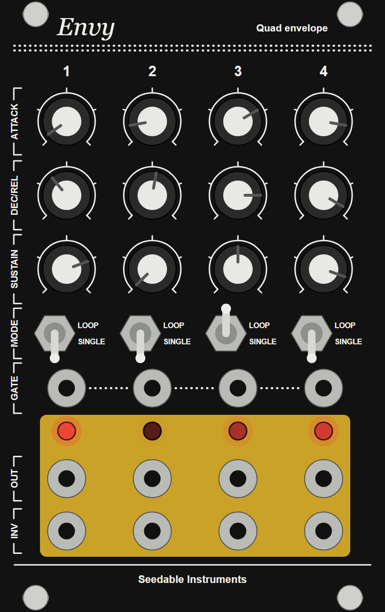

# Envy — quad envelope

Four Moritz Klein envelopes (the MKI x ES.EDU EG kit's circuit) in 16HP
Eurorack, all analog (6 × TL074). Each channel has ATTACK, a shared
DEC/REL, SUSTAIN, a LOOP / SINGLE toggle, OUT, an inverted INV and an LED.
The gates normal down the column, so one gate fires all four. A few
changes over the kit:

- the burst no longer depends on the gate's level;
- INV mirrors OUT instead of clipping;
- Schottky steering diodes give a cleaner floor.

Built the Marblesy way, with Thonk panel parts.



## Status

| Part | Status | Files |
|---|---|---|
| Panel layout, drill template, artwork | Draft, awaiting review | `hardware/tools/panel.py`, `hardware/panel/` |
| Circuit plan | Done, with five open choices | [docs/design.md](docs/design.md) |
| Netlist, EasyEDA schematic, PCB placement, panel PCB | Not started | |

## Files

```
docs/design.md            behaviour, circuit, changes from the kit, op-amp map, power, panel, parts, choices
hardware/
  tools/
    circuit.py            panel parts and their placement; the netlist goes here next
    panel.py              hole list, drill template and the panel artwork from the placement
  panel/
    envy-panel-holes.csv, envy-panel-drill.svg
    envy-panel.svg        panel artwork (groups: copper, silk, holes, mockup), envy-panel-preview.png
```

Regenerate from `hardware/tools`:

```bash
python circuit.py && python panel.py
```
