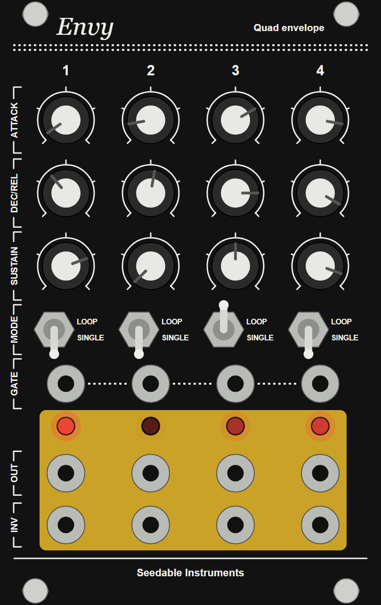

# Envy — design notes

Four Moritz Klein envelopes in 16HP Eurorack, all analog. Each channel is the
MKI x ES.EDU EG (`EG_MANUAL_v3.pdf` in the Manuals folder): a pseudo-ADSR with
attack, a shared decay/release, sustain, a LOOP mode, an output and an
inverted output, and an LED. The gates normal down the column, so one gate
can fire all four. Reference designators match `hardware/tools/circuit.py`.

Status (2026-10-31): panel draft and circuit plan. The netlist starts
once the panel and the [open choices](#open-choices) are agreed.

---

## What it does

Per channel k:

| Control | Range | Notes |
|---|---|---|
| GATE k | trips at 2.55 V | Unpatched, GATE k takes GATE k−1; GATE 1 sits at 0 V |
| ATTACK k | fastest about 0.3 ms, slowest a 1 s time constant | A1M, clockwise = slower |
| DEC/REL k | fastest about 0.3 ms, slowest a 1 s time constant | One knob for decay *and* release, as on the kit |
| SUSTAIN k | 0 … peak | A100k. At full, the decay disappears |
| MODE k | LOOP (up) / SINGLE (down) | LOOP ignores the gate |
| OUT k | 0 … about 9.7 V | 1 kΩ series |
| INV k | about 9.7 … 0 V | Mirrors OUT: rests high and dips during the envelope |
| LED k | brightness follows OUT | Starts glowing at about 2.5 V |

### How the kit's envelope works

The gate drives two comparators.

- **Gate comparator.** Its output, through a diode, is 0 V or about 10 V for
  as long as the gate is high. SUSTAIN divides it down; that level feeds
  the input buffer through 100k.
- **Burst comparator.** It sees a high-passed copy of the gate, so it
  outputs a full 10 V burst of about 14 ms on each rising edge. The burst
  reaches the buffer through a diode alone, so it wins over the sustain
  level.

The buffer charges the 1 µF timing cap through ATTACK, and the cap
discharges through DEC/REL. Each pot has its own steering diode. So:

1. The burst pulls the cap towards the peak (attack).
2. When the burst ends, the cap falls back to the sustain level through
   DEC/REL (decay).
3. When the gate ends, it falls to 0 V through DEC/REL (release).

A second buffer copies the cap to OUT. The kit's two caveats stay, because
they are what makes the circuit this small:

- Decay and release share one knob.
- With a slow attack, the cap does not reach the peak during the 14 ms
  burst, so the decay phase shrinks and then vanishes. ATTACK past about
  10 o'clock gives an AR-shaped curve towards the sustain level.

**LOOP** switches the buffer's input from the gate side to a Schmitt
trigger that watches OUT. The trigger drives the buffer high until OUT
passes about 7.5 V, then low until OUT falls below about 0.5 V, then high
again. The result is an attack/release LFO between 0.5 and 7.5 V.

- With both knobs fully clockwise, a cycle takes about 4 s.
- With both fully counter-clockwise, it runs at audio rate.
- SUSTAIN and the gate do nothing in LOOP.

---

## Circuit

Per channel; all 1 % metal film, 100k unless marked.

```
GATE k tip ──10k──┬── GIN_k ─[+ gate comp]─ 1N4148 ─► G_k ──┬── 10k ── GND
 (lug: GATE k-1)  ├─100k─ GND        VREF ─[-]              ├── SUSTAIN A100k ─ GND
                  └─1N4148 to GND (clamps negative)         │     wiper ─ 100k ─► N_k
                                                             └── 1µ ── HP_k ─┬─ 10k ─ GND
                                                                            └─ 1N4148 to GND
HP_k ─[+ burst comp]─ 1N4148 ─► N_k        VREF ─[-]

MODE k (SPDT): SINGLE = N_k, LOOP = L_k ──► [+ input buffer] ── 100R ─┬─ BAT85 ─► ATTACK A1M ─┐
                                                                      └─ BAT85 ◄─ DEC/REL A1M ─┼─ C_T 1µ ─ GND
                                                                                               │
                         ENV_k ◄─ [output buffer +] ◄──────────────────────────────────────────┘
ENV_k ── 1k ── OUT k
ENV_k ── 100k ─[- inverter]─ 1k ── INV k          AXIS ─[+], 100k feedback
ENV_k ── BC548 base; collector +12 V; emitter ── 1k5 ── red LED ── GND
ENV_k ─[- loop Schmitt]─ 1N4148 ─► L_k ── 100k ── GND
        [+] = 100k to +12 V, 100k to GND, 100k from its output
```

Shared by all channels:

- **VREF** is 100k / 27k from +12 V, which gives 2.55 V, with 100 n. It
  feeds the − input of all eight comparators.
- **AXIS** is 100k / 68k from +12 V, which gives 4.86 V, with 1 µ. It feeds
  the + input of all four inverters, so INV = 9.71 V − ENV.

### Changes from the kit, and why

| # | Kit | Here | Why |
|---|---|---|---|
| 1 | One channel | GATE k normalled from GATE k−1 | One gate fires all four, each with its own shape (VCA, filter, pitch, FX send) |
| 2 | The high-pass takes the gate jack | The high-pass takes G_k, the gate comparator's output | The burst is the same 14 ms for 5 V and 10 V gates (kit: about 2.6 ms with a 5 V gate). The source also sees one 110k per input instead of four 1 µF / 10k high-passes on its edges |
| 3 | Jack straight to the comparators | 10k series, 100k pull-down, clamp diode | A negative LFO into GATE cannot push the TL074 into phase reversal (a false trigger), and a dangling cable reads 0 V |
| 4 | Threshold 3.8 V (100k / 47k) | 2.55 V (100k / 27k) | Margin for 5 V sequencer gates behind a 1 kΩ output into four normalled inputs; still far above noise |
| 5 | 1N4148 steering diodes | BAT85 Schottky | The kit's release leaves a 0.2–0.3 V tail for about a second (a 1N4148 at µA currents), which a linear VCA hears as bleed. BAT85 gets under 0.1 V |
| 6 | Inverter axis 6 V | 4.86 V | Kit: INV = 12 V − ENV, so it rests clipped at the op-amp's ~10.6 V and only reaches ~2.6 V. Here it mirrors OUT: 9.7 V at rest, about 0 V at the peak |
| 7 | 470 Ω LED resistor | 1k5 | About 5 mA at the peak instead of 16 mA, times four, on +12 V |
| 8 | 3 × TL072 per channel | 6 × TL074 for all four | Fewer sockets; comparators on their own chips (below) |

Everything else is the kit's values.

### Op-amp sections

Comparators sit on their own chips (U1, U4), away from the buffers and the
timing caps. Their 20 V edges are the module's only fast signals; the FM
drum's noise came from square waves running beside an op-amp.

| Chip | A | B | C | D |
|---|---|---|---|---|
| U1 | gate comp 1 | burst comp 1 | burst comp 2 | gate comp 2 |
| U2 | input buffer 1 | output buffer 1 | output buffer 2 | input buffer 2 |
| U3 | loop Schmitt 1 | inverter 1 | inverter 2 | loop Schmitt 2 |
| U4–U6 | the same for channels 3 and 4 | | | |

### Power

- **Header:** 2 × 5, 2.54 mm, shrouded. No +5 V is needed.
- **Reverse protection:** a 1N5819 in each rail. On +12 V the anode goes to
  the header; on −12 V the *cathode* goes to the header (the reversed −12 V
  diode on the older PCBs is the error to avoid).
- **Filtering:** 10 Ω and 47 µF per rail, and a 100 n pair beside every TL074.
- **Current, estimated:**
  - +12 V: about 45 mA typical and 80 mA at worst. The TL074s draw about
    34 mA (60 mA at their datasheet maximum), four LEDs at full add 19 mA,
    and each gate comparator sourcing G_k adds 1 mA.
  - −12 V: about 35 mA typical and 60 mA at worst.

### Times

- **Single mode:** C_T is 1 µF and the pots go to 1 MΩ, so each time
  constant runs to about 1 s. A full release (peak to 0.1 V) then takes
  about 4.5 s, and a slow attack reaches 95 % of the sustain level in
  about 3 s.
- **Fast settings:** the fastest full-scale edge takes a few tenths of a
  millisecond, so a filter does not click. The 100 Ω after the buffer and
  the TL074's output current limit (about 25 mA into 1 µF) set it.
- **Longer times:** the kit has an optional second timing cap (C11) that
  doubles the times. Here that is choice 3.

---

## Panel

16HP, in the house style: Offset's columns, frame and bracket labels.

- The channels are columns 18 mm apart, with their numbers on top.
- Knobs are at the top and jacks at the bottom, so cables hang away from
  the hands.
- Each row's word stands once in the left margin, on a bracket.
- The MODE toggles carry LOOP / SINGLE beside the lever.
- Dotted lines between the GATE jacks show the normal.
- The outputs (LED, OUT, INV) sit on the gold band.



| Row | Panel y (mm) | Parts |
|---|---|---|
| Channel numbers | 16.0 | silk |
| ATTACK | 25.5 | RV1, RV4, RV7, RV10: Alpha 9 mm A1M |
| DEC/REL | 41.0 | RV2, RV5, RV8, RV11: Alpha 9 mm A1M |
| SUSTAIN | 56.5 | RV3, RV6, RV9, RV12: Alpha 9 mm A100k |
| MODE | 70.0 | SW1–SW4: sub-mini SPDT ON-ON, 2.5 mm left of the column |
| GATE | 81.5 | J1–J4: Thonkiconn |
| LEDs | 90.5 | D1–D4: 3 mm red |
| OUT | 100.5 | J5–J8: Thonkiconn |
| INV | 111.5 | J9–J12: Thonkiconn |

- **Columns:** channel x is 14, 32, 50 and 68 mm.
- **Clearances:** `panel.py` reports no gap under 1 mm (knob scales with a
  0.6 mm margin, nuts, and the toggle levers thrown both ways). The
  tightest gap is 1.02 mm, between a lever thrown up and the SUSTAIN
  scale above it.
- **Spacing against Offset:** the knob rows are 15.5 mm apart, against
  Offset's 21.5 mm. The knobs are the same 10 mm, so 5.5 mm of panel lies
  between caps.

---

## Lessons from the earlier boards

| Lesson | From | Here |
|---|---|---|
| 2.54 mm power header | Compressor, FM, Clap, CB/RM had 2.00 mm | 2 × 5 2.54 mm shrouded |
| −12 V protection diode the right way round | every module PCB so far | cathode on the header pin |
| DIP-14 rows 7.62 mm apart | Kick, Mixer, Output (8.89 mm, legs bent) | `fp_dip(14, "DIP-14-W7.62-P2.54")` |
| Alpha pot shaft 4.0 mm from the PTV09A origin | Marblesy, Plaitsy | `POT_SHAFT = 4.0` in `circuit.py` |
| Decoupling next to each chip | Marblesy routing | a 100 n pair per TL074, placed before routing |
| One unbroken ground pour | Compressor's six islands | checked in the copper audit |
| Fast edges away from quiet nodes | FM drum noise | comparators on U1 / U4; timing caps and buffers on U2 / U5 |

---

## Parts (estimate)

| Qty | Part | Notes |
|---|---|---|
| 12 | Thonkiconn PJ398SM | GATE, OUT, INV |
| 8 | Alpha 9 mm A1M | ATTACK, DEC/REL. Check Thonk has A1M before ordering |
| 4 | Alpha 9 mm A100k | SUSTAIN |
| 4 | Dailywell 2MS1 sub-mini toggle, SPDT ON-ON, PCB pins | the kit's part is 2MS1T1B5M2RE |
| 4 | 3 mm red LED | |
| 4 | BC548 | LED drivers |
| 6 | TL074 + DIP-14 sockets | |
| 20 | 1N4148 | five per channel |
| 8 | BAT85 | steering, two per channel |
| 2 | 1N5819 | power |
| 8 | 1 µF film, 5.08 mm | C_T and the high-pass, two per channel (+4 if choice 3) |
| 15 | 100 n ceramic | a pair per TL074, a pair at the power entry, VREF |
| 1 | 1 µF ceramic | AXIS |
| 2 | 47 µF 25 V | bulk |
| ~66 | resistors | 100k ×34, 10k ×12, 1k ×8, 1k5 ×4, 100 Ω ×4, 27k, 68k, 10 Ω ×2 |
| 1 | 2 × 5 shrouded header, 2.54 mm | |

About 133 parts behind the panel and 32 on it.

---

## Open choices

1. **Width and channel count.** 16HP with four channels is drawn; your
   voice-case list had 16HP for a quad ASR. 14HP also fits, with 15.5 mm
   columns (Offset's density). Six channels would need about 24HP.
2. **One board or the two-board stack.** 133 parts behind the panel is
   more than one 16HP board holds at the kit's density, which is about
   95 mm² per part (one board has 8,600 mm²). I recommend the stack: a
   faceplate board with the panel parts, the LED drivers and the output
   resistors, and a main board with the rest, joined by headers at
   identical coordinates. It ends up about 30 mm deep.
3. **Longer times.** Options:
   - footprints for a second timing cap per channel (the kit's C11, unfitted
     by default);
   - fit it on channels 3 and 4 only, for pads and slow swells;
   - a range switch, which costs a toggle per channel and panel room this
     layout does not have.
4. **Gate threshold.** 2.55 V is drawn, so 5 V gates have margin. The kit's
   3.8 V is the faithful option.
5. **Name.** "Envy" (ENV + the house -y), subtitle "Quad envelope".
