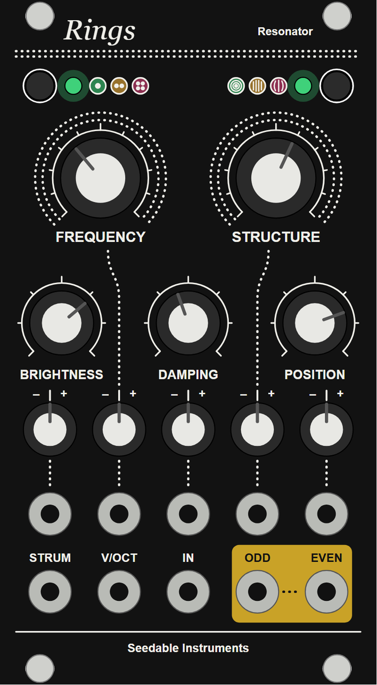

# Ringsy — a Rings clone on a Daisy Seed

A Mutable Instruments Rings clone for Eurorack, 14HP like the original,
built the way [Plaitsy](../plaits/README.md) and
[Marblesy](../marbles/README.md) are: two stacked PCBs behind a PCB panel,
Thonk panel parts, and a Daisy Seed on Rob Heel's
[seed_power_opamps](https://oshwlab.com/scape_rob/seed_power_opamps)
breakout. The firmware will be a port of Mutable's open-source Rings code
to libDaisy with the Daisy bootloader, so the official
[Rings manual](https://pichenettes.github.io/mutable-instruments-documentation/modules/rings/manual/)
applies as written.



## Status

| Part | Status | Files |
|---|---|---|
| Panel layout, drill template, artwork | Approved 2026-10-31 | `hardware/tools/panel.py`, `hardware/panel/` |
| Netlist (two boards), circuit values, Seed pin map, BOM | Done, checks at 0 problems | `hardware/tools/circuit.py`, [docs/design.md](docs/design.md) |
| EasyEDA Pro schematic, three pages | Done 2026-11-01, checks at 0 problems | `hardware/tools/easyeda_export.py`, `hardware/easyeda/Ringsy.epro2` |
| PCB placement, panel PCB | Next | |
| Firmware | Not started | |

## Panel

Rings' arrangement, with the rows taken from Mutable's own panel file
(`rings.ai`, its CAD layer): the polyphony and model buttons with their
LEDs and icons at the top, FREQUENCY and STRUCTURE large, BRIGHTNESS,
DAMPING and POSITION below them, five attenuverters over five unlabelled
CV jacks tied together by dotted guides, and STRUM, V/OCT, IN, ODD and EVEN
at the bottom, ODD and EVEN on the gold band. House style otherwise: black
mask, white silk, the shared title band and maker line.
`hardware/panel/rings-panel-vs-original.png` shows the panel beside the
original.

## Circuit

- Main board: the Seed on the breakout (power, audio in through its J5),
  two TL074 with six of Plaitsy's CV input stages and Rings' own ODD / EVEN
  output stage (an unpatched EVEN is mixed into ODD, in analog, as on
  Rings), Rings' STRUM transistor, the probe clamps.
- Faceplate: jacks, pots (eight through a 74HC4051), LED buttons, bicolour
  LEDs, and Rings' jack normals (FM fine tune, the probe into STRUM, V/OCT
  and IN).
- The output stage's input resistor is fitted after measuring the Seed's
  full-scale output (docs/design.md, "ODD / EVEN").

## Layout

```
README.md
docs/design.md                 what Rings needs, panel, circuit, Seed pin map, headers, checks, BOM, firmware plan
hardware/
  tools/
    circuit.py                 netlist (both boards), headers, PLACEMENT; netlist, circuit-value and front checks
    easyeda_export.py          EasyEDA Pro project: the schematic of both boards (builds on plaitsy/'s exporter)
    panel.py                   hole list, drill template and the panel artwork from the placement
  easyeda/
    Ringsy.epro2               import into EasyEDA Pro
    rings-easyeda-*.png        page previews
  panel/
    rings-panel-holes.csv, rings-panel-drill.svg
    rings-panel.svg            panel artwork (groups: copper, tint, silk, holes, mockup)
    rings-panel-preview.png, rings-panel-vs-original.png
```

Regenerate from `hardware/tools`:

```bash
python circuit.py && python easyeda_export.py && python panel.py
```

The exporter needs Pillow for the previews and the MorrisSynth library
cache in `plaitsy/hardware/easyeda/`.

The preview PNG is a headless-Edge screenshot of `rings-panel.svg` (see
docs/design.md).
