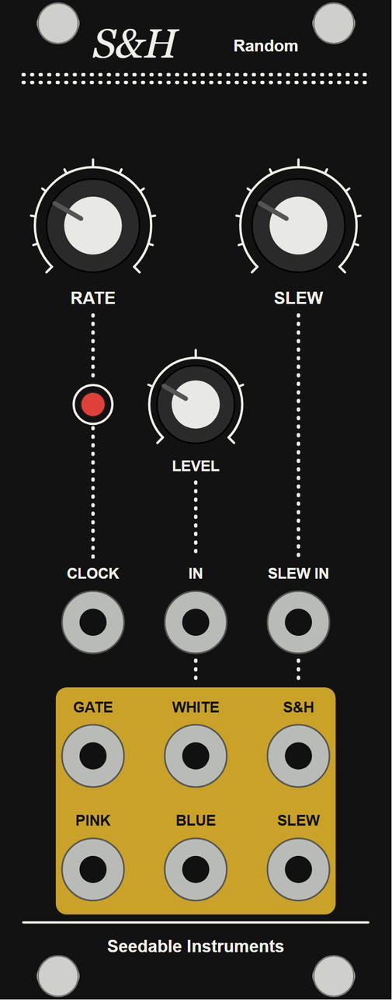

# S&H — sample & hold, noise and random

Moritz Klein's MKI x ES.EDU S&H/Noise, rebuilt in the house style: a
JFET sample & hold with its own clock and a slew output, plus white, pink
and blue noise. One addition: a random GATE output from the op-amp section
the MKI board leaves unused. 10HP Eurorack like the original, built the
Marblesy way: two stacked PCBs, Thonk panel parts, generated panel and
EasyEDA project.



## Status

| Part | Status | Files |
|---|---|---|
| Panel layout, hole table, drill template, artwork | Draft, waiting for review | `hardware/tools/panel.py`, `hardware/panel/` |
| Circuit plan | Draft, waiting for review | [docs/design.md](docs/design.md) |
| Netlist, schematic, PCBs, panel PCB | Not started | |

## Panel

| Control | Part | Notes |
|---|---|---|
| RATE | Alpha 9 mm B500k | Internal clock, 0.9–227 Hz (MKI: B250k, 1.8–227 Hz) |
| LEVEL | Alpha 9 mm B100k | Attenuates IN before the S&H |
| SLEW | Alpha 9 mm A1M | Glide time constant 0–0.47 s (MKI: B100k, 0–47 ms) |
| Clock LED | 3 mm red | Lights with the clock in use, internal or patched |
| CLOCK | Thonkiconn | Normalled to the internal clock; a 5 V gate triggers |
| IN | Thonkiconn | Normalled to white noise |
| SLEW IN | Thonkiconn | Normalled to the S&H output |
| GATE | Thonkiconn | New: high (+10 V) while the held voltage is above 0 V |
| S&H, SLEW, WHITE, PINK, BLUE | Thonkiconn | Outputs, 1 kΩ, on the gold block |

## How it plays

Unpatched, S&H gives a new random voltage on every flash of the LED and
SLEW gives the same sequence smoothed: stepped and smooth random from one
knob. GATE flips a coin on every clock. Patch the clock module into CLOCK to
lock all three to the tempo; patch an LFO into IN to quantise it in time;
use SLEW IN alone as a portamento for the sequencer's pitch CV.

Regenerate the panel files from `hardware/tools`:

```bash
python panel.py
```
