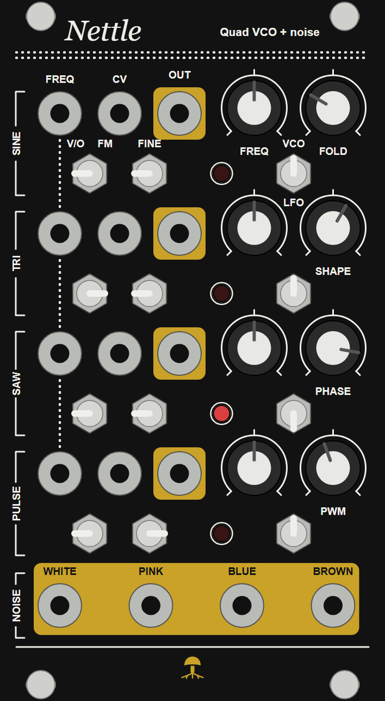

# Senay: a Vostok Sena clone

Four analog AS3340 oscillators and a four-colour noise bank in 14HP. Each
channel has one waveform and one voltage-controlled modifier: a sine with a
two-stage folder, a triangle that clips into a trapezoid, a saw summed with
a phase-shifted copy of itself, a pulse with PWM. FREQ inputs chain down
the rows, so one pitch CV plays all four; each channel switches between V/oct
and linear FM, coarse and fine tuning, VCO and LFO.

Built like Marblesy and the stereo mixer: panel first, one netlist in
Python, generated panel files and EasyEDA project. Two boards, SMD on
the rear.



Circuit, values, lessons applied, calibration and BOM: [docs/design.md](docs/design.md).

## Panel

| Row | Jacks | Knobs | Toggles | LED |
|---|---|---|---|---|
| SINE | FREQ, CV (fold), OUT | FREQ, FOLD | V/O–FM, FINE, VCO/LFO | rate |
| TRI | FREQ, CV (shape), OUT | FREQ, SHAPE | V/O–FM, FINE, VCO/LFO | rate |
| SAW | FREQ, CV (phase), OUT | FREQ, PHASE | V/O–FM, FINE, VCO/LFO | rate |
| PULSE | FREQ, CV (PWM), OUT | FREQ, PWM | V/O–FM, FINE, VCO/LFO | rate |
| NOISE | WHITE, PINK, BLUE, BROWN | | | |

16 jacks, 8 knobs, 12 toggles, 4 LEDs.

- **FREQ** takes V/oct (V/O) or audio-rate linear FM (FM, AC-coupled).
  Unpatched, it takes the row above's FREQ input.
- **FINE** turns the FREQ knob from about ±3 octaves into about ±2
  semitones round the calibrated pitch (C2 at 0 V).
- **CV** on the PWM row: with a cable in, the PWM knob attenuates it.

## Status

| Part | Status | Files |
|---|---|---|
| Panel | Drafted from Sena's own layout: hole list, drill template, artwork | `hardware/panel/`, `hardware/tools/panel.py` |
| Netlist | Done: 245 main-board parts, 53 faceplate parts, 44 nets over two headers (one per side edge), 10-pin power, no single-pin nets | `hardware/tools/circuit.py` |
| EasyEDA Pro project | Done: 8 schematic pages, 0 problems; both PCBs placed (SMD, unrouted), 0 placement problems; the panel PCB. Not yet opened in EasyEDA | `hardware/easyeda/Senay.epro2` |
| Routing | Not started (yours, in EasyEDA Pro; notes in design.md) | — |

Before ordering: the AS3340 pulse polarity, the toggle's hole and footprint
(design.md, "Open before ordering").

## Files

```
README.md
docs/design.md                    circuit, values, boards, routing notes, open points, calibration, BOM
hardware/
  tools/
    circuit.py                    the whole circuit, the board split, headers, panel positions: the source of truth
    easyeda_export.py             schematic pages, SMD and THT footprints, devices, project writer (+ previews)
    pcb.py                        both PCBs: anchors, the placer, checks, PCB documents, previews
    panel.py                      hole list, drill template, artwork
    panel_pcb.py                  the panel as the project's third PCB
  easyeda/
    Senay.epro2                   EasyEDA Pro 3.x project: Senay Main, Senay Faceplate, Senay Panel
    senay-easyeda-*.png           previews of the eight pages and the three PCBs
  panel/
    senay-panel.svg               artwork, 1:1 in mm
    senay-panel-preview.png       the same as a picture
    senay-panel-drill.svg         drill template, print at 100 %
    senay-panel-holes.csv         every hole: board origin, panel x/y from the top-left, diameter
```

In EasyEDA Pro, import `hardware/easyeda/Senay.epro2` as a project. To
regenerate after editing `circuit.py`, run from `hardware/tools`:
`python panel.py && python easyeda_export.py`.
