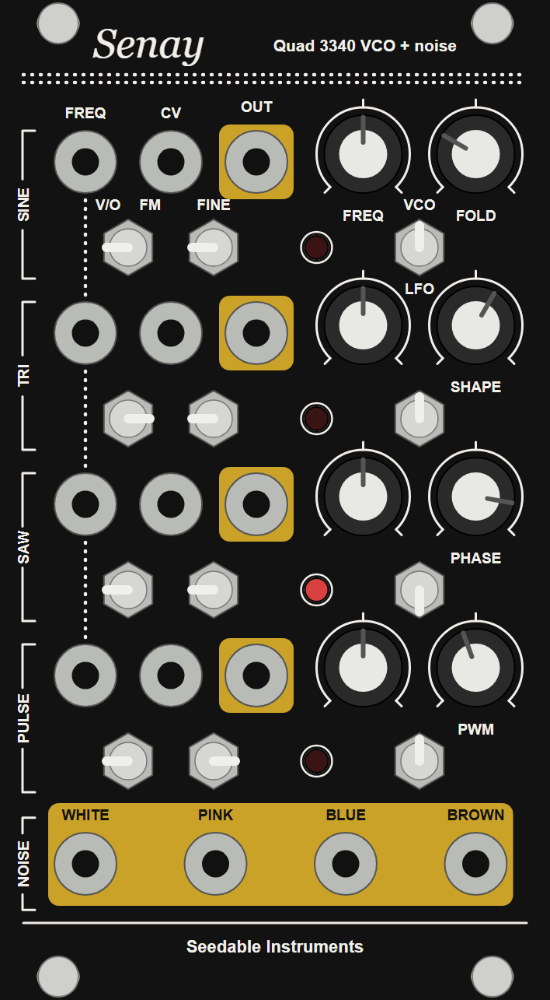

# Senay: design notes

A clone of the Vostok Instruments Sena: four 3340 oscillators, each with
one waveform and one voltage-controlled modifier, and an analog noise bank,
in 14HP. Vostok publishes no schematic, so the circuits here are designed
from the user manual's behaviour and the AS3340 datasheet. Everything is
generated from [`hardware/tools/circuit.py`](../hardware/tools/circuit.py).

## Panel

Sena's arrangement, row by row. The differences are deliberate:

| | Sena | Senay |
|---|---|---|
| Switches | slide switches | sub-mini toggles (Thonk / Tayda), same positions |
| Labels | every control in every row | columns named once over channel 1 (FREQ, CV, OUT, the toggles' positions, FREQ knob); each row named by its wave on a bracket in the left margin; the modifier word under each modifier knob |
| Outputs | white label boxes | bare-copper (ENIG) squares, and the noise row on a copper band |
| FREQ daisy chain | ⌥ mark on FREQ 1 | dots from each FREQ jack down to the next |
| Frame | title centred | the repo's frame: title, subtitle, band, rule and maker at the same spots as every other module |

A word over a lower row's CV jack sat just under the toggles of the row
above and read as theirs (the first draft), so the CV column is named once.

Holes: pots 7.5 mm, jacks 6.5 mm, LEDs 3.2 mm, toggles 6.0 mm. **The
toggle hole is not checked against the switch drawing yet** (6.0 fits an
M5 bushing with play; a 1/4-40 bushing needs 6.5). Check it with the
switches in hand before ordering the panel.

## Per channel: the core

AS3340 (pin-compatible with CEM3340 / V3340), on ±12 V.

| Pin | To | Why |
|---|---|---|
| 16 / 12 | +12 V / GND | 100 n at pin 16 |
| 3 | 560 Ω to −12 V, 100 n to GND | REE = (12 − 7.4) / 8 mA; the chip's own 7.4 V zener |
| 1, 2 | 27 k and 5.6 k to pin 3 | Rz and Rt, the tempco currents (Hordijk: Rt 5k6, Rz ≈ 26 k) |
| 14 | 1.5 k + 500 Ω trimmer to GND | Rs: **SCALE** (1 V/oct with the 100 k input) |
| 15 | summing node: 100 k (V/O), 160 k (FREQ coarse), 3.0 M (FREQ fine); 470 Ω + 10 n to GND | exponential CV |
| 13 | 1.2 M + 2 M trimmer from +5 V; 3.3 M from the FM coupling cap; 470 Ω + 10 n | reference current: **PITCH**, linear FM |
| 11 | 1 n C0G to GND; 47 n film to the VCO / LFO toggle | timing; LFO divides by 48 |
| 9 | 1 µ to GND | steadies the triangle's top (Alfa / Hordijk), and the reference for the triangle's centre |
| 10 | triangle 0..V9 (≈ Vcc / 3) | shaped on channels 1, 2; LED driver on all |
| 7 | GND | high-frequency tracking not used |
| 6 | open | no sync on Sena |

**FREQ input and the chain.** FREQ k → 1 k → TL074 follower (100 k input
impedance). The follower's output feeds the next channel's FREQ jack
through its switch lug, so a cable in FREQ 1 plays all four until another
FREQ jack breaks the chain there. V/O sends the follower through 100 k into
pin 15; FM sends it through 1 µF and 3.3 M into pin 13. Pin 13 sets the
current that the exponential converter multiplies, so FM there is linear
and keeps the same depth at every pitch: about ±50–70 % at ±5 V, depending
on the chip's reference-to-core ratio (2.2 M could pass 100 % and stall the
core on the negative peaks). The throw
not in use is held at GND by 1 M, so no floating trace hangs on a summing
node.

**FREQ pot and FINE.** B10k across ±5 V. FINE off: 160 k into pin 15,
about ±3 octaves (Sena: about 6 octaves). FINE on: 3.0 M, about ±2
semitones round the trimmed pitch (Sena: about 2 semitones). With FINE on
and nothing patched the oscillator sits on PITCH's C2.

**Ranges.** The core charges 1 nF between 0 and V9, so f ≈ I / (2 · 1 nF ·
V9). PITCH puts 0 V at C2 (65.4 Hz) with FINE on; the trimmer covers
about 30–130 Hz, enough for the spread in the chip's reference-to-core
ratio. VCO with the coarse pot: about 7.5–570 Hz before CV. LFO: the 47 n
in parallel divides by 48, about 0.16–12 Hz over the pot (Sena: 0.15–10 Hz).

**LED.** Triangle → 2N3904 emitter follower → 470 Ω → LED. It glows over
the top third of each cycle (blinks in LFO, steady at audio rate) and the
follower keeps the LED's current out of the triangle that channels 1 and 2
shape.

## The four modifiers

### 1 SINE + FOLD (LM13700 A, U6)

- **Sine.** The triangle drives OTA A's inputs without the linearising
  diodes: 27 k / 1 k on in+, and the triangle's centre (V9 / 2) on in−
  through 110 k / 2 k, the same ratio, so the sine stays symmetric without a
  trimmer. ±67 mV into the tanh gives 1.5 % THD (numerical model; ±50 mV
  would give 5 %).
- **FOLD** sets OTA A's Iabc, so it scales the sine's amplitude without
  changing its shape: 37 µA (0.32 V, no fold) to 240 µA (2.1 V). A 10 k
  transimpedance stage turns the OTA's current into X.
- **Folder.** An inverter makes −X; the summer (20 k in, 270 k feedback)
  takes X and four diode branches. Above one diode drop a branch from −X
  through 8.2 k subtracts twice the slope (first fold); above three drops a
  branch from X through 4.7 k adds it back (second fold). The values came
  from a sweep of a 1N4148 model: both folds peak at the same height
  (±4.3–5 V out) and the second completes at full FOLD, which is what Sena's
  manual describes ("fully folds twice"). Soft diode knees, like a Serge.

### 2 TRI + SHAPE (LM13700 B, U7)

The triangle at ±15 mV on OTA B (linear to 1 %). SHAPE sets Iabc from
125 µA to 810 µA, gain 1 to 6.5. The 100 k transimpedance has
back-to-back 4.7 V zeners across it: ±3.6 V triangle at minimum, clipped
at ±5.3 V into a trapezoid that steepens towards a square.

### FOLD and SHAPE control (one op-amp each)

Pot (B10k, CW to −5 V) into the inverting input through 33 k, an offset
from +5 V through 62 k, CV on the non-inverting input through 100 k / 39 k,
100 k feedback: Vc ≈ 1.6 × CV − 3.0 × pot − 8 V, about −8 to +7 V over
the pot, and ±5 V of CV covers the whole range (Sena: 10 Vpp). Vc feeds the
Iabc pin (two diode drops above −12 V) through 75 k (FOLD) or 22 k (SHAPE).

### 3 SAW + PHASE (U7)

A saw plus the same saw shifted by a fraction φ of a cycle is 2·saw + A·p −
A·φ, where p is a pulse of width φ that is high from the saw's reset. The
AS3340 makes exactly that pulse from its PW input (0 V = 0 %, V9 = 100 %),
so PHASE drives pin 5: pot 0..12 V through 91 k, CV through 75 k, 110 k to
GND, a BAT85 against negative CV. The summer adds 2 × saw (75 k), the pulse
scaled to one saw height (200 k), −PW (a copy of the PW network on its in+)
and an offset from −5 V (100 k). Both ends of PHASE are in phase; the middle
is the octave. The −PW term keeps the output centred while PHASE moves.

### 4 PULSE + PWM (U7)

PW = V9 / 2 (50 %) plus 0.37 × the PWM pot's wiper: 51 k from pin 9, 68 k
from the wiper, 180 k to GND. The PWM jack's switch lug carries +5 V, so
with nothing patched the pot is an offset up to about 96 %; with a cable in
it attenuates the CV, as on Sena. The pulse (0 to Vcc − 1.3 V, 51 k pull-down
as Alfa recommends) is centred by an inverting stage with an offset from
−5 V.

## Noise bank (U8, Q5)

- **Source.** A 2N3904's base-emitter junction in reverse avalanche (100 k
  from +12 V, collector open), AC-coupled into a non-inverting amp. Its gain
  is 1 + 100 k / (1 k + **LEVEL** trimmer 10 k), DC gain 1. Avalanche noise
  varies a lot between transistors; LEVEL covers ×10 to ×100.
- **WHITE** is that amp's output.
- **PINK.** Inverting amp, 10 k in, a ladder in the feedback: 1 M ∥ (330 k +
  47 n) ∥ (100 k + 15 n) ∥ (33 k + 4.7 n) ∥ (10 k + 1.5 n) ∥ 470 p.
  −2.98 dB/oct, ±0.7 dB, 20 Hz to 20 kHz.
- **BLUE.** The same ladder (without the 470 p) as the input element, 10 k ∥
  820 p feedback: +3 dB/oct, rolled off above 20 kHz.
- **BROWN.** Leaky integrator, 10 k in, 330 k ∥ 22 n: −6 dB/oct above 22 Hz.
- The three filters share one 10 µF coupling cap from the white amp. Levels
  relative to white (rms, 20 Hz–40 kHz): pink 1.1, blue 0.8, brown 0.7.

## Power

- 2 × 8 box header at **2.54 mm**, −12 V on pins 1–2 (red stripe).
- 1N5819 in each rail: +12 V anode on the header; **−12 V cathode on the
  header, anode to the board's −12 V** (the lesson of the ten module boards
  that have it backwards). 10 Ω and 10 µF per rail.
- 78L05 / 79L05 make ±5 V for the pots, the offsets and the pitch reference
  current (pitch follows the reference, so not the rails).
- 100 n pairs: one per op-amp chip, beside its supply pins; 100 n at each
  AS3340's pin 16 and pin 3.
- Estimated draw: about 65 mA on +12 V, 75 mA on −12 V (Sena: 130 / 130).

## Lessons from the earlier boards, applied

| Lesson (where it bit) | In Senay |
|---|---|
| 2.00 mm power header footprint (Compressor, FM, Clap, CB/RM) | 2.54 mm box header |
| −12 V protection diode drawn backwards (all ten module boards) | cathode on the header, written per pin in the netlist |
| TL074 footprint with 8.89 mm rows (Kick, Mixer, Output) | DIP-14 / DIP-16 at 7.62 mm rows (`fp_dip`) |
| Alpha shaft 4.0 mm from the PTV09A origin, not 0.53 (Marblesy, Plaitsy) | `POT_SHAFT = 4.0`; Alpha footprint |
| TO-92 footprint in BC549C order, 2N3904 had to be turned (Compressor) | transistor pins named E / B / C, footprint in 2N3904 order |
| LED symbol's pin names swapped (Compressor) | LED pin 1 = anode, 2 = cathode |
| VCO squares 0.2 mm from an op-amp summing node (FM drum) | pulses only on channels 3 and 4, LEDs from the triangle; summing nodes (pins 13, 15, the folder's S1) stay on the main board, short, no square nearby |
| A word between two rows reads as either's (stereo mixer) | row brackets; column words once on top |
| Count the slots before promising a layout (Plaitsy) | the area budget below |

## Open before the PCB stage

1. **The stack.** The main side has 254 parts. THT footprints add up to
   about 7,900 mm²; hand-routable density is about half that, so ≈ 15,800
   mm². One 14HP board is 7,500 mm². Options:
   - **A. 14HP, three boards** (faceplate + two main boards), THT: the
     oscillator cores and pitch CV on one, modifiers, noise and power on the
     other. Keeps Sena's width and your parts; about 40 mm deep.
   - **B. 14HP, two boards, SMD** (0805 + SOIC, JLC assembly): like the
     real Sena (30 mm deep). Needs SMD footprints in the generator and the
     AS3340D (SOIC) from a source JLC can use.
   - **C. 20HP, two boards**, THT: a new, wider panel; the main board is
     still as dense as the mixer's.
2. **Pulse polarity (PHASE).** The design assumes the AS3340's pulse is high
   from the saw's reset until the saw crosses the PW level (0 V = 0 %). If
   it is the other way round, the pulse term changes sign. Check one chip on
   a breadboard (saw and pulse on two scope channels) before ordering.
3. **PW full scale.** Taken as V9 (Vcc / 3, ≈ 3.7 V here), ratiometric like
   the datasheet's 5 V at 15 V. Channel 4's 50 % point comes from pin 9 for
   that reason.
4. **Toggle bushing**: see Panel.
5. **AS3340 sourcing**: Thonk, Electric Druid, Tayda carry the DIP. The A
   version (AS3340A) is the better one.

## Calibration (per channel, 10 minutes warm)

All four calibrate at once: a cable in FREQ 1 reaches every channel through
the chain. V/O mode, FINE on, FREQ knobs at noon.

1. 0 V in: **PITCH** to C2 (65.41 Hz).
2. 2.000 V in: **SCALE** to C4 (261.6 Hz). PITCH sets the 0 V point and
   SCALE the slope, so one pass does it.
3. **LEVEL** (noise): WHITE about 10 Vpp on its peaks, not clipping.

## BOM (main side, as netlisted)

| Qty | Part | Notes |
|---|---|---|
| 4 | AS3340 (or AS3340A, CEM3340) | DIP-16, socketed |
| 4 | TL074 | DIP-14 |
| 1 | LM13700 | DIP-16 |
| 1 / 1 | 78L05 / 79L05 | TO-92 |
| 5 | 2N3904 | 4 LED followers, 1 noise source (try a few) |
| 8 | 1N4148 | folder |
| 2 | BZX55C4V7 | SHAPE clip |
| 1 / 2 | BAT85 / 1N5819 | PW clamp / reverse protection |
| 4 + 4 + 1 | Bourns 3296W 500 Ω, 2 MΩ, 10 kΩ | SCALE, PITCH, LEVEL (multi-turn) |
| 4 | 1 nF C0G (or polystyrene) | timing |
| 4 + 4 | 47 nF, 1 µF film | LFO caps; FM coupling |
| 4 | 3.3 MΩ, 3.0 MΩ, 1.2 MΩ each | FM depth, FINE, reference current (1 % metal film goes this high) |
| ~165 | 1 % metal film resistors | values in circuit.py |
| ~50 | ceramic caps | 100 n, 10 n, 1 µ, small values |
| 6 | electrolytics | 10 µ ×4, 1 µ ×2 |
| 1 | 2 × 8 box header, 2.54 mm | power |

Panel side: 16 Thonkiconn, 7 Alpha 9 mm B10k, 1 Alpha B100k (PWM), 12
sub-mini SPDT on-on toggles (Dailywell 2MS1T1B1M2QES or equal, PCB pins),
4 × 3 mm LEDs, 8 knobs.
