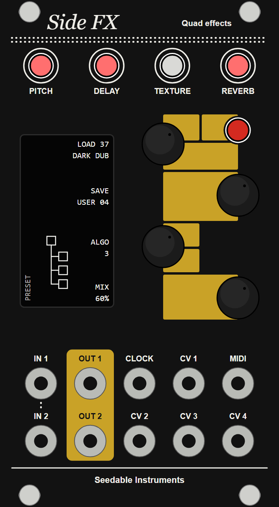

# Side FXy — a RYK SIDE FX clone on a Daisy Seed

A clone of RYK Modular's SIDE FX (October 2026): a quad multi-effects
module that runs up to four effect blocks in seven serial and parallel
chain algorithms. It has four CV inputs, a clock input, MIDI in, internal
LFOs, a random source and an envelope follower. The original keeps its
presets on a microSD card; the clone keeps them in the Seed's own flash.
The clone is 14HP Eurorack like the original and built the Marblesy way: two stacked PCBs, Thonk panel parts, and the Daisy Seed on
Rob Heel's seed_power_opamps breakout.



## Status

| Part | Status | Files |
|---|---|---|
| Panel layout, drill template, artwork | Done (approved 2026-10-31) | `hardware/tools/panel.py`, `hardware/panel/` |
| Netlist | Done, 74 parts over two boards, checks pass; no SD card (presets in QSPI flash); the 74HC595 moved to the main board for the display's keep-out | `hardware/tools/circuit.py`, [docs/design.md](docs/design.md) |
| EasyEDA Pro schematic | Done, 4 A3 pages (main board 1, faceplate 2, panel note), every footprint assigned, drawing checked against the netlist | `hardware/easyeda/SideFXy.epro2`, previews `hardware/easyeda/side-fx-easyeda-*.png` |
| PCB placement | Done, both boards placed and net-assigned, not routed; every clearance, header and keep-out check at 0 | `hardware/tools/pcb.py`, previews `hardware/easyeda/side-fx-easyeda-pcb-*.png` |
| Panel PCB | Done: the panel as the project's third board, window milled out, gold band and block stack | `hardware/tools/panel_pcb.py` |
| Routing | Third export audited 2026-11-02 and the layout master; every fix from the first two audits is in the tracks. Before ordering: rebuild the copper pours (they are stale in this export) and export once more ([audit](docs/routing-audit-2026-11-01.md)) | `hardware/easyeda/SideFXy-routed.epro2`, `hardware/tools/copper_audit.py` |
| Firmware | Not started | |

## Panel

The arrangement follows the original: four send buttons across the top,
the screen on the left, and four soft knobs in a zigzag on the right, each
named by the display row beside it. The red SHIFT button sits at the top of
the knob stack, and ten jacks are in two rows. House style otherwise (title
band, gold output band, maker line). RYK's white block stack behind the
knobs is bare gold copper here.

| Control | Part | Notes |
|---|---|---|
| PITCH, DELAY, TEXTURE, REVERB | Thonk low-profile LED button, red | The four blocks' FX sends, lit = on. 5.5 mm caps; the original's are about 9 mm |
| SHIFT | Thonk low-profile LED button, red | |
| K1–K4 | EC11-type encoder with push, M7 threaded bushing, D shaft | Endless, so preset changes and page flips don't make values jump. Not found at Thonk; Tayda / Mouser |
| IN 1, IN 2, OUT 1, OUT 2, CLOCK, CV 1–4 | Thonkiconn | IN 2 normalled to IN 1 |
| MIDI | Thonkiconn stereo (TRS, type A) | Same panel hole as the mono jack |
| Screen | 1.9" IPS, 170 × 320, ST7789V2, SPI (Waveshare "1.9inch LCD Module") | Active area 22.70 × 42.72 mm, module 27.3 × 51.2 mm; window 23.7 × 43.7 mm |

## Why this screen

RYK's window measures about 26 × 42 mm, portrait, in their product photos.
The part couldn't be identified from those photos. The screen has to be about
42 mm tall so that each of the four knobs gets its own row, and narrow
enough to leave room for the knob stack in 14HP.

| Option | Visible area | Driver | Verdict |
|---|---|---|---|
| **1.9" IPS 170 × 320, ST7789V2** | 22.7 × 42.7 | Not in libDaisy: a small SPI + DMA driver to write; 170 × 320 × 16 bit = 109 KB frame, or 27 KB at 4 bit | **Chosen.** Same shape as the original's window, sharp, no burn-in, a few euros. IPS black is not OLED black: use a black UI and PWM the backlight |
| 2.42" OLED 128 × 64, SSD1309 | 27.5 × 55 (portrait) | libDaisy `oled_ssd130x` | True black, but only 64 px across in portrait, and the 37 mm wide glass collides with the knob column |
| 1.5" OLED 128 × 128 greyscale, SSD1327 | 26.9 × 26.9 | libDaisy `oled_ssd1327` | True black and 16 greys, but too short for four knob rows; a mostly static preset page burns in |

## Files

```
docs/design.md            pin map, circuits, headers, schematic notes, BOM, firmware notes
hardware/
  tools/
    circuit.py            the netlist, headers and the panel placement
    easyeda_export.py     builds SideFXy.epro2 (reuses ../../../plaitsy/hardware/tools/easyeda_export.py)
    pcb.py                the two PCBs: placement (rear sides and main board read from the routed export), checks, the PCB documents
    copper_audit.py       audits a routed export: nets, copper graph, clearances, holes, cutout, headers, panel
    panel.py              hole list, drill template and the panel artwork from the placement
    panel_pcb.py          the panel as a PCB document, from the same lists as the artwork
  easyeda/
    SideFXy.epro2         schematic, both PCBs placed (unrouted) and the panel PCB, generated
    SideFXy-routed.epro2  your routed export, the layout master
    side-fx-easyeda-*.png page and PCB previews
    side-fx-routed-*.png  the routed boards with the audit's items marked
  panel/
    side-fx-panel-holes.csv, side-fx-panel-drill.svg
    side-fx-panel.svg     panel artwork (groups: copper, silk, holes, mockup), side-fx-panel-preview.png
```

Regenerate from `hardware/tools`:

```bash
python easyeda_export.py && python panel.py
```

Import with File > Import > EasyEDA (Professional) > `SideFXy.epro2`, then
run Design > Check DRC on the schematics; [design.md](docs/design.md#schematic)
lists the floating-pin warnings to expect. The PCBs are placed but not
routed; [design.md](docs/design.md#routing-notes) has the routing notes.

## Open questions

- The panel gap: the placement assumes about 7 mm between panel and
  faceplate (the module is about 4 mm plus 2 mm of parts on its back; its
  connector gets a cutout). Measure a Thonkiconn on a board before ordering.
- Encoder height: an EC11's body is lower than a Thonkiconn, so the bushing
  may need a washer. Check against the part that gets ordered.
