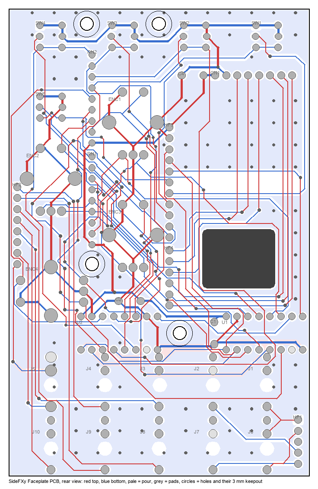

# Side FXy routing audit, 2026-11-01

## Fourth export, `ProPrj_SI FX_2026-11-02(1).epro2`: clean

The pours are rebuilt. The faceplate now has seven GND_F pour pieces: one
over each whole layer and small ones by HF2 and in the jack strip.

Every GND_F pad, HF1.3 and HF2.6 are in one connected piece, and no other
net's copper lies inside the pours. Nothing is under 0.127 mm. The only
spot under 0.152 mm is the BTN_K3_F via at (34.0, 47.4), which
BTN_TEXTURE_F passes exactly on the rule, as in every export.

The cutout and the jack barrels stay clear:

- ENC4_A_F is 2.3 mm from the barrel centre and OUT1_F 1.9 mm.
- Nothing is behind the display module.
- The two mounting holes keep at least 1.15 mm to the nearest signal track.

The main board, the headers and the panel are unchanged and clean. The
generator matches this export pad for pad and reports 0 PCB problems.

**One cosmetic leftover.** A floating sliver of GND_F, about 0.1 × 0.3 mm
(0.01 mm²), sits on the bottom layer at (64.1, 40.3). It is wedged between
the LCD_BL_F via at (64.0, 39.5), the LCD_RST_F via at (63.5, 40.5) and
ENC1_B_F at x 64.7.

It connects to nothing, so it is electrically harmless. A fab's DFM check
may still call it a sliver, which can lift off. If you want it gone, draw a
small no-copper area over it and rebuild.

This export is now `SideFXy-routed.epro2`, and this is the state to order
from. The checks still open from the design notes concern parts, not the
routing:

- measure the panel gap (about 7 mm assumed);
- check an EC11 and a PJ366ST against their footprints;
- order 1.6 mm FR4.

## Third export, `ProPrj_SI FX_2026-11-02.epro2`: rebuild the pours

Both items are fixed in the tracks:

- **Item 5, the cutout.** ENC1_A_F and ENC1_B_F now go round the cutout.
  Nothing is closer than 0.3 mm.
- **Item 6, the jack barrels.**
  - ENC4_A_F moved to y 23.5 on the bottom layer, 2.28 mm from J2's and
    J3's barrel centres, with its via at (31.5, 23.5), 4 mm from J3's.
  - OUT1_F moved to y 8.5, 1.88 mm from J6's barrel centre.
  - Both are now outside the 3 mm plug-tip area that Thonk's datasheet
    note describes.

**The pours were not rebuilt.** The faceplate's two `POURED` records are
identical to the second export's, while 30 track segments changed. In this
export the new tracks of eight nets therefore lie inside the old GND_F
copper:

- CV3_F
- ENC1_A_F
- ENC1_B_F
- ENC4_A_F
- ENC4_B_F
- IN2_F
- LCD_CS_F
- OUT1_F

That accounts for 25 "inside the GND_F pour" items. As exported, the
Gerbers would short all of those nets to ground.

Rebuild all copper areas in EasyEDA Pro, run DRC, and export once more.
Once the pours are rebuilt, the audit should show:

- GND_F in one piece;
- nothing under 0.127 mm.

Everything else checks out:

- **Tracks.** Nothing is under 0.152 mm between tracks, pads and vias,
  apart from the exact-0.152 via pass at (34.0, 47.4) that was there
  before.
- **Generator.** It matches the export pad for pad (0 PCB problems).
- **Headers, panel and main board.** Unchanged and clean.

This export replaces the second as `SideFXy-routed.epro2`: its placement
and tracks are the newest.

## Second export, `ProPrj_SI FX_2026-11-01(1).epro2`

Four of the five fixes are in. One item is still open, and one new item
came from the re-route. This export replaces the first as
`SideFXy-routed.epro2`. `easyeda_export.py` now reports 0 PCB problems, and
the generator agrees with the export pad for pad.

### Fixed

1. **H1 / HF1.** HF1 on the faceplate is now at 270°, like H1, so all five
   pins mate: IN to IN and OUT to OUT. The main board's copper is identical
   to the first export, track for track and via for via.
2. **GND_F.**
   - Poured on both layers, with 96 stitching vias.
   - Every piece is connected: the two whole-board pours, the small islands
     by HF2.6 and in the jack strip, all 17 GND_F pads, HF1.3 and HF2.6.
   - GND_D_F still never touches it.
3. **Mounting holes.** ENC4_A_F and BTN_DELAY_F were re-routed. The closest
   copper is now GND_D_F and SR_CHAIN, 1.15–1.20 mm from the edge of the
   hole at (39.6, 33.1), at the rim of the screw head. Only GND_F vias and
   ENC4's A pad remain near (19.3, 49.0).
4. **Gaps.** Nothing is under 0.127 mm. The only item under 0.152 mm is the
   same as before: BTN_TEXTURE_F passes the BTN_K3_F via at (34.0, 47.4)
   exactly on the rule.

### Still open

5. **Copper at the display cutout.** Unchanged:

   | Track | Layer | Segment | Gap |
   |---|---|---|---|
   | ENC1_A_F | top | (61.0, 57.45) to (63.01, 55.44) | 0.16 mm |
   | ENC1_B_F | bottom | (54.47, 64.05) to (64.67, 53.85) | 0.21 mm |

   Both pass the upper right corner of the cutout. Move each about 0.2 mm
   out.

### New

6. **Signal tracks under jack barrels on the panel side.** Thonk's jack
   datasheet, as Control quotes it, asks for a 3 mm hole under each barrel's
   centre, or no tracks or ground plane there, because a fully inserted
   plug's tip can reach the board. Two bottom-layer tracks now pass close
   to barrel centres:

   | Track | Segment | Distance from barrel centre |
   |---|---|---|
   | ENC4_A_F | along y 22.0, x 32.0–52.4 | 0.78 mm from J3's (34.8, 21.07) and J2's (47.3, 21.07) |
   | OUT1_F | along y 5.46, x 58.0–67.0 | 0.86 mm from J6's (59.8, 6.47) |

   ENC4_A_F matters most. It is a 3.3 V input on the 74HC165 with only its
   pull-up, so a ±10 V plug tip that wears through the mask would land on
   the chip.

   **Fix:** put those stretches on the top layer, with the vias outside the
   3 mm circles, or route round the barrels. Top-layer copper is on the far
   side of the board from the plug, so ENC4_B_F crossing J1–J3's centres on
   the top layer is fine.

   I called OUT1_F under J1 fine in the first audit (item 9 below). Thonk's
   note says otherwise.

   The GND_F pour now also lies under all ten barrels, with a few tented
   stitching vias 0.5–1.6 mm from their centres. A plug tip on ground can't
   hurt anything: it only grounds the plugged-in source through that
   module's output resistor. So clearing it is optional:
   - Option one: a 3 mm no-copper circle on the bottom layer at each barrel
     centre.
   - Option two: the datasheet's 3 mm holes. These would also need ENC4_B_F
     moved off J1–J3's centres, and I would add them to the generator.

The barrel centres (PCB frame) are at y 21.07 for J1–J5 and y 6.47 for
J6–J10:

| x | Top row (y 21.07) | Bottom row (y 6.47) |
|---|---|---|
| 59.8 | J1 | J6 |
| 47.3 | J2 | J7 |
| 34.8 | J3 | J8 |
| 22.3 | J4 | J9 |
| 9.8 | J5 | J10 |

`hardware/easyeda/side-fx-routed-faceplate.png` marks items 5 and 6.

After fixing 5 and 6:

1. Rebuild the pours.
2. Run DRC.
3. Re-export.

The audit should then come back with nothing at the cutout and no signal
track within 3 mm of a barrel on the panel side.

## First export, `ProPrj_SI FX_2026-11-01.epro2`

This audits the first routed export of both Side FXy boards. The audit ran
in `hardware/tools/copper_audit.py`, Plaitsy's tool adapted to this module.
Additions over Plaitsy's version:

- the display checks: no lead behind the module, copper kept clear of the
  milled cutout;
- the panel window and slots;
- JLCPCB's limits: 0.127 mm spacing on 2 layers, 0.254 mm from a
  non-plated hole to a track;
- a marked render of each board.

The audit:

- rebuilds every pad from the footprints in the export;
- joins tracks, vias, pads and EasyEDA's computed pours (thermal spokes
  included) into one copper graph per net;
- compares the pads and nets with `circuit.py` and the generator's boards.

EasyEDA's DRC is still the last word.

Coordinates below are in the PCB frame that EasyEDA shows: mm, origin at the
bottom-left, looking at the top layer, which is the rear of the stack. "Top"
is the rear layer and "bottom" the panel side.

This export was the layout master until the second export replaced it (see
the last section).

`hardware/easyeda/side-fx-routed-faceplate.png` and
`side-fx-routed-main-board.png` show the routed copper with each item below
numbered on it. Red is the top layer, blue the bottom. The circles are the
mounting holes with their 3 mm keepout.

---

## Verdict

The main board is clean. All of these hold:

- every net is one piece of copper;
- nothing is under any clearance rule;
- the GND pour covers both layers;
- the analog lines are short and away from digital ones.

The faceplate is not ready. Its analog ground is not connected at all, and
a few tracks sit closer to holes, the cutout and each other than the fab
allows. The audio header that both boards share was moved with its pins in
opposite order on the two boards, which swaps the inputs and the outputs.
Five things to fix, all in EasyEDA, none of them a re-route of more than a
few nets.

---

## Must fix

### 1. H1 / HF1: the audio header's pins are mirrored (inputs and outputs swapped)

Both headers moved to the same spot, (67.0, 2.9–13.1), but at different
rotations:

| Board | Part | Layer | Rotation | Pin 1 at |
|---|---|---|---|---|
| Faceplate | HF1 | top | 90° | (67.0, 2.92), the lower end |
| Main board | H1 | bottom | 270° | (67.0, 13.08), the upper end |

The two rows therefore mate in reverse:

| Faceplate pin | Mates with main board pin |
|---|---|
| IN1_F | OUT2 |
| IN2_F | OUT1 |
| GND_F | GND (pin 3, unchanged) |
| OUT1_F | IN2 |
| OUT2_F | IN1 |

As built, the breakout's output drivers would feed the IN jacks, and the OUT
jacks would go to the codec inputs.

The bottom-layer mirror is not the cause. A 1×N header's pads lie on its own
axis, so the same rotation lines up on both layers.

**Fix:** give both headers the same rotation.

- **Option A, main board (recommended):** set H1 to 90° and re-route IN1,
  IN2, OUT1 and OUT2 to its pads. Pin 1 (IN1) is then at the bottom. Then
  rebuild the pour.
- **Option B, faceplate:** set HF1 to 270° and re-route the four lines
  there.

Option A is the easier one:

- The IN lines become two short hops to the breakout's J5-1 / J5-3 at
  x 62.3.
- The OUT lines pass between the breakout's J5 pads on the bottom layer to
  its J4 at x 47.1. The gaps between those pads take one 0.3 mm track each.

`python easyeda_export.py` reports this as 4 PCB problems
(`header H1 pin …`) until the export is fixed.

### 2. GND_F is not connected: every jack sleeve floats

The faceplate has no copper pour and no GND_F tracks. All 17 GND_F pads are
on their own:

- the sleeves and switch lugs of the jacks;
- HF1.3 at (67.0, 8.0);
- HF2.6 at (2.0, 54.1).

As routed, no jack's sleeve reaches ground. CV 1–4, CLOCK and IN 1 also
lose their normalling to ground.

**Fix:**

1. Add a GND_F copper area on the bottom layer (the panel side) over the
   whole board, as in the routing notes.
2. Rebuild all copper areas.
3. Check that the jack strip, HF1.3 and HF2.6 all land in one island.

HF2.6 sits on the left edge, 25 mm above the jack rows, past ENC4. If the
pour cannot reach it there, run a 0.6 mm GND_F track from HF2.6 down to J10
or J5's sleeve. GND_D_F must stay a separate net: they meet only on the main
board.

### 3. Two tracks 0.2 mm from a mounting hole

JLCPCB wants 0.254 mm between a non-plated hole and a track, and both
tracks sit under the M3 screw head on the panel side:

- **ENC4_A_F**, bottom layer, (35.9, 31.15) to (46.4, 31.15): 0.20 mm from
  the edge of the hole at (39.6, 33.1). The 0.6 mm GND_D_F track below it at
  y 30.56 is 0.14 mm from it (item 4).
- **BTN_DELAY_F**, bottom layer, from (18.1, 52.64) via (19.9, 50.84) and
  (20.2, 50.84) to (23.2, 47.84): 0.19 mm from the edge of the hole at
  (19.3, 49.0).

**Fix:** take both round the outside of the 3 mm keepout circle, or at the
very least 0.3 mm from the hole edge.

### 4. Track gaps under the fab's minimum

Two pairs are 0.12 mm apart, under JLCPCB's 0.127 mm for 2-layer boards:

| Nets | Layer | Where |
|---|---|---|
| LCD_DC_F / ENC2_A_F | bottom | LCD_DC_F along y 41.5 (x 40.5–62.5), ENC2_A_F along y 41.92 (x 45.8–52.3), centres 0.42 mm apart |
| GND_D_F (0.6 mm) / ENC1_B_F | top | GND_D_F at x 28.8 (y 65.3–74.3), ENC1_B_F at x 28.23 (y 67.95–69.32) |

Six more pairs are 0.13–0.151 mm apart. That is legal at JLCPCB but under
the 0.152 mm that EasyEDA's other rules use. Most are a 0.6 mm power track
at 0.6 mm centre spacing from a 0.3 mm one:

| Nets | Gap | Where |
|---|---|---|
| 3V3D_F / BTN_PITCH_F | 0.13 mm | bottom, near (18.8, 39.8) |
| GND_D_F / ENC4_A_F | 0.14 mm | item 3's spot, so moving ENC4_A_F fixes both |
| 3V3D_F / SR_CHAIN | 0.150 mm | bottom, y 36.3–36.9, x 35–48.5 |
| 3V3D_F / ENC3_B_F | 0.151 mm | bottom, near (35, 38.5) |
| 3V3D_F / ENC4_B_F | 0.150 mm | top, x 16.9–17.5, y 47–77 |
| 3V3D_F / BTN_DELAY_F | 0.150 mm | top, x 17.5–18.1, y 57–70 |

The template's track-to-track rule appears to be 0.102 mm (4 mil): it is
the first entry of the safe-spacing table, while everything else there is
0.152. That would be why DRC passed these.

**Fix:** set track to track to 0.152 mm in Design Rules > Safe Spacing, run
DRC, and nudge what it lists.

### 5. Copper at the display cutout

The cutout is milled at x 44.9–61.6, y 43.5–57.0. Two tracks pass its upper
right corner too closely:

| Track | Layer | Segment | Gap |
|---|---|---|---|
| ENC1_A_F | top | (61.0, 57.45) to (63.01, 55.44) | 0.16 mm |
| ENC1_B_F | bottom | (54.47, 64.05) to (64.67, 53.85) | 0.21 mm |

JLCPCB wants 0.2 mm from copper to a milled edge, and the generator keeps
0.3 mm.

**Fix:** move both about 0.2 mm out, round the corner.

After the fixes:

1. Rebuild the pours.
2. Run DRC.
3. Re-export.
4. Run `python copper_audit.py <export>`.

You should see:

- GND_F in one piece;
- nothing under 0.127 mm, no NPTH warning, nothing at the cutout;
- 0 header pins out of line.

---

## Worth a look

### 6. Other copper under the standoffs and screw heads (faceplate)

Within the 3 mm circles, besides item 3:

| Copper | Layer | Distance |
|---|---|---|
| GND_D_F | bottom | 0.64 mm from the edge of the hole at (39.6, 33.1) |
| ENC4_B_F | top | 0.65 mm from the edge of the hole at (19.3, 49.0) |
| BTN_PITCH_F | bottom | 0.44 mm from the edge of the hole at (19.3, 49.0) |
| ENC4's A pad | — | 2.93 mm from the centre of the hole at (19.3, 49.0) |

All of it is under solder mask. A metal standoff or screw head that scratches
through could short a button line to GND_D_F.

Either clear the circles while you are re-routing items 3 and 4 anyway, or
use nylon washers at those two holes. On the main board only GND stitching
vias sit inside the circles, which is harmless.

### 7. Long logic lines

The shift-register lines are long:

| Net | Main board | Faceplate | Total |
|---|---|---|---|
| SR_CLK | 90 mm | 96 mm | about 19 cm |
| SR_LOAD | 99 mm | 92 mm | about 19 cm |

Both reach the 74HC595 on the main board and the two 165s on the faceplate.
At the GPIO's default slew (libDaisy's `GPIO::Speed::LOW`) that length is
harmless, so keep that speed for these two pins.

The display's SPI is 37 mm on the main board plus 56 mm on the faceplate,
plus the module's cable. Start the SPI clock modest and raise it on the
bench. Both points are in the firmware notes of `design.md`.

### 8. CV 3 and CV 4 run beside CLK_IN_F

CV3_F and CV4_F run 32 and 37 mm within 0.8 mm of CLK_IN_F along the left
margin (top layer). This is harmless: each CV input is always either driven
by a cable or grounded by its jack's switch lug, so a clock edge has nothing
to couple into. No action.

### 9. OUT1_F under J1

OUT1_F crosses under J1 on the panel side, 1.3 mm from its barrel's
centre. This first pass called it fine because it sits under the plastic
body. That was wrong: see the second export's item 6.

---

## Clean

- **Netlist.** Every pad net on both boards matches `circuit.py`. No pins or
  channels were swapped while routing, so the firmware's tables stand.
- **Connectivity, main board.** 54 nets, each one piece. GND is poured on
  both layers (one island per layer) with 178 stitching vias. No net touches
  another.
- **Connectivity, faceplate.** 45 of 46 nets are one piece; the exception is
  GND_F (item 2). GND_D_F runs as 0.6 mm tracks and never touches GND_F. No
  net touches another.
- **Main board clearances.** Nothing is under 0.152 mm. The closest are LCD
  lines 0.23 mm from unused Seed pads.
- **Display.** No pad behind the module.
- **Headers.** H2, H3 and H4 line up pin for pin.
- **Panel.** The 19 holes, the 4 mounting slots and the window equal
  `panel_pcb.py`'s to 0.01 mm.
- **Power and audio track widths.** All 0.6 mm:
  - 3V3D, 3V3A and ±12 V on the main board;
  - 3V3D_F and GND_D_F on the faceplate;
  - the faceplate's audio lines.
- **Main board, analog.** The CV stages' summing nodes (IN_CV1–4) are
  7.6 mm and the op-amp outputs (OA_CV1–4) 8.7 mm, each on one layer with no
  via. No analog line runs within 0.8 mm of a digital one on the same
  layer.
- **Main board, ADC lines.** These are longer than placed (50–112 mm, 1–2
  vias each) because the breakout moved away from the TL074. They run over
  the pour and are driven through the 1 k, so that is fine.
- **Edges.** Copper is 0.35 mm from the main board's edge and 0.55 mm from
  the faceplate's.

---

## What you changed while routing (now the generator's layout)

The routed export is the placement master from here, as for Marblesy and
Plaitsy.

- `pcb.py` reads the faceplate's rear side and the whole main board from
  `SideFXy-routed.epro2`.
- The panel parts stay on `circuit.PLACEMENT`.
- `routed_check()` fails the exporter if the generator and the routed
  boards ever disagree. With the first export they agreed pad for pad, and
  the only problems `easyeda_export.py` reported were item 1's four header
  pins. With the second export it reports 0.

### Moves on the main board

- **Breakout.** It moved 17.5 mm towards H1's side. Its pin rows are now at
  x 47.1 and 62.3, front view x 7.3–22.5. H3 and H4 stayed at front x 32.4,
  so they are no longer in the breakout's channel. That is fine, since the
  sockets are on the other layer.
- **Audio header (H1 / HF1).** Both moved from the jack strip's right end
  (front (62.5, 31), pins along x) to the bottom corner beside IN 2 (front
  x 2.6, y 2.9–13.1, pins along y). See item 1.
- **MIDI block.** U7, R26, R27 and C17 moved 4.5 mm towards the breakout. D2
  now stands vertical at x 28.5.
- **Bias.** R22, R23 and C14 moved 12.5 mm towards the breakout.
- **Clock stage.** Q1, R24, R25 and D1 moved 1.5 mm down.
- **C3.** It now lies flat below the 74HC595 at y 5.5.

### Moves on the faceplate

C2 moved 0.9 mm up.

### What did not change

The netlist, the mounting holes and every panel part.
