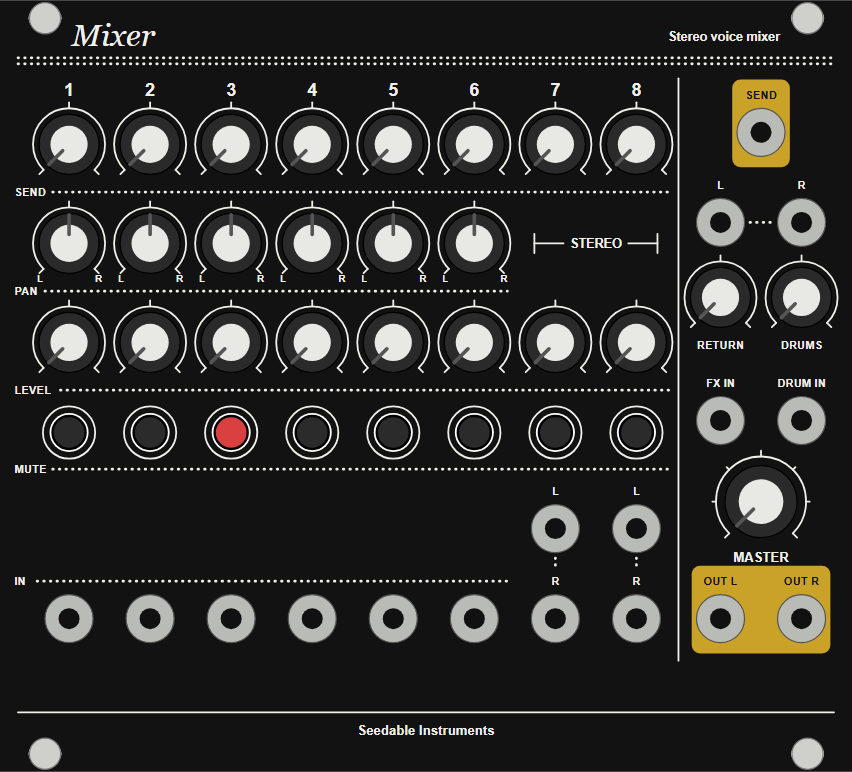

# Stereo mixer: master mixer for the Eurorack voice case

The voice case's stereo master, 28HP. It mixes six mono channels with pan,
two stereo channels, the Clouds return and the drum mixer's output, with
one send for Clouds. Every channel has an LED-button mute (lit = muted,
all open at power-up). OUT L / R go to the output module, so the rig ends
in stereo with the drums and the low end in the centre.

Analog audio path (4× TL074, DC-coupled, ±12 V), a CMOS latch for the
mutes, PhotoMOS switches. Built like Marblesy and Plaitsy: two stacked
PCBs behind a PCB panel, Thonk panel parts.



The circuit, values, placement, routing notes and BOM are in
[docs/design.md](docs/design.md).

---

## Panel

| Section | Controls | Jacks |
|---|---|---|
| Channels 1–6 (mono) | SEND, PAN, LEVEL, MUTE (LED button) | IN |
| Channels 7–8 (stereo) | SEND, LEVEL (dual-gang), MUTE (both sides) | IN L, IN R (R takes L when unpatched) |
| Return | RETURN (dual-gang) | L, R (R takes L when unpatched) |
| Drums | DRUMS | DRUM IN (drum mixer output, centred) |
| Send | — | FX IN (drum mixer send, into the send bus), SEND |
| Master | MASTER (dual-gang) | OUT L, OUT R |

25 knobs (4 dual-gang), 8 LED buttons, 17 jacks.

## Hooking it up

- **OUT L / OUT R** to the output module's IN 1 and IN 2, pans hard left
  and right, IN at noon or below (those stages have a gain of 2).
- **Mono check:** turn both of the output module's pans to the centre.
- **SEND** to Clouds IN L (IN R follows L); Clouds OUT L / R to **RETURN
  L / R**. Clouds' blend at full wet if the dry signal should come only
  from the channel strips.
- **Drum mixer:** its main output to **DRUM IN**, its send to **FX IN**,
  so the drums share Clouds' reverb.

---

## Status

| Part | Status | Files |
|---|---|---|
| Netlist | Done: main board 155 parts, faceplate 59, no single-pin nets, every header net used on both boards | `hardware/tools/circuit.py` |
| EasyEDA Pro project | Done: 6 schematic pages, 0 problems; both PCBs placed and net-assigned, 0 placement problems; the panel PCB. Not yet opened in EasyEDA | `hardware/easyeda/StereoMixer.epro2` |
| Panel | Done: hole list, 1:1 drill template, artwork | `hardware/panel/`, `hardware/tools/panel.py` |
| Routing | Not started (yours, in EasyEDA Pro; notes in design.md) | — |

## Files

```
README.md
docs/design.md                          circuit, mutes, gains, headers, panel, placement, routing, BOM
hardware/
  tools/
    circuit.py                          the whole circuit and the panel positions: the single source of truth
    easyeda_export.py                   schematic pages, footprints, devices, project writer (+ PNG previews)
    pcb.py                              both PCBs: placement, checks, PCB documents, previews
    panel.py                            hole list, drill template, artwork
    panel_pcb.py                        the panel as the project's third PCB
  easyeda/
    StereoMixer.epro2                   EasyEDA Pro 3.x project: Mixer Main, Mixer Faceplate, Mixer Panel
    stereo-mixer-easyeda-*.png          previews of the six pages and the three PCBs
    stereo-mixer-parts.epru             library parts from your MorrisSynth export (10R, 10 uF, box header)
  panel/
    stereo-mixer-panel.svg              artwork, 1:1 in mm
    stereo-mixer-panel-preview.png      the same as a picture
    stereo-mixer-panel-drill.svg        drill template, print at 100 %
    stereo-mixer-panel-holes.csv        every hole: board origin, panel x/y from the top-left, diameter
```

In EasyEDA Pro, import `hardware/easyeda/StereoMixer.epro2` as a project.
To regenerate after editing `circuit.py`, run from `hardware/tools`:

```bash
python easyeda_export.py && python panel.py
```

It needs Python with Pillow, and reads the library caches in the repo
(`plaitsy/hardware/easyeda/morrissynth-parts.epru`,
`stereo-mixer-parts.epru`, `marbles/hardware/easyeda/pcb-template.epru`).
