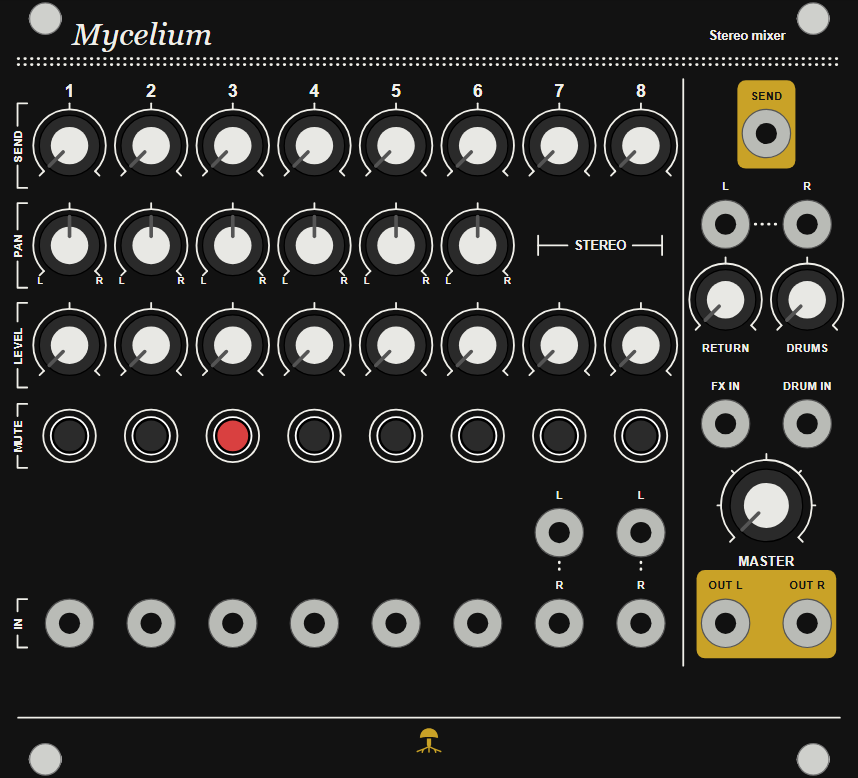

# Stereo mixer: master mixer for the Eurorack voice case

The voice case's stereo master, 28HP. It mixes six mono channels with pan,
two stereo channels, the Clouds return and the drum mixer's output, with
one send for Clouds. Every channel has an LED-button mute (lit = muted,
all open at power-up). OUT L / R go to the output module, so the rig ends
in stereo with the drums and the low end in the centre.

Analog audio path (4× TL074, DC-coupled, ±12 V), a CMOS latch for the
mutes, PhotoMOS switches. Built like Marblesy and Plaitsy: two stacked
PCBs behind a PCB panel, Thonk panel parts.

On the panel it is **Mycelium**, one of the voice case's Garden names
(2026-11-02), with the gold mushroom mark at the foot.



The circuit, values, placement and routing notes are in
[docs/design.md](docs/design.md); the BOM, with the Thonk parts in their own
table, is [docs/bom.md](docs/bom.md).

---

## Panel

| Section | Controls | Jacks |
|---|---|---|
| Channels 1–6 (mono) | SEND, PAN, LEVEL, MUTE (LED button) | IN |
| Channels 7–8 (stereo) | SEND, LEVEL (dual-gang), MUTE (both sides) | IN L, IN R (R takes L when unpatched) |
| Return | RETURN (dual-gang) | L, R (R takes L when unpatched) |
| Drums | DRUMS | DRUM IN (drum mixer output, centred) |
| Send | — | FX IN (drum mixer send, into the send bus), SEND |
| Master | MASTER (dual-gang) | OUT L, OUT R |

25 knobs (4 dual-gang), 8 LED buttons, 17 jacks.

## Hooking it up

- **OUT L / OUT R** to the output module's IN 1 and IN 2, pans hard left
  and right, IN at noon or below (those stages have a gain of 2).
- **Mono check:** turn both of the output module's pans to the centre.
- **SEND** to Clouds IN L (IN R follows L); Clouds OUT L / R to **RETURN
  L / R**. Clouds' blend at full wet if the dry signal should come only
  from the channel strips.
- **Drum mixer:** its main output to **DRUM IN**, its send to **FX IN**,
  so the drums share Clouds' reverb.

---

## Status

| Part | Status | Files |
|---|---|---|
| Netlist | Done: main board 159 parts, faceplate 59, no single-pin nets, every header net used on both boards | `hardware/tools/circuit.py` |
| EasyEDA Pro project | Done: 6 schematic pages, 0 problems; both PCBs placed and net-assigned, 0 placement problems; the panel PCB. Not yet opened in EasyEDA | `hardware/easyeda/StereoMixer.epro2` |
| Panel | Done: hole list, 1:1 drill template, artwork | `hardware/panel/`, `hardware/tools/panel.py` |
| Routing | Both boards routed and audited clean (third export 2026-11-02). Value labels re-placed, LED resistor values and a -12V mark patched in 2026-11-04; J18 re-routed, D903 / D904 / C907–C909 added and J18's pads grown by script 2026-11-14. Re-import it, rebuild the copper areas (minimum island about 2 mm²), then Gerbers | `hardware/easyeda/StereoMixer-routed.epro2`, `docs/routing-audit-2026-11-02.md`, `hardware/tools/copper_audit.py`, `hardware/tools/value_labels.py` |
| Tests | 1960 checks in 8 groups (2026-11-04, extended 2026-11-14). The first run found 37 findings; the same day the LED resistors (1k / 820 Ω), value labels, standoff length (11 mm), BOM and docs were fixed without touching copper. On 2026-11-13 J18 turned out to be on the wrong bus pins (GND on 3–10, +12 V on 11–12; Doepfer has +12 V on 9–10): fixed in circuit.py and re-routed at J18 in the routed master on 2026-11-14. The same day, in copper: D903 became a BAT85 from GND to POR, C907–C909 (4.7 / 4.7 / 10 pF C0G) give the output stages 66–72° of phase margin, D904 (BAT85) clamps a missing +12 V, J18's pads are 1.7 mm. 69 checks still fail: the open findings, the main one the PhotoMOS off capacitance (no DIP-4 part does better; a respin would cure it). A bench kit measures that one on a breadboard channel or a socketed channel (2026-11-15) | `hardware/tests/`, `hardware/bench/`, `docs/test-report-2026-11-04.md` |

## Files

```
README.md
docs/design.md                          circuit, mutes, gains, headers, panel, placement, routing
docs/bom.md                             the BOM, Thonk parts in their own table (generated by hardware/tools/bom.py)
docs/routing-audit-2026-11-02.md        what the copper audit found on the routed main board
docs/test-report-2026-11-04.md          what the test suite found
hardware/
  tests/
    run_tests.py                        runs the eight test groups (test_*.py); README.md says what each checks
  bench/
    mute_test.py                        bench kit for the mute PhotoMOS (M1): test signals, THD, IMD, null test
    README.md                           the breadboard stand-in, the takes, the predicted figures
  tools/
    circuit.py                          the whole circuit and the panel positions: the single source of truth
    easyeda_export.py                   schematic pages, footprints, devices, project writer (+ PNG previews)
    pcb.py                              both PCBs: placement, checks, PCB documents, previews
    panel.py                            hole list, drill template, artwork
    panel_pcb.py                        the panel as the project's third PCB
    copper_audit.py                     audits a routed export: nets, copper, clearances, standoffs, audio, headers
    value_labels.py                     adds silkscreen value labels to a routed export
  easyeda/
    StereoMixer.epro2                   EasyEDA Pro 3.x project: Mixer Main, Mixer Faceplate, Mixer Panel
    StereoMixer-routed.epro2            your routed export with value labels: the layout master, order from this
    stereo-mixer-labels-*.png           where the value labels landed
    stereo-mixer-easyeda-*.png          previews of the six pages and the three PCBs
    stereo-mixer-parts.epru             library parts from your MorrisSynth export (10R, 10 uF, box header)
  panel/
    stereo-mixer-panel.svg              artwork, 1:1 in mm
    stereo-mixer-panel-preview.png      the same as a picture
    stereo-mixer-panel-drill.svg        drill template, print at 100 %
    stereo-mixer-panel-holes.csv        every hole: board origin, panel x/y from the top-left, diameter
```

In EasyEDA Pro, import `hardware/easyeda/StereoMixer.epro2` as a project.
To regenerate after editing `circuit.py`, run from `hardware/tools`:

```bash
python easyeda_export.py && python panel.py
```

It needs Python with Pillow, and reads the library caches in the repo
(`plaitsy/hardware/easyeda/morrissynth-parts.epru`,
`stereo-mixer-parts.epru`, `marbles/hardware/easyeda/pcb-template.epru`).
