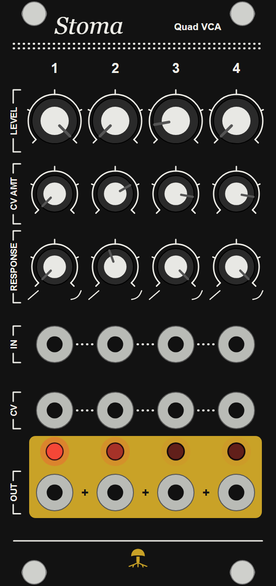

# Veilsy — quad VCA

Four VCAs on SSI2164 in 12HP Eurorack, all analog (2 × SSI2164, 5 × TL074),
on two through-hole boards. It works the way Mutable's Veils (2020) does.
Each channel has a signal input, a gain CV with its own CV AMT knob, a
LEVEL knob that offsets the CV, a RESPONSE knob from linear to exponential,
an output and a gain LED. The inputs and CVs normal down the columns. An
unpatched output adds into the next one, so the module is also a 4 → 1
mixer, or two pairs (1+2, 3+4).

The control circuits follow the SSI2164 datasheet's application notes. What
differs from Veils:
- The linear law is exact: a servo built from a second SSI2164 cell on the
  same die.
- A closed channel really closes (−104 dB).
- The LED reads the gain in dB whatever RESPONSE is set to.

Built the Marblesy way, with Thonk panel parts.

On the panel it is **Stoma**, one of the voice case's Garden names
(2026-11-02), with the gold mushroom mark at the foot.



## Status

| Part | Status | Files |
|---|---|---|
| Panel layout, drill template, artwork | Approved (RESPONSE knobs) | `hardware/tools/panel.py`, `hardware/panel/` |
| Netlist, two boards | Done, 0 problems | `hardware/tools/circuit.py` |
| Simulation of the netlist | Done, all checks pass | `hardware/tools/sim.py`, [docs/design.md](docs/design.md#simulation) |
| EasyEDA schematic, PCB placement, panel PCB | Not started | |

Two choices are still open (normals, name); see
[docs/design.md](docs/design.md#choices).

## Files

```
docs/design.md            behaviour, circuit, netlist, simulation, panel, boards, parts, choices
hardware/
  tools/
    circuit.py            the netlist (faceplate + main board, headers), panel parts and their placement
    panel.py              hole list, drill template, panel artwork and the panel parts' board check
    sim.py                DC solve of the netlist (laws, normals, chain, LEDs) and the servo's step response
  panel/
    veilsy-panel-holes.csv, veilsy-panel-drill.svg
    veilsy-panel.svg      panel artwork (groups: copper, silk, holes, mockup), veilsy-panel-preview.png
```

Regenerate and check from `hardware/tools` (numpy for `sim.py`):

```bash
python circuit.py && python panel.py && python sim.py
```
