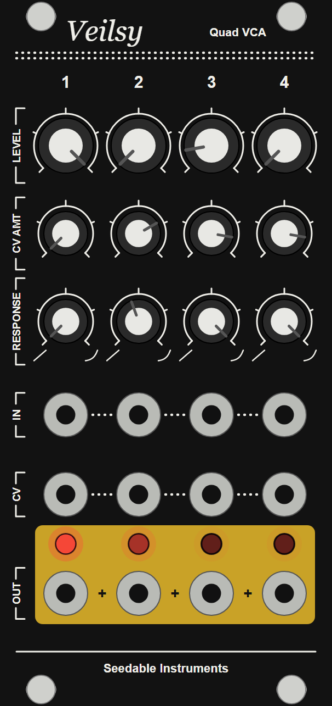

# Veilsy — design notes

Four VCAs on SSI2164 in 12HP Eurorack, all analog, in the spirit of
Mutable's Veils (2020). Per channel:
- a signal input;
- a gain CV with its own depth knob;
- a LEVEL knob that offsets the CV;
- a RESPONSE knob that blends continuously from a linear to an exponential
  law;
- an output that adds into the next channel when nothing is patched into it.

It is the Eurorack row's missing VCA: Senay → Atlasy → Veilsy, with Envy
shaping it. Reference designators match `hardware/tools/circuit.py`.

Status (2026-10-31):
- **Panel:** approved with RESPONSE knobs.
- **Build:** two through-hole boards (your choices).
- **Netlist:** written (`circuit.py`, 0 problems).
- **Simulation:** `sim.py` solves the netlist and passes every check (see
  [Simulation](#simulation)).
- **Next:** the EasyEDA schematic, then the placement of both boards.

Two choices are still open: the normals and the name. The netlist uses the
defaults (see [Choices](#choices)).

---

## What it does

Per channel k:

```
C k   = LEVEL k + CV AMT k × CV k                      (volts; 5 V is unity gain)
OUT k = G(C k, RESPONSE k) × IN k  (+ OUT k−1, when OUT k−1 is unpatched)
```

| Control | Range | Notes |
|---|---|---|
| LEVEL k | 0 … 5 V of control | The offset: alone it is a manual level; with a CV it sets the floor the CV moves from |
| CV AMT k | 0 … 1 | Depth of CV k. 5 V of CV at full depth is unity gain, 10 V is +6 dB (LIN) |
| RESPONSE k | LIN (CCW) … EXP (CW) | Continuous. LIN: gain = (C − 50 mV) / 4.95 V. EXP: 15 dB per volt, −76 dB at C = 0. Between: the two laws blended in dB (table below) |
| IN k | ±10 V, 100 kΩ, DC-coupled | Audio or CV. Unpatched, IN k takes IN k−1; IN 1 takes 0 V |
| CV k | ±10 V | Unpatched, CV k takes CV k−1; CV 1 takes 0 V. C ≤ 0 closes the channel |
| OUT k | 1 kΩ series | Unpatched, it adds into OUT k+1, so OUT 4 is the sum of every channel whose output is unpatched |
| LED k | red, brightness in dB | Follows the gain the audio cell gets, like Veils' gain LED: 2 mA at unity, 0.8 mA at −40 dB, 0.3 mA at −60 dB, out by −75 dB |

Gain (dB) over C at three RESPONSE settings, from `sim.py` (the netlist's
values):

| C | 0.5 V | 1 V | 2 V | 2.5 V | 3 V | 4 V | 5 V | 7.5 V | 10 V |
|---|---|---|---|---|---|---|---|---|---|
| LIN (CCW) | −20.8 | −14.3 | −8.1 | −6.1 | −4.5 | −2.0 | 0.0 | +3.5 | +6.1 |
| noon | −44.4 | −37.4 | −26.7 | −22.0 | −17.4 | −8.5 | 0.0 | +2.4 | +4.0 |
| EXP (CW) | −68.0 | −60.5 | −45.4 | −37.8 | −30.2 | −15.1 | 0.0 | +1.2 | +2.0 |

When the channel is closed:

| C | LIN | noon | EXP |
|---|---|---|---|
| 0 V | −104 dB | −90 dB | −76 dB |
| −5 V | −104 dB | −128 dB | −151 dB |

### What the normals and the chain are for

- **Pumping.** Envy's INV (9.7 V at rest, dropping to 0 V on each gate)
  into CV 1, LEVEL 1 at zero, CV AMT 1 about half way: the channel sits at
  unity and ducks on every kick. RESPONSE sets the shape of the duck: LIN
  gives a soft, even pump, EXP a hard gap that recovers late. Patch the pad's
  other side into IN 2 and CV 2 follows CV 1, so a stereo pad pumps as a pair.
- **Tempo-locked wobbles.** A clocked LFO into CV 3, a bass into IN 3,
  LEVEL 3 for the floor of the wobble, RESPONSE towards EXP for the vowel-like
  "wub" that spends longer near silence.
- **4 → 1 mixer.** Patch only OUT 4: it carries all four channels, each at
  its LEVEL (and its CV).
- **Two pairs (1+2, 3+4).** Patch OUT 2 and OUT 4: OUT 2 carries channels
  1 + 2 and OUT 4 channels 3 + 4. With CV 1 patched, channel 2 follows it, and
  with CV 3 patched, channel 4 follows that. So the two halves are a stereo
  VCA each, or two 2 → 1 mixes.
- **One voice, two envelopes.** A voice into IN 1 (IN 2 follows it), a
  pluck into CV 1 and a slow swell into CV 2, OUT 1 unpatched: OUT 2 is the
  voice under both envelopes added.
- **Autopan.** A voice into IN 1, an LFO into CV 1 and its inverse into
  CV 2, OUT 1 and OUT 2 to the mixer's left and right.

To use a channel alone, patch its output. An unpatched output still adds
into the next channel when its gain is above zero.

---

## Circuit

Two SSI2164s and five TL074s. The control circuits follow the SSI2164
datasheet's application notes (Sound Semiconductor, figures 1, 9 and 10:
"Zero to 5V linear and exponential control optimized for modular
synthesizers"). Every channel uses two cells on the same die, which the
datasheet asks for: one carries the audio, the other is the linear law's
servo. All resistors are 1 %; 100 k unless noted.

```
              IN k-1 (IN 1: GND)
                 │ switch lug
 IN k jack ──────┴─ tip ── 100k ──► audio cell (U1/U2) ──► [A −] I-V ── [B −] inverter ── 1k ── OUT k tip
                                         ▲ VC              ▲ 100k ∥ 22p                          │ switch lug
                                         │                 └── 100k ── OUT k-1 lug               └── 100k ──► I-V k+1
 LEVEL k:  +5 V ref ─ B10k ─ GND, wiper L ──┬──────────────┐
 CV k jack ─ CV AMT k: B100k to GND, wiper V ┼────────────┐ │
                                             ▼            ▼ ▼
   EXP [C −]: L, V, −5 V ref; 49k9 ∥ 100p; precision half-wave → Vc_exp = 0.5 (5 V − C), ≥ 0 V
   LIN [D −]: L, V, 10M from −5 V; servo cell (101k from −5 V) into the same node; 100p;
              → 4k7 → Vc_lin (servo cell's VC); BC557 clamp to 2.77 V      servo gain = (C − 50 mV) / 4.95 V
                                                   │
           RESPONSE k (B100k): Vc_lin (CCW) ── wiper ── Vc_exp (CW)
                                    │
                               [E +] follower ──► audio cell VC
                                    └── 1k ── 2 × 1N4148 ── LED ── +5 V (78L05)
```

### Audio path

- **Cell and I-V summer (A).** IN k goes through 100 k into the audio
  cell's input. The cell's output feeds an inverting summer (100 k ∥ 22 p),
  so the path is unity at 0 V control.
  - The SSI2164 behaves like a resistor: the current into its input comes
    out of its output. With the I-V stage, the path inverts (datasheet).
  - The datasheet's 220 Ω + 1n2 sits on every cell input.
  - At 10 V the cell carries 100 µA of its 1 mA.
  - 100 k is at the top of the datasheet's 7.5–100 k range. It gives the
    house's 100 k input impedance, and the fan-out normals need it. It costs
    some noise against the datasheet's 20 k.
- **Inverter (B)** puts the output back in phase with the input, so CV
  through a channel keeps its sign. It is also what makes the chain add:
  OUT k−1's switch lug feeds A of channel k through 100 k, and A inverts it
  along with channel k's own signal. A patched output opens its lug, and
  the next channel gets nothing from it. OUT 4's lug stays open.
- **Gain staging.** No ×2 anywhere, and the audio is never above its input
  level at unity. Four 10 Vpp channels summed at unity clip at ±10.5 V, as
  any unity mixer would. Each chain step reads the previous channel 1 % low
  (the 1 k output resistor into 100 k, as on Offset).
- **MODE pin open** (class AB): lowest noise and control feedthrough
  (datasheet; Atlasy does the same). The input is DC-coupled for CV work,
  so the datasheet's optional 10 µF series capacitor is left out.

### Control

- **C**, the control in volts, is never formed on its own. The LEVEL and
  CV AMT wipers each feed two summing nodes through 100 k, and both stages
  read the same C.
- **EXP (C)**, after the datasheet's figure 10.
  - An inverting summer of the two wipers and the −5 V reference, gain
    0.5 (49k9): Vc_exp = 0.5 (5 V − C). At −33 mV/dB that is 15 dB/V,
    unity at C = 5 V, −76 dB at C = 0. The datasheet uses 0.68 and
    −100 dB; the gentler slope keeps the RESPONSE blend useful across the
    knob.
  - A precision half-wave (two 1N4148, as Atlasy's summers) keeps Vc_exp
    at or above 0 V. Without it, 10 V of CV would ask the cell for +75 dB.
- **LIN (D): the datasheet's figure 9** (Irwin's linearization).
  - **The loop.** The two wipers and the servo cell's output meet at an
    integrator (100 p). The servo cell's input takes 49.5 µA from −5 V
    through 101 k. The integrator drives the servo cell's VC through 4k7
    until that cell's gain is (C − 50 mV) / 4.95 V. That voltage, Vc_lin,
    gives the audio cell beside it the same gain.
  - **The 10M bias.** 10M from −5 V into the summing node subtracts
    50 mV from C. A TL074C's offset (up to 10 mV, 20 mV of C) could
    otherwise hold a "closed" channel at about −58 dB instead of letting
    it close. The 101 k reference puts C = 5 V back at unity.
  - **The clamp.** A BC557 from Vc_lin to 2.77 V (10k / 3k from +12 V)
    holds a closed channel at −104 dB. The datasheet uses 1 k where we
    have 4k7; 4k7 keeps the clamp current at 1.5 mA instead of 7 mA per
    closed channel.
  - **Speed.** The loop runs about 18 kHz wide at unity and narrower as the
    gain falls (see [Simulation](#simulation)).
  - *Why a servo and not a transistor log converter:* a single
    transistor's log law drifts about 0.7 dB per kelvin once scaled to the
    cell (−2 mV/K × 11). The cell matches itself, so the law is exact, it
    tracks temperature, and 0 V really is off.
- **RESPONSE (E).**
  - **The blend.** A B100k from Vc_lin to Vc_exp, its wiper on a follower
    that drives the audio cell's 10 k control port (the datasheet asks for
    a buffer). The blend is linear in volts, which means in dB: the noon
    row of the table.
  - **Why B100k, not B10k.** It keeps the pot's current below what the
    EXP half-wave can sink: near C = 0 the LIN end sits above the EXP end.
    The simulation showed a 10 k turning the half-wave's diode off there.
- **LED.** Its current runs +5 V → LED → two 1N4148 → 1 k → the follower's
  output: (2.0 V − Vc) / 1 k.
  - **Brightness.** 2 mA at unity, 0.8 mA at −40 dB, 0.3 mA at −60 dB,
    0.04 mA at EXP's −76 dB floor, none once LIN closes the channel. It
    reads the cell's own control voltage, so the brightness is linear in
    dB whatever RESPONSE is set to.
  - **Protection.** The diodes also stop the reverse voltage when Vc goes
    up to 7.5 V (EXP with negative CV).
  - **Supply.** A 78L05 feeds the LEDs only, so their current never touches
    the LEVEL reference.
- **Pot values.** LEVEL is B10k: two 100 k loads on its wiper read at most
  3.6 % low at three quarters. CV AMT is B100k because the source drives
  it, and with the CV normals one source drives up to four of them. Its two
  100 k loads bend it towards an audio taper (a third at noon). That gives
  finer depth at the low end, which is where pumping is set.

### Op-amp and cell map

| Chip | 1 | 2 | 3 | 4 |
|---|---|---|---|---|
| U1 SSI2164 | audio ch 1 | audio ch 2 | servo ch 1 | servo ch 2 |
| U2 SSI2164 | audio ch 3 | audio ch 4 | servo ch 3 | servo ch 4 |
| U3 TL074 | A ch 1 | B ch 1 | A ch 2 | B ch 2 |
| U4 TL074 | A ch 3 | B ch 3 | A ch 4 | B ch 4 |
| U5 TL074 | C ch 1 | D ch 1 | C ch 2 | D ch 2 |
| U6 TL074 | C ch 3 | D ch 3 | C ch 4 | D ch 4 |
| U7 TL074 | E ch 1 | E ch 2 | E ch 3 | E ch 4 |

### References and power

- **±5 V:** two LM4040-5.0 (TO-92), each fed through 1 k (7 mA), as on
  Offset. The cathode is the middle lead (pin 2). TI's tables disagree on
  whether the anode is pin 1 or pin 3, so pins 1 and 3 both go to the anode
  net (GND on D901, −5 V on D902), and the part works whichever table is
  right. The netlist used to have the SOT-23 order (pin 1 cathode), which
  would have left both references at about a diode drop; fixed 2026-11-12.
  - **+5 V** feeds the four LEVEL pots (2 mA).
  - **−5 V** feeds the servo references, the EXP offsets and the servo
    biases (under 1 mA).
  - LEVEL's top, the servo reference and the EXP offset all come from these
    two, so LEVEL fully clockwise is unity in LIN and in EXP within the
    references' 0.2 %, whatever the rails do.
- **+5 V for the LEDs:** a 78L05.
- **Power entry:** 16-pin 2.54 mm shrouded header. One 1N5819 per rail:
  the +12 V anode at the header, the −12 V *cathode* at the header (the
  reversed −12 V diode on the older boards is the error to avoid;
  `check()` asserts it). Then 10 Ω + 10 µF per rail and a 100 n pair beside
  every chip.
- **Current, estimated:**
  - five TL074 about 28 mA;
  - two SSI2164 12 mA;
  - the references and the clamp divider 15 mA;
  - the LEDs up to 8 mA;
  - the clamps 1.5 mA per closed channel.
  That is about 65 mA on +12 V and 55 mA on −12 V.

---

## Netlist

`hardware/tools/circuit.py`: both boards, one netlist. `python circuit.py`
prints the part counts and the problems it checks:
- single-pin nets and duplicate designators;
- chip pins left out;
- interface nets present on one side only;
- header pins used on one side only;
- the reverse diodes' orientation.

Result: 0 problems.

| Board | Parts |
|---|---|
| Faceplate (31) | J1–J12 (IN, CV, OUT), RV1–RV12 (LEVEL B10k, CV AMT B100k, RESPONSE B100k per channel), D1–D4 (LEDs), HF1–HF3 (male headers) |
| Main (154) | U1–U2 SSI2164, U3–U7 TL074, U8 78L05, D901–D902 LM4040, Q1–Q4 BC557, J13 power, H1–H3 (sockets); per channel R*k*01–R*k*18, C*k*01–C*k*05, D*k*01–D*k*04 (R101 … D404); shared R901–R906, C901–C907, C911–C924 |

Net names say what they carry:

| Nets | What |
|---|---|
| `IN1`, `CV1_F` | the jack tips |
| `LW1`, `VW1`, `RW1` | the LEVEL, CV AMT and RESPONSE wipers |
| `SA1` / `AO1` | the I-V summer's node and output |
| `BO1` | before the 1k |
| `OSW1` | OUT 1's switch lug |
| `SE1` / `EO1` / `VCE1` | the EXP summer's node, its op-amp output, Vc_exp |
| `SL1` / `DO1` / `VCL1` | the servo's node, its integrator output, Vc_lin |
| `VC1` | the audio cell's control |
| `LK1`, `LM1`, `LD1` | the LED string |
| `P5`, `N5`, `P5L`, `VCLAMP` | the references, the LEDs' +5 V, the clamp level |

Faceplate nets carry `_F`.

**Board-to-board headers** (38 nets on 43 pins), male on the faceplate's
rear, female on the main board's front:

| Header | Where | Pins |
|---|---|---|
| H1 (11) | top strip, row 1 | GND, P5, then LW / VW per channel, GND |
| H2 (14) | top strip, row 2 | GND, then VCL / RW / VCE per channel, GND |
| H3 (18) | bottom strip, under OUT | GND, then IN / OUT / OSW / LK per channel, P5L, GND |

**Where they go.**
- **H1 and H2: the top strip.** The strip above the LEVEL knobs (panel y
  10.25–21.65) is the only full-width strip the panel parts leave free on
  the faceplate's front, so the two rows go there.
- **H3: the bottom strip.** Between the OUT jacks' bodies (to y 114) and
  the board's edge (118.25), 4.25 mm, room for one row.

The pin order inside each header is tuned at placement (fewest crossings,
Plaitsy's method).

---

## Simulation

`hardware/tools/sim.py` (about 45 s), all from the netlist's part values.

**DC.** A Newton solve of both boards' netlist, joined at the headers.
- **Models.**
  - the SSI2164 cells as the datasheet describes them: input at virtual
    ground, the same current out times the gain, −33 mV/dB, a 10 k control
    port;
  - Shockley diodes and LEDs;
  - the BC557 clamps;
  - the TL074 sections at a gain of 10⁵, clipping at ±10.5 V;
  - ideal references, capacitors open.
- **Checks, all passing:**
  - The three laws above, on all four channels at once, against the
    formulas (±0.15 dB).
  - LEVEL fully clockwise is 0.00 dB in LIN, at noon and in EXP.
  - Closing: LIN reaches −104 dB at C = 0, also with ±10 mV of offset on
    every op-amp. EXP's floor is −76 dB. Negative CV closes both.
  - The CV normals: CV 1 feeds all four channels; CV 3 takes over 3 and 4.
  - The chain: OUT 4 alone is the sum of four. OUT 2 and OUT 4 patched
    give two pairs. All patched gives no chain. IN 2 patched feeds 3 and 4.
  - The LED currents above.
  - Loading: a 1 k source into IN 1, normalled on to all four inputs,
    arrives at 96 %.

**Servo in time.** One channel's LIN loop:
- **Model.** The integrator op-amp as a 3 MHz gain-bandwidth integrator,
  its 100 p, 10 pF on the summing node, the 4k7, both control ports, the
  RESPONSE pot and the clamp.
- **Results.** No step overshoots.

| Step of C | Within 1 dB after |
|---|---|
| closed → unity (an attack from silence, out of the clamp) | 22 µs |
| unity → −40 dB (a fast decay) | 190 µs |
| −40 dB → unity | 4 µs |
| −20 dB → −60 dB | 1.9 ms |

The loop slows as the gain falls (the datasheet's circuit does the same),
and only below −40 dB, where nothing is heard.

Not modelled: the cells' own bandwidth, control feedthrough (the datasheet
gives −60 dB) and noise.

---

## Panel

12HP, in the house style.
- **Columns.** The channels are columns 13.3 mm apart: column 1 leaves the
  left margin to the row words, and column 4 keeps LEVEL's scale 2 mm off
  the right edge.
- **Knobs and jacks.** LEVEL is the big knob (10 mm cap, Offset's), the one
  played as a fader. CV AMT and RESPONSE are small (8 mm caps). The knobs
  are at the top and the jacks at the bottom, so cables hang away from the
  hands.
- **Labels.** Each row's word stands once in the left margin on a bracket.
  RESPONSE carries its two laws as little curves under its scale's ends: a
  straight ramp at LIN, an exponential at EXP.
- **Normals and the chain.** Dotted lines between the IN jacks and between
  the CV jacks show the normals. The LEDs and outputs sit on the gold band,
  with a + between the outputs for the chain.



| Row | Panel y (mm) | Parts |
|---|---|---|
| Channel numbers | 16.0 | silk |
| LEVEL | 26.5 | RV1, RV4, RV7, RV10: Alpha 9 mm B10k |
| CV AMT | 42.5 | RV2, RV5, RV8, RV11: Alpha 9 mm B100k |
| RESPONSE | 58.5 | RV3, RV6, RV9, RV12: Alpha 9 mm B100k |
| IN | 75.5 | J1–J4: Thonkiconn |
| CV | 90.0 | J5–J8: Thonkiconn |
| LEDs | 99.0 | D1–D4: 3 mm red |
| OUT | 108.0 | J9–J12: Thonkiconn |

Channel x: 12.0, 25.3, 38.6, 51.9.

**The row spacing is set by the rear, not by the look.** A pot's pins sit
7.5 mm below its shaft. A Thonkiconn's pads run along its column, the
sleeve 6.48 mm above the barrel and the tip 4.92 mm below. Rows of jacks
therefore need 14.3 mm, as on Marblesy, Plaitsy and Side FXy. Three
consequences:
- RESPONSE to IN needs 17 mm.
- The LED fits between CV and OUT only at 18 mm.
- Envy's OUT and INV rows (13 mm apart in its `circuit.py` today) put one
  jack's tip pad 1.6 mm from the next one's sleeve pad, centre to centre.
  That overlaps once that board is placed.

`panel.py` checks this before any PCB work: `board_check()` places every
panel part's pads and body and wants 1 mm between pads (0.3 mm between two
ground lugs) and no touching bodies. It passes. The panel check reports
the LEVEL scales as 0.5 mm "tight". They are 1.7 mm apart on the panel,
and the knob caps 3.3 mm.

---

## Boards (through-hole, two boards, decided 2026-10-31)

| Board | Front (towards the panel) | Rear |
|---|---|---|
| Faceplate | 12 jacks, 12 Alpha pots, 4 LEDs | three male headers (HF1, HF2 in the top strip, HF3 in the bottom strip) |
| Main | three female sockets, standoffs | everything else: 5 × TL074 (DIP-14, sockets, 7.62 mm rows), 2 × SSI2164 (SOIC-16, by hand), standing resistors and diodes (2.54 mm), ceramic caps, TO-92s, the power header |

- **The SSI2164 is SOIC-16 only.** Solder it by hand on its pads (or on a
  SOIC-to-DIP adapter, if you would rather socket it).
- **The main board is dense.** Its parts' footprints cover about 50 % of
  the 59.4 × 108 mm board: 77 standing resistors, 41 capacitors, 18 diodes,
  7 TO-92, 5 DIP-14, 2 SOIC-16, the power header and the socket rows. The
  mixer's main board was at 37 %. Placement will show whether it routes on
  two layers. If it doesn't, either of these makes room:
  - move the output resistors and the LED parts onto the faceplate's rear,
    in the 6 mm band free of bodies between RESPONSE and IN;
  - go to 14HP (16 % more board).
- **Mounting holes** (four, identical on both boards). Candidates:
  - in the band between the RESPONSE pots' bodies and the IN jacks' bodies
    (panel y 65–71, free on the faceplate's front across the width);
  - at the ends of the top strip, beside H1 and H2.
- **Depth:** about 45 mm with the power cable, as Atlasy's through-hole estimate.

---

## Parts (through-hole)

| Qty | Part | Where | Notes |
|---|---|---|---|
| 12 | Thonkiconn PJ398SM | Thonk | |
| 4 + 8 | Alpha 9 mm vertical B10k / B100k | Thonk | LEVEL / CV AMT and RESPONSE |
| 4 + 8 | Knobs, about 10 mm / about 8 mm | Thonk | LEVEL / CV AMT and RESPONSE; check they fit the Alpha shaft |
| 4 | 3 mm red LED | Thonk | |
| 2 | SSI2164, SOIC-16 | Thonk / Mouser | |
| 5 + 5 | TL074 + DIP-14 sockets | Tayda | The 7.62 mm DIP footprint, not the library's 8.89 mm one |
| 2 | LM4040 5.0 V, TO-92 | Mouser | A or B grade (0.1 / 0.2 %) |
| 1 | 78L05, TO-92 | Tayda | LEDs only |
| 4 | BC557B | Tayda | servo clamps |
| 16 + 2 | 1N4148 / 1N5819 | Tayda | EXP clamps and LEDs / reverse protection |
| 39 + 4 + 4 | 100k / 101k / 49k9, 1 % | | 101k and 49k9 are E96 |
| 10 + 8 + 4 | 1k / 220R / 4k7 | | |
| 4 + 1 + 1 + 2 | 10M / 10k / 3k / 10R | | 10M: the servo bias |
| 19 | 100 n ceramic | | decoupling, references |
| 8 + 8 + 4 | 1n2 / 100 p / 22 p, C0G | | cell inputs / integrators and EXP / I-V |
| 2 | 10 µF electrolytic | | rail bulk |
| 1 + 1 | 16-pin shrouded Eurorack header, 2.54 mm; header bag (male + female) | Thonk | Not the 2.00 mm footprint the FM / Clap / Compressor boards got |

---

## Lessons from the earlier boards, and where they land here

| Lesson | From | Here |
|---|---|---|
| Panel first, picture before PCB | Marblesy's re-layout | Panel approved before the netlist |
| One panel frame everywhere | Marblesy / mixer drift | Title, subtitle, band, rule and mark at the skill's numbers |
| Rows labelled once, on brackets | Mixer panel (option D) | Six row words, numerals over the columns |
| Count the room before promising a layout | Plaitsy, Senay | `board_check()` for the panel parts' pads; the density estimate above |
| Alpha shaft 4.0 mm from the PTV09A-frame origin | Pot shaft fix (2026-10-30) | `POT_SHAFT = 4.0`, pins down |
| DIP-14 rows 7.62 mm, never the library TL074 footprint | Kick, Mixer, Output bent legs | In the parts list; the exporter will use `fp_dip(14, ...)` |
| Eurorack header at 2.54 mm; −12 V diode the right way | Compressor, FM, every drum board | `check()` asserts the diodes |
| Transistor pins by function | FM (VT13), Compressor (CBE) | BC557 pins named E, B, C in the netlist |
| Every jack lug goes somewhere on purpose | Kick ACCENT floating | IN and CV lugs chained, IN 1 / CV 1 on GND, OUT lugs into the next I-V node, OUT 4 open; `check()` flags any other open pin |
| No ×2 stage that clips in dense patches | Mixer → output chain | Unity through every channel; only your mix can clip |
| Decoupling beside each chip; one ground pour | Marblesy routing, Compressor | A 100 n pair per chip in the netlist; copper audit before ordering |
| Prove the numbers before the board | Atlasy, Envy | `sim.py`: it caught a 10 k RESPONSE pot starving the EXP clamp, and the op-amp offset that would have left a closed channel at −58 dB |

---

## Choices

Settled on 2026-10-31:

1. **RESPONSE: knobs** (B100k), Veils' continuous blend.
2. **Board: two through-hole boards**, faceplate + main.

Still open, with the defaults in the netlist:

3. **Normals.**
   - The netlist chains IN and CV down the columns, with IN 1 and CV 1 on
     0 V. A stereo pair then shares one envelope, and one voice can feed
     two envelopes.
   - Veils instead normals every CV to +8 V, which makes CV AMT a second
     manual level when nothing is patched. With LEVEL beside it, that adds
     little here.
4. **Name.** "Veilsy" / "Quad VCA", after the Mutable-derived Marblesy and
   Plaitsy, though nothing of Veils' circuit is copied. An original name in
   the Envy / Offset line works as well.
